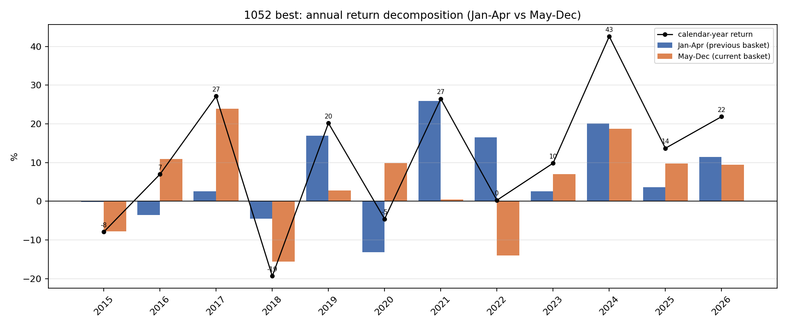

# 1052 最佳策略：逐年收益与持仓（2026-11）

> 策略：**PB < 15% 分位 + ROE > 70% 分位 + 按 PE 最低排名 + 1% 裁尾 + N=5，年度调仓。**
> 指标：M3b **11.25%**，M1 12.37%，M2 14.05%，M3 10.92%。数据截至 2026-11-06。

## 0. 先看读法

年收益不是“当年 5 月篮子的收益”，而是两段复合：

```text
年收益 = (1 + 1-4 月收益) × (1 + 5-12 月收益) - 1
```
- **1-4 月**：还持有上一年 5 月建的篮子。
- **5-12 月**：当年 5 月调仓后的新篮子。
- 所以“当年持仓”只对应 5-12 月；1-4 月的收益来自上年持仓。表 2 的贡献合计≈5-12 月收益，残差是现金/交易成本。



## 1. 逐年拆解

| 年份 | 年收益 | 1-4 月（上年篮子） | 5-12 月（当年篮子） |
|---|---:|---:|---:|
| 2015 | -7.91% | -0.13% | -7.79% |
| 2016 | +6.99% | -3.57% | +10.95% |
| 2017 | +27.15% | +2.59% | +23.94% |
| 2018 | -19.33% | -4.47% | -15.56% |
| 2019 | +20.20% | +16.95% | +2.78% |
| 2020 | -4.57% | -13.18% | +9.92% |
| 2021 | +26.51% | +25.97% | +0.43% |
| 2022 | +0.28% | +16.58% | -13.98% |
| 2023 | +9.85% | +2.59% | +7.07% |
| 2024 | +42.62% | +20.09% | +18.77% |
| 2025 | +13.71% | +3.61% | +9.75% |
| 2026 | +21.88% | +11.41% | +9.40% |

## 2. 当年 5 月篮子：每只股票的 5-12 月收益与贡献

| 年份 | 股票 | 权重 | 5-12 月收益 | 贡献 |
|---|---|---:|---:|---:|
| 2015 | 工商银行 | 20% | -11.0% | -2.2pp |
| 2015 | 农业银行 | 20% | -14.6% | -2.9pp |
| 2015 | 浦发银行 | 20% | +7.3% | +1.4pp |
| 2015 | 建设银行 | 20% | -12.6% | -2.5pp |
| 2015 | 兴业银行 | 20% | -8.1% | -1.6pp |
| 2016 | 工商银行 | 20% | +8.5% | +1.7pp |
| 2016 | 农业银行 | 20% | +4.0% | +0.8pp |
| 2016 | 建设银行 | 20% | +21.4% | +4.3pp |
| 2016 | 光大银行 | 20% | +11.4% | +2.3pp |
| 2016 | 华夏银行 | 20% | +9.6% | +1.9pp |
| 2017 | 工商银行 | 21% | +34.7% | +7.1pp |
| 2017 | 农业银行 | 20% | +20.8% | +4.2pp |
| 2017 | 建设银行 | 23% | +35.8% | +8.2pp |
| 2017 | 兴业银行 | 19% | +14.1% | +2.7pp |
| 2017 | 民生银行 | 16% | +10.6% | +1.7pp |
| 2018 | 农业银行 | 20% | -2.2% | -0.4pp |
| 2018 | 兴业银行 | 20% | -3.1% | -0.6pp |
| 2018 | 衢州发展 | 20% | -32.0% | -6.4pp |
| 2018 | 长安汽车 | 20% | -31.3% | -6.1pp |
| 2018 | 浦发银行 | 19% | -10.2% | -2.0pp |
| 2019 | 新钢股份 | 20% | -1.4% | -0.3pp |
| 2019 | 马钢股份 | 20% | +0.8% | +0.2pp |
| 2019 | 建发股份 | 19% | +4.3% | +0.8pp |
| 2019 | 南京银行 | 20% | +10.5% | +2.1pp |
| 2019 | 中国建筑 | 20% | -0.1% | -0.0pp |
| 2020 | 新钢股份 | 20% | +17.5% | +3.5pp |
| 2020 | 建发股份 | 21% | +1.6% | +0.3pp |
| 2020 | 中绿电 | 20% | -2.0% | -0.4pp |
| 2020 | 华菱钢铁 | 20% | +27.3% | +5.5pp |
| 2020 | 贵阳银行 | 19% | +5.2% | +1.0pp |
| 2021 | 中国建筑 | 20% | +5.2% | +1.0pp |
| 2021 | 绿地控股 | 17% | -18.5% | -3.1pp |
| 2021 | 保利发展 | 19% | +19.2% | +3.6pp |
| 2021 | 宁夏建材 | 20% | -4.7% | -0.9pp |
| 2021 | 成都银行 | 20% | -1.2% | -0.2pp |
| 2022 | 英科医疗 | 20% | -9.9% | -1.9pp |
| 2022 | 彩虹股份 | 20% | -1.9% | -0.4pp |
| 2022 | 华菱钢铁 | 20% | -13.5% | -2.7pp |
| 2022 | 新钢股份 | 20% | -22.7% | -4.5pp |
| 2022 | 马钢股份 | 20% | -22.0% | -4.4pp |
| 2023 | 中远海控 | 20% | +4.7% | +0.9pp |
| 2023 | 新城控股 | 20% | -24.9% | -5.0pp |
| 2023 | 昊华能源 | 20% | +4.4% | +0.9pp |
| 2023 | 新集能源 | 20% | +28.1% | +5.6pp |
| 2023 | 兰花科创 | 20% | +23.3% | +4.6pp |
| 2024 | 建发股份 | 20% | +11.5% | +2.2pp |
| 2024 | 成都银行 | 20% | +22.7% | +4.6pp |
| 2024 | 江苏银行 | 20% | +30.5% | +6.1pp |
| 2024 | 杭州银行 | 20% | +21.3% | +4.2pp |
| 2024 | 宁波银行 | 20% | +8.0% | +1.6pp |
| 2025 | 成都银行 | 20% | -0.1% | -0.0pp |
| 2025 | 江苏银行 | 23% | +5.8% | +1.3pp |
| 2025 | 杭州银行 | 20% | +8.7% | +1.7pp |
| 2025 | 宁波银行 | 18% | +22.1% | +3.9pp |
| 2025 | 南京银行 | 19% | +14.7% | +2.8pp |
| 2026 | 成都银行 | 20% | +13.3% | +2.7pp |
| 2026 | 江苏银行 | 22% | +15.6% | +3.4pp |
| 2026 | 杭州银行 | 20% | +3.9% | +0.8pp |
| 2026 | 常熟银行 | 20% | -1.4% | -0.3pp |
| 2026 | 招商银行 | 18% | +15.9% | +2.8pp |

## 3. 几个反直觉的年份

- **2021 年 +26.51%**：1-4 月持有 2020 年篮子（新钢、华菱等）涨了 **+25.97%**；2021 年 5 月换成的中国建筑/绿地/保利/宁夏建材/成都银行，5-12 月只有 **+0.43%**。所以“2021 年篮子”看起来没赚钱，但全年收益很高。
- **2022 年 +0.28%**：1-4 月持有 2021 年篮子涨 **+16.58%**；5-12 月换成英科/彩虹/华菱/新钢/马钢，跌 **-13.98%**，全年几乎打平。
- **2020 年 -4.57%**：1-4 月持有 2019 年篮子在疫情冲击下 **-13.18%**；5-12 月新篮子（新钢、华菱等）**+9.92%**，全年仍小亏。
- **2024 年 +42.62%**：1-4 月 +20.09%，5-12 月 +18.77%，两段都强，是少见的两段共振。

## 4. 文件

- 明细 CSV：[1052_best_yearly_holdings.csv](data/1052_best_yearly_holdings.csv)
- 主报告：[m3b-backtest-2026-11.md](m3b-backtest-2026-11.md)

## 5. 复现

```bash
cd backtesting
../.venv/bin/python run_backtest.py \
  --frequency annual --ranking pe --filter_indicators pb \
  --pb_threshold 0.15 --roe_threshold 0.70 --threshold_trim_ratio 0.01 \
  --ignore_first_cutoff_new_stock --end_date 2026-11-06
```