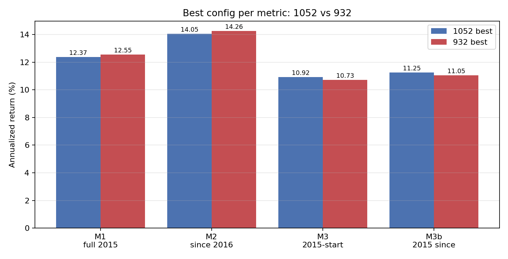
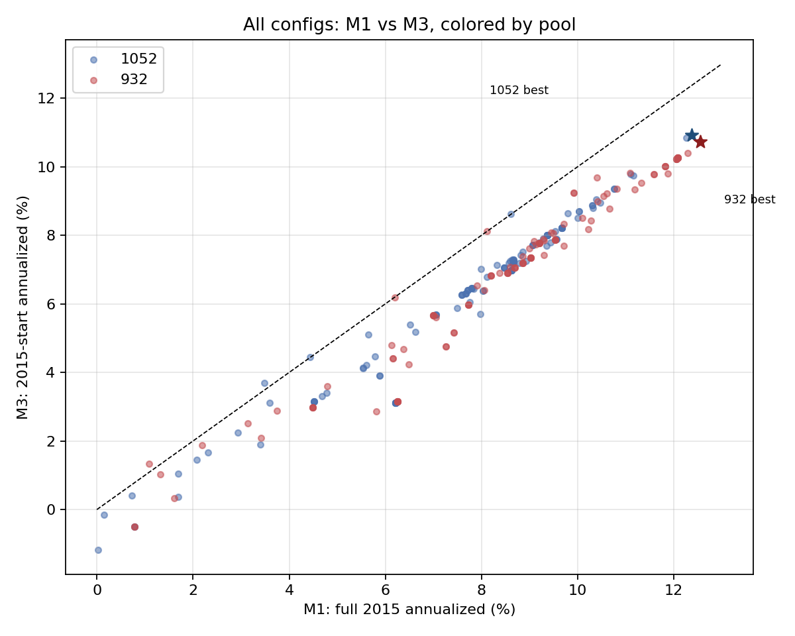

# 1052 vs 932：全部回测合并对比（M1/M2/M3/M3b）

- 数据：两池各 131/133 组参数，标准回测 + 2015-start 回测，共 **262 组匹配**
- 截止日：2026-11-06（价格快照，统一截断）
- M1 = 标准回测全期年化（2015-01 起，含 2015 空仓）
- M2 = 标准回测首次建仓以来（2016-05 起）
- M3 = 2015-start 回测全期年化（2015-05 建仓）
- M3b = 2015-start 回测首次建仓以来（2015-05 起）

## 0. 结论

1. **M1/M2 下 932 略高**：M1 12.55% vs 12.37%，M2 14.26% vs 14.05%。这主要是 932 单期清单的幸存者偏差。
2. **M3/M3b 下 1052 反超**：M3 10.92% vs 10.73%，M3b 11.25% vs 11.05%。因为 1052 最佳配置的 2015 年损失更小（-7.91% vs -9.05%）。
3. **两池的最佳配置不同**：1052 是 `PB15/ROE70 + PE 排名`，932 是 `PE25/ROE75 + PB 排名`。把对方的“最佳”搬过来会明显变差：1052 最佳在 932 只有 10.61%（M1），932 最佳在 1052 只有 8.63%（M1）。
4. **经典配置的池间差异最大**：PE+PB+PR / PB 排名 / 1% 裁尾，932 是 12.06%，1052 只有 8.63%；2% 裁尾则收敛到 9.02% vs 9.55%。
5. **结论**：参数必须绑定股票池；M1/M2 适合和历史记录对齐，M3/M3b 更适合做跨池稳健性检查。

## 1. 各指标下的最佳

| 指标   |   池子 | 配置                                                              | 最佳值   | M1     | M3     |
|:-------|-------:|:------------------------------------------------------------------|:---------|:-------|:-------|
| M1     |   1052 | refine_union_annual_pb_pe_trim1pct_N5_pe0.15-pb0.15-pr0.25-roe0.7 | 12.37%   | 12.37% | 10.92% |
| M1     |    932 | core_legacy_annual_pe_pb_trim1pct_N5_pe0.25-pb0.25-pr0.25-roe0.75 | 12.55%   | 12.55% | 10.73% |
| M2     |   1052 | refine_union_annual_pb_pe_trim1pct_N5_pe0.15-pb0.15-pr0.25-roe0.7 | 14.05%   | 12.37% | 10.92% |
| M2     |    932 | core_legacy_annual_pe_pb_trim1pct_N5_pe0.25-pb0.25-pr0.25-roe0.75 | 14.26%   | 12.55% | 10.73% |
| M3     |   1052 | refine_union_annual_pb_pe_trim1pct_N5_pe0.15-pb0.15-pr0.25-roe0.7 | 10.92%   | 12.37% | 10.92% |
| M3     |    932 | core_legacy_annual_pe_pb_trim1pct_N5_pe0.25-pb0.25-pr0.25-roe0.75 | 10.73%   | 12.55% | 10.73% |
| M3b    |   1052 | refine_union_annual_pb_pe_trim1pct_N5_pe0.15-pb0.15-pr0.25-roe0.7 | 11.25%   | 12.37% | 10.92% |
| M3b    |    932 | core_legacy_annual_pe_pb_trim1pct_N5_pe0.25-pb0.25-pr0.25-roe0.75 | 11.05%   | 12.55% | 10.73% |

注意：M1/M2 的最佳是 932 的 PE25/ROE75/PB 配置；M3/M3b 的最佳是 1052 的 PB15/ROE70/PE 配置。

## 2. 关键配置的池间横向对比

| 配置                           |   池子 | M1     | M2     | M3     | M3b    |   M1 夏普 |   M3 夏普 | 2015(M3)   | 2016(M3)   |
|:-------------------------------|-------:|:-------|:-------|:-------|:-------|----------:|----------:|:-----------|:-----------|
| 1052 最佳：PB15/ROE70/PE/1%/N5 |   1052 | 12.37% | 14.05% | 10.92% | 11.25% |     0.516 |     0.401 | -7.91%     | 6.99%      |
| 1052 最佳：PB15/ROE70/PE/1%/N5 |    932 | 10.61% | 12.04% | 9.23%  | 9.51%  |     0.438 |     0.33  | -7.91%     | 4.38%      |
| 932 最佳：PE25/ROE75/PB/1%/N5  |   1052 | 8.63%  | 9.79%  | 6.98%  | 7.19%  |     0.334 |     0.226 | -9.05%     | 5.52%      |
| 932 最佳：PE25/ROE75/PB/1%/N5  |    932 | 12.55% | 14.26% | 10.73% | 11.05% |     0.526 |     0.392 | -9.05%     | 3.17%      |
| 经典 1%：PE+PB+PR/PB/1%/N5     |   1052 | 8.63%  | 9.79%  | 6.98%  | 7.19%  |     0.334 |     0.226 | -9.05%     | 5.52%      |
| 经典 1%：PE+PB+PR/PB/1%/N5     |    932 | 12.06% | 13.69% | 10.22% | 10.53% |     0.539 |     0.391 | -9.05%     | 3.17%      |
| 经典 2%：PE+PB+PR/PB/2%/N5     |   1052 | 9.55%  | 10.84% | 7.89%  | 8.14%  |     0.382 |     0.268 | -9.05%     | 5.27%      |
| 经典 2%：PE+PB+PR/PB/2%/N5     |    932 | 9.02%  | 10.23% | 7.34%  | 7.56%  |     0.35  |     0.239 | -9.05%     | 5.52%      |
| 经典 raw：PE+PB+PR/PB/raw/N5   |   1052 | 8.04%  | 9.11%  | 6.38%  | 6.57%  |     0.321 |     0.206 | -9.05%     | 5.52%      |
| 经典 raw：PE+PB+PR/PB/raw/N5   |    932 | 11.59% | 13.16% | 9.79%  | 10.09% |     0.513 |     0.37  | -9.05%     | 3.17%      |

### 2.1 同一配置的池间差

| 配置                           | 1052 M1   | 932 M1   | M1 差   | 1052 M3   | 932 M3   | M3 差   |
|:-------------------------------|:----------|:---------|:--------|:----------|:---------|:--------|
| 1052 最佳：PB15/ROE70/PE/1%/N5 | 12.37%    | 10.61%   | -1.76pp | 10.92%    | 9.23%    | -1.69pp |
| 932 最佳：PE25/ROE75/PB/1%/N5  | 8.63%     | 12.55%   | +3.92pp | 6.98%     | 10.73%   | +3.75pp |
| 经典 1%：PE+PB+PR/PB/1%/N5     | 8.63%     | 12.06%   | +3.43pp | 6.98%     | 10.22%   | +3.25pp |
| 经典 2%：PE+PB+PR/PB/2%/N5     | 9.55%     | 9.02%    | -0.53pp | 7.89%     | 7.34%    | -0.56pp |
| 经典 raw：PE+PB+PR/PB/raw/N5   | 8.04%     | 11.59%   | +3.55pp | 6.38%     | 9.79%    | +3.41pp |

## 3. 按 M1 的前 8 名（分池）

### 1052 池

| 配置                 | M1     | M2     | M3     | M3b    |
|:---------------------|:-------|:-------|:-------|:-------|
| PB15/ROE70 pe 1% N5  | 12.37% | 14.05% | 10.92% | 11.25% |
| PB15/ROE60 pe 1% N5  | 12.26% | 13.93% | 10.84% | 11.17% |
| PB20/ROE60 pe 1% N5  | 11.16% | 12.68% | 9.73%  | 10.03% |
| PB25/ROE60 pe 1% N7  | 11.10% | 12.60% | 9.78%  | 10.08% |
| PB25/ROE60 pe 1% N5  | 10.75% | 12.21% | 9.35%  | 9.64%  |
| PB15/ROE65 pe 1% N5  | 10.47% | 11.89% | 8.95%  | 9.23%  |
| PB25/ROE70 pe raw N5 | 10.39% | 11.80% | 9.05%  | 9.32%  |
| PB15/ROE65 pe 1% N6  | 10.31% | 11.70% | 8.79%  | 9.06%  |

### 932 池

| 配置                               | M1     | M2     | M3     | M3b    |
|:-----------------------------------|:-------|:-------|:-------|:-------|
| PE25/ROE75 pb 1% N5                | 12.55% | 14.26% | 10.73% | 11.05% |
| PE10/ROE75 pb 1% N5                | 12.29% | 13.97% | 10.39% | 10.71% |
| PE25/ROE75 pb raw N5               | 12.08% | 13.72% | 10.27% | 10.58% |
| PB25/ROE75 pb 1% N5                | 12.06% | 13.69% | 10.22% | 10.53% |
| PE25/ROE75 pb 1% N6                | 11.87% | 13.48% | 9.80%  | 10.10% |
| PE25/ROE75 pb 0.5% N5              | 11.83% | 13.43% | 10.01% | 10.32% |
| PE+PB+PR 25/25/25/ROE75 pb raw N5  | 11.59% | 13.16% | 9.79%  | 10.09% |
| PE+PB+PR 25/25/25/ROE75 pb 0.5% N5 | 11.33% | 12.87% | 9.53%  | 9.82%  |

## 4. 按 M3 的前 8 名（分池）

### 1052 池

| 配置                 | M1     | M2     | M3     | M3b    |
|:---------------------|:-------|:-------|:-------|:-------|
| PB15/ROE70 pe 1% N5  | 12.37% | 14.05% | 10.92% | 11.25% |
| PB15/ROE60 pe 1% N5  | 12.26% | 13.93% | 10.84% | 11.17% |
| PB25/ROE60 pe 1% N7  | 11.10% | 12.60% | 9.78%  | 10.08% |
| PB20/ROE60 pe 1% N5  | 11.16% | 12.68% | 9.73%  | 10.03% |
| PB25/ROE60 pe 1% N5  | 10.75% | 12.21% | 9.35%  | 9.64%  |
| PB25/ROE70 pe raw N5 | 10.39% | 11.80% | 9.05%  | 9.32%  |
| PB15/ROE65 pe 1% N5  | 10.47% | 11.89% | 8.95%  | 9.23%  |
| PB25/ROE55 pe raw N5 | 10.30% | 11.69% | 8.87%  | 9.15%  |

### 932 池

| 配置                              | M1     | M2     | M3     | M3b    |
|:----------------------------------|:-------|:-------|:-------|:-------|
| PE25/ROE75 pb 1% N5               | 12.55% | 14.26% | 10.73% | 11.05% |
| PE10/ROE75 pb 1% N5               | 12.29% | 13.97% | 10.39% | 10.71% |
| PE25/ROE75 pb raw N5              | 12.08% | 13.72% | 10.27% | 10.58% |
| PB25/ROE75 pb 1% N5               | 12.06% | 13.69% | 10.22% | 10.53% |
| PE25/ROE75 pb 0.5% N5             | 11.83% | 13.43% | 10.01% | 10.32% |
| PE25/ROE75 pb 1% N6               | 11.87% | 13.48% | 9.80%  | 10.10% |
| PE+PB+PR 25/25/25/ROE75 pb raw N5 | 11.59% | 13.16% | 9.79%  | 10.09% |
| PE15/ROE85 pb 1% N5               | 10.40% | 11.81% | 9.68%  | 9.98%  |

## 5. 全部配置的 M1 vs M3

932 的点整体在 1052 上方（M1 更高），但差距在 M3 下明显收窄；45° 线附近的结构说明：股票池主要影响 2015-2016 的起点，2017 年以后两池的选股差异才是长期收益差异的来源。

## 6. 建议

1. **实际使用 1052 池**：用 1052 最佳（PB15/ROE70 + PE 排名 + 1% 裁尾 + N5）或经典 2%（9.55%）。
2. **不要套用 932 最佳**：它在 1052 上只有 8.63%（M1）/6.98%（M3）。
3. **跨池比较看 M3**：M1/M2 的 932 优势主要来自清单偏差，M3 下 1052 反而略高。
4. **保留经典 2% 作为稳健基准**：两池差距最小（9.55% vs 9.02%），参数平台也更宽。

## 7. 文件

- 合并总表：[consolidated.csv](../data/processed/backtesting/consolidated_20261120/consolidated.csv)
- 关键配置：[key_configs.csv](../data/processed/backtesting/consolidated_20261120/key_configs.csv)
- 各指标最佳：[best_by_metric.csv](../data/processed/backtesting/consolidated_20261120/best_by_metric.csv)
- 生成脚本：[build_consolidated_metrics.py](../backtesting/build_consolidated_metrics.py)
- 原始报告：[1052](universe-backtest-2026-11.md) / [932](universe-backtest-932-2026-11.md) / [三口径](three-start-metrics-2026-11.md)