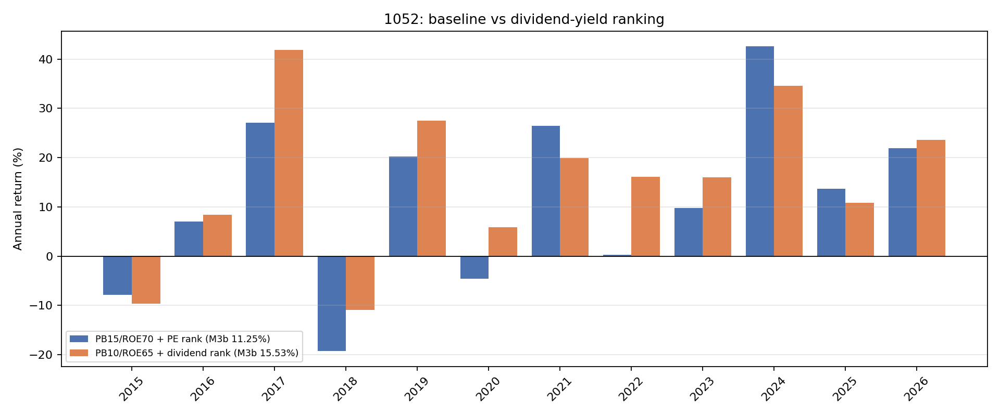
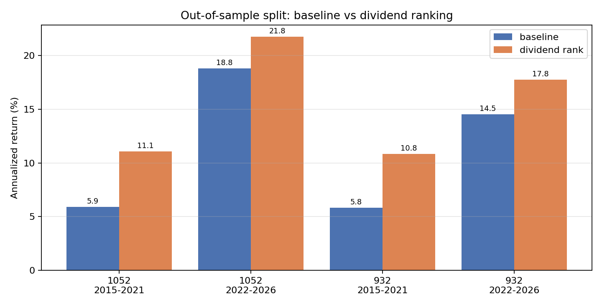

# 股息率排名策略（2026-11）

> 问题：能不能从 AkShare 拿到 4·30 的股息率，把原来的 PE/PB 排名换成“股息率从高到低”？
> 结论：数据可行，按“最终实施金额”回测很强；但信息时点审计后，15.53% 不能直接采信，保守口径约 12.2%。

## 0. 结论

1. **数据可行**：AkShare `stock_fhps_em` 能按报告期批量拿到全市场分红方案（年报 + 中期），2014-2025 共 38,831 条。
2. **规则**：`PB < 10%` + `ROE > 65%` + **股息率 TTM 从高到低排名** + 1% 裁尾 + N=5，年度调仓。
3. **最终实施金额口径**：1052 M3b **15.53%**，M1 15.07%，夏普 0.593，回撤 -32.8%；932 M3b **13.80%**，M1 13.39%。
4. **信息时点审计**：只用“已派息”（除权日 ≤ 4·30）时，1052 **12.21%**、932 **11.83%**；只用“最终公告日 ≤ 4·30”时，1052 8.85%、932 10.28%（过严，漏掉 4 月预案）。
5. **15.53% 不能直接采信**：它用的是最终实施金额，而 4·30 当天可能只有初始预案；保守口径的优势从 +4.3pp 缩到约 +1pp，但仍然是正的。
6. **不是单点尖峰**：PB10/15/20 × ROE65/70/75 的 9 个格子里，大多数在 12.4-13.5%，只有 ROE75 明显走弱；两段样本（2015-2021 / 2022-2026）都改善。
7. **暂不替换默认**：等“4·30 初始预案金额”的数据再做一次干净的回测，才能决定是否升级。

## 1. 数据与口径

- 来源：AkShare `stock_fhps_em(date=YYYYMMDD)`，按报告期拉全市场分红方案。
- 报告期：2014-2025，含 06-30 / 09-30 / 12-31。
- 字段：每 10 股派息、预案公告日、最新公告日、除权除息日、方案进度。
- 本地文件：`data/input/backtesting/dividend/fhps_all.csv`（3.0MB，可重新拉取）。

**股息率 TTM 定义**：

```text
div_ttm = 过去 365 天内“预案公告日 <= 4·30”的每 10 股派息之和 / 10
div_yield = div_ttm / 4·30 的非复权收盘价（close_na）
```

- 用 `close_na` 而不是 HFQ，因为每股股息是当前股本口径。
- 包含年报 + 中期分红；例如工商银行 2026-04-30 的 TTM = 2025 年报 1.689 + 2025 中期 1.414 = 3.103 元/10 股，对应 4.17%。
- 2015-2025 每年都有数据；2026-04-30 用 2025 年报 + 2025 中期。

## 2. 规则

在原策略上只改两处：

| 步骤 | 原策略 | 股息率策略 |
|---|---|---|
| Step 2 | PB < 15% 分位 | **PB < 10% 分位** |
| Step 3 | ROE > 70% 分位 | **ROE > 65% 分位** |
| 排名 | PE 最低 | **股息率最高** |
| 裁尾 / N / 频率 | 1% / 5 / 年度 | 不变 |

> 也可以保留 PB15/ROE70，只把排名换成股息率：1052 M3b 13.23%，932 13.36%，仍然明显高于基准。

## 3. 结果

| 池 / 配置 | M3b | M1 | 夏普 | 最大回撤 |
|---|---:|---:|---:|---:|
| **1052 PB10/ROE65 + 股息率** | **15.53%** | 15.07% | **0.593** | **-32.8%** |
| 932 PB10/ROE65 + 股息率 | 13.80% | 13.39% | 0.516 | -32.8% |
| 1052 PB15/ROE70 + 股息率 | 13.23% | 12.83% | 0.482 | -32.8% |
| 932 PB15/ROE70 + 股息率 | 13.36% | — | 0.500 | — |
| 1052 基准（PB15/ROE70 + PE） | 11.25% | 12.37% | 0.410 | -34.4% |
| 932 同配置（PB15/ROE70 + PE） | 9.51% | — | 0.330 | — |
| 932 原最佳（PE 过滤 + PB 排名） | 11.05% | — | 0.401 | -33.8% |

### 3.1 两段样本

| 池 | 2015-2021 基准 | 2015-2021 股息率 | 2022-2026 基准 | 2022-2026 股息率 |
|---|---:|---:|---:|---:|
| 1052 | 5.91% | **11.07%** | 18.82% | **21.77%** |
| 932 | 5.83% | **10.85%** | 14.54% | **17.76%** |

两段都改善，不是靠某一年。

### 3.2 1052 逐年

| 年份 | 基准 | 股息率 |
|---|---:|---:|
| 2015 | -7.9% | -9.6% |
| 2016 | +7.0% | +8.4% |
| 2017 | +27.1% | **+41.9%** |
| 2018 | -19.3% | **-10.9%** |
| 2019 | +20.2% | **+27.5%** |
| 2020 | -4.6% | **+5.9%** |
| 2021 | +26.5% | +19.9% |
| 2022 | +0.3% | **+16.1%** |
| 2023 | +9.8% | **+16.0%** |
| 2024 | +42.6% | +34.6% |
| 2025 | +13.7% | +10.8% |
| 2026 | +21.9% | +23.6% |





### 3.3 信息时点审计

| 口径 | 1052 M3b | 932 M3b | 说明 |
|---|---:|---:|---|
| 最终实施金额（当前） | **15.53%** | **13.80%** | 用最终金额，可能前视 |
| 仅已派息（除权日 ≤ 4·30） | **12.21%** | **11.83%** | 严格无前视，但滞后 |
| 仅最终公告日 ≤ 4·30 | 8.85% | 10.28% | 过严，漏掉 4 月刚出、5-6 月实施的年报分红 |

- 已派息口径仍高于基准：1052 12.21% vs 11.25%，932 11.83% vs 11.05%。
- 但 15.53% 明显被“最终金额”抬高；真实值大概率在 **12.2%-15.5%** 之间。
- AkShare 的 `stock_fhps_detail_em` 和 `stock_dividend_cninfo` 都只给最终实施金额，没有初始预案金额；要拿到干净值，需要交易所/巨潮的“预案公告时点”数据。

## 4. 参数敏感性

M3b（行 = PB 阈值，列 = ROE 阈值）：

**1052**

| PB \ ROE | 65% | 70% | 75% |
|---|---:|---:|---:|
| 10% | **15.53%** | 12.43% | 9.32% |
| 15% | 12.99% | 13.23% | 10.31% |
| 20% | 12.96% | 12.91% | 12.52% |

**932**

| PB \ ROE | 65% | 70% | 75% |
|---|---:|---:|---:|
| 10% | **13.80%** | 10.89% | 6.77% |
| 15% | 13.49% | 13.36% | 9.28% |
| 20% | 13.28% | 12.89% | 13.21% |

- 大多数格子在 12.4-13.5%，说明股息率因子本身有效，不是单点。
- **PB10/ROE65 是局部最高点（15.53%）**，但它的邻居仍在 12.4-13.5%，不是 1.5 倍 EPS 那种“1.4=10.98、1.6=10.37”的刀锋。
- ROE75 明显走弱（6.8-10.3%），说明“高股息 + 极高 ROE”容易买到周期顶。

## 5. 2022 与持仓

1052 的 2022 年 **+16.1%**：1-4 月 +13.5%，5-12 月 +2.3%。

2022-05-05 持仓（股息率）：

| 股票 | 股息率 |
|---|---:|
| 中国建筑 | 4.0% |
| 新钢股份 | 8.6% |
| 厦门国贸 | 6.6% |
| 中国重汽 | 3.0% |
| 英科医疗 | 2.6% |

2026-05-06 持仓：江苏银行 5.0%、南京银行 4.6%、齐鲁银行 3.9%、招商银行 5.3%、成都银行 4.8%。

## 6. 风险与限制

1. **潜在前视偏差（最重要）**：`stock_fhps_em` 给的是最终实施方案；4·30 当天可能只有董事会预案，后续金额可能微调。审计结果：最终口径 15.53%，已派息口径 12.21%，最终公告口径 8.85%；真实值在 12.2%-15.5% 之间，需要初始预案金额才能定论。
2. **高股息周期陷阱**：2015 -9.6%、2018 -10.9%；高股息在周期顶可能是“股价跌出来的”，不是安全边际。
3. **拆分/送转**：每股股息按当时股本，若之后拆分，用当前 `close_na` 计算会失真；当前持仓的股息率 4-10%，没有明显异常，但仍需校验。
4. **股息税**：回测用 HFQ 价格，隐含现金分红；持有满 1 年免征红利税，和年度调仓基本匹配。
5. **参数内样本选择**：PB10/ROE65 是网格里挑出来的；两段样本和两个池子都改善，但还不是完整 walk-forward。

## 7. 建议

- 这是目前最强的候选，但**不是已经验证的默认**：最终口径 15.53%，保守口径 12.21%（1052）/ 11.83%（932）。
- 在替换默认之前，先做两件事：
  1. 用“4·30 时点已知的初始分红预案”重算一遍；如果拿不到，先用 `--dividend_mode paid` 作为保守下界；
  2. 做 2015-2021 训练 / 2022-2026 验证之外的滚动 walk-forward。
- 如果审计通过，可以考虑把默认从“PB15/ROE70 + PE 排名”换成“PB10/ROE65 + 股息率排名”；否则至少把股息率作为**第二排序因子**（先 PB/ROE 过滤，再股息率排名）。

## 8. 复现

```bash
cd backtesting
../.venv/bin/python fetch_dividend_data.py
../.venv/bin/python run_backtest.py \
  --frequency annual --ranking div --filter_indicators pb \
  --pb_threshold 0.10 --roe_threshold 0.65 --threshold_trim_ratio 0.01 \
  --ignore_first_cutoff_new_stock --dividend_mode paid --end_date 2026-11-06
```

代码：`stock_selector.py` 的 `get_dividend_yield` / `rank_and_limit`，`config.py` 的 `DIVIDEND_DATA_FILE`。
