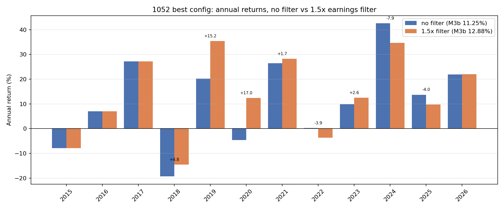

# 妖股 / 峰值业绩过滤实验（2026-11）

> 问题：2022 年 5 月调仓后的回测，主要是不是英科医疗这只“疫情妖股”拖累的？能不能用财务指标把这类股票排除掉，再回测？

## 0. 结论

1. **2022 年的主因不是英科医疗，是钢铁三只。** 2022-05-05 篮子 5-12 月：新钢 -4.54pp、马钢 -4.42pp、华菱 -2.71pp、英科 -1.94pp、彩虹 -0.38pp。钢铁三只合计约 **-11.7pp**，英科只占 **-1.9pp**。
2. **英科确实是典型的“峰值业绩”股。** EPS_TTM 从 2019 年的 0.61 涨到 2020 年的 14.65，2021 年一季度峰值 21.45，2022 年一季度回落到 4.22；ROE 从 13% 冲到 132% 再跌回 27%。这是疫情一次性利润，不是可持续的低估值。
3. **规则有效：** 用“EPS_TTM / 过去最多 5 年年度 EPS 中位数”落在 [0.5, 2] 之外就排除，可以同时挡住英科（4.56 倍）、彩虹（12.53 倍）和 2021 年的宁夏建材（2.29 倍）。
4. **但回测不是稳健改进：**
   - 1052 最佳：M3b 11.25% → **11.67%**（+0.42pp），可是 2022 年反而从 +0.28% 变成 **-1.76%**；收益改善来自 2019/2020 的组合路径，不是 2022。
   - 932 最佳：M3b 11.05% → **8.06%**（-2.99pp）；2022 年从 -22.9% 改善到 -6.2%，但 2021 年从 +56.1% 掉到 +14.1%，全期反而更差。
   - 阈值 1.5 / 2 / 3 倍下，1052 的 M3b 是 12.88% / 11.67% / 10.10%，**非单调**，典型的过拟合信号。
5. **结论：不作为默认规则。** 它是风险过滤器，不是免费 alpha；如果目标是控制 2022 那种回撤，真正对症的是**行业集中度上限**（当时 3/5 是钢铁），而不是“妖股”过滤。
6. **后续组合过滤（EPS 峰值 + ROE 峰值 + 价格先崩）也没有改善**：ROE 过滤和价格过滤单独或组合都低于基准；详见第 9 节。

## 1. 2022 年 5-12 月归因

2022-05-05 建仓的 5 只：

| 股票 | 权重 | 2022-05-05→12-30 | 贡献 |
|---|---:|---:|---:|
| 600782 新钢股份 | 20.0% | -22.7% | **-4.54pp** |
| 600808 马钢股份 | 20.1% | -22.0% | **-4.42pp** |
| 000932 华菱钢铁 | 20.0% | -13.5% | **-2.71pp** |
| 300677 英科医疗 | 19.6% | -9.9% | -1.94pp |
| 600707 彩虹股份 | 20.1% | -1.9% | -0.38pp |
| 合计 | 99.8% | **-13.98%** | **-13.99pp** |

英科在 2022-05 已经从 2021 年高点 884.46 跌到 134.06（**-84.8%**），大部分泡沫已经破了；5-12 月再跌 9.9%，不是主要拖累。真正的拖累是钢铁：2022 年地产/需求下行，三只钢铁同时下跌。

## 2. 英科医疗的财务特征

| 年度 | EPS_TTM | ROE_TTM |
|---|---:|---:|
| 2017 | 0.87 | — |
| 2018 | 0.92 | 15.30 |
| 2019 | 0.61 | 13.08 |
| 2020 | 14.65 | 132.22 |
| 2021 | 11.33 | 59.61 |
| 2022Q1 | 4.22 | 26.84 |

- 2019 → 2020 EPS 涨了 **24 倍**，ROE 从 13% 到 132%，典型的疫情手套一次性利润。
- 2021Q1 EPS 峰值 21.45，之后连续下滑；2022Q1 只剩 4.22。
- 策略在 2022-04-30 看到的是“跌了 85% + PE 很低”的表象，但盈利还在快速下修，属于价值陷阱。

## 3. 规则

**定义**：在截面日，计算

```text
ratio = 最新 EPS_TTM / 过去最多 5 个年度 EPS 的中位数
```

若 `ratio < 0.5` 或 `ratio > 2.0`，排除该股票。

- 上界 2.0：挡住“利润是过去常态 2 倍以上”的疫情/景气峰值股。
- 下界 0.5：挡住“利润已经崩到过去常态一半以下”的衰退股，避免接飞刀。
- 年度 EPS 指 `report_date` 在 12-31 的报表，按 `ann_available_date <= 截面日` 取最近最多 5 年，至少 3 年。

2022-04-30 的实际倍数：

| 股票 | 最新 EPS_TTM | 5 年年度 EPS 中位数 | 倍数 | 是否排除 |
|---|---:|---:|---:|---|
| 300677 英科医疗 | 4.22 | 0.92 | 4.56 | 是 |
| 600707 彩虹股份 | — | — | 12.53 | 是 |
| 600606 绿地控股 | — | — | 0.33 | 是（下界） |
| 000932 华菱钢铁 | — | — | 1.05 | 否 |
| 600782 新钢股份 | — | — | 1.29 | 否 |
| 600808 马钢股份 | — | — | 1.21 | 否 |
| 601668 中国建筑 | — | — | 1.33 | 否 |

2021-04-30 时，英科是 **23.9 倍**、彩虹 **20.2 倍**、宁夏建材 **2.29 倍**，也都会被排除。

## 4. 回测结果

### 4.1 M3b 与 2022 年

| 配置 | 无过滤 M3b | 2 倍 / 0.5 | 1.5 倍 / 0.5 | 3 倍 / 0.5 |
|---|---:|---:|---:|---:|
| 1052 最佳 | 11.25% | **11.67%** | 12.88% | 10.10% |
| 932 最佳 | 11.05% | **8.06%** | 9.69% | 8.56% |

| 配置 | 无过滤 | 1.5 倍 | 2 倍 | 3 倍 |
|---|---:|---:|---:|---:|
| 1052 最佳 | +0.28% | **-3.70%** | **-1.76%** | **+1.30%** |
| 932 最佳 | -22.86% | **+6.50%** | **-6.15%** | **-4.50%** |

1.5 倍是事后看着 1052 的 12.88% 挑出来的，不是事前选择；它在 2022 年反而最差（1052 -3.7%），说明 12.88% 不是靠 2022 改善得到的。这里同时给 1.5/2/3 倍，是为了看阈值敏感性，而不是推荐 1.5 倍。2 倍是事前设定的中枢，所以正文用 2 倍做基准。

### 4.2 逐年对比（2 倍 / 0.5）

**1052 最佳：**

| 年份 | 无过滤 | 加过滤 |
|---|---:|---:|
| 2019 | 20.2% | **45.6%** |
| 2020 | -4.6% | **9.7%** |
| 2021 | 26.5% | 25.0% |
| 2022 | 0.3% | -1.8% |
| 2023 | 9.8% | -1.5% |
| 2024 | 42.6% | 28.2% |
| 2025 | 13.7% | 13.5% |
| 2026 | 21.9% | 22.2% |

1052 的改善来自 **2019/2020** 换了持仓路径，而不是 2022；2022-2024 反而更差。

**932 最佳：**

| 年份 | 无过滤 | 加过滤 |
|---|---:|---:|
| 2021 | 56.1% | **14.1%** |
| 2022 | -22.9% | **-6.2%** |
| 2023 | 20.1% | -0.2% |
| 2024 | 46.9% | 28.0% |
| 2025 | 15.8% | 13.8% |

932 的 2021 年 +56% 很大程度就是英科/彩虹这类“妖股”贡献的；过滤掉它们，2022 回撤是小了，但 2021/2024 的收益也大幅缩水，全期年化反而低 3pp。

### 4.3 2022-05-05 加过滤后的持仓

- **1052**：中国建筑 23%、绿地控股 19%、新钢 20%、厦门国贸 20%、南钢 19%；2022 年 -1.76%。
- **932**：新钢 20%、厦门国贸 20%、南钢 20%、华菱 20%、万科A 19%；2022 年 -6.15%。

可以看出：过滤掉英科/彩虹后，补进来的是地产/贸易/钢铁，2022 年同样承压。**“排除妖股”并不能解决行业集中的问题。**

### 4.4 1.5 倍的 2022 持仓

**1052 最佳，2022-05-05：**

| 股票 | 权重 | 2022-05→12 | 贡献 |
|---|---:|---:|---:|
| 601668 中国建筑 | 23.8% | -8.1% | -1.93pp |
| 600606 绿地控股 | 18.5% | -29.8% | -5.51pp |
| 600782 新钢股份 | 19.9% | -22.7% | -4.52pp |
| 600282 南钢股份 | 20.0% | -6.9% | -1.38pp |
| 600373 中文传媒 | 17.8% | +0.2% | +0.04pp |
| 合计 | 100% | **-13.3%** | **-13.30pp** |

2022 全年：1-4 月 **+11.1%**，5-12 月 **-13.3%**，全年 **-3.65%**。对比 2 倍过滤：1-4 月 +13.0%、5-12 月 -13.1%、全年 -1.76%。

**932 最佳，2022-05-05：**

| 股票 | 权重 | 2022-05→12 | 贡献 |
|---|---:|---:|---:|
| 601668 中国建筑 | 21.2% | -8.1% | -1.72pp |
| 600606 绿地控股 | 19.2% | -29.8% | -5.72pp |
| 600782 新钢股份 | 19.9% | -22.7% | -4.52pp |
| 600282 南钢股份 | 20.0% | -6.9% | -1.38pp |
| 600064 南京高科 | 19.6% | -8.9% | -1.74pp |
| 合计 | 100% | **-15.1%** | **-15.08pp** |

932 的 2022 年 +6.5% 不是这 5 只赚的，而是 **1-4 月还持有 2021 年篮子（+25.4%）**；5-12 月这个新篮子其实跌了 15.1%。

### 4.5 1052：无过滤 vs 1.5 倍的逐年对比

| 年份 | 无过滤 | 1.5 倍 | 差 |
|---|---:|---:|---:|
| 2015 | -7.91% | -7.91% | 0.00pp |
| 2016 | 6.99% | 6.99% | 0.00pp |
| 2017 | 27.15% | 27.15% | 0.00pp |
| 2018 | -19.33% | -14.53% | +4.80pp |
| 2019 | 20.20% | **35.40%** | **+15.20pp** |
| 2020 | -4.57% | **12.38%** | **+16.95pp** |
| 2021 | 26.51% | 28.21% | +1.70pp |
| 2022 | 0.28% | -3.65% | **-3.93pp** |
| 2023 | 9.85% | 12.49% | +2.64pp |
| 2024 | 42.62% | 34.73% | **-7.89pp** |
| 2025 | 13.71% | 9.76% | -3.95pp |
| 2026 | 21.88% | 21.98% | +0.10pp |
| **M3b** | **11.25%** | **12.88%** | **+1.63pp** |

持仓差异（只列差异；未列出的为共同持仓）：

| 调仓 | 无过滤独有 | 1.5 倍独有 | 年收益（无 / 1.5） |
|---|---|---|---|
| 2015 | 相同（5 只银行） | — | -7.9% / -7.9% |
| 2016 | 相同（5 只银行） | — | 7.0% / 7.0% |
| 2017 | 相同（5 只银行） | — | 27.2% / 27.2% |
| 2018 | 衢州发展 | 工商银行 | -19.3% / -14.5% |
| 2019 | 建发股份、新钢股份、马钢股份 | 中交设计、兴业银行、成都银行 | 20.2% / **35.4%** |
| 2020 | 建发股份 | 成都银行 | -4.6% / **12.4%** |
| 2021 | 保利发展、宁夏建材、成都银行 | 华发股份、厦门国贸、贵阳银行 | 26.5% / 28.2% |
| 2022 | 华菱钢铁、英科医疗、彩虹股份、马钢股份 | 南钢股份、中文传媒、绿地控股、中国建筑 | 0.3% / **-3.7%** |
| 2023 | 兰花科创、昊华能源、新集能源、中远海控 | 南京高科、江苏银行、兴业银行、中国建筑 | 9.8% / 12.5% |
| 2024 | 宁波银行、建发股份、杭州银行 | 南京银行、齐鲁银行、中国建筑 | 42.6% / **34.7%** |
| 2025 | 杭州银行 | 齐鲁银行 | 13.7% / 9.8% |
| 2026 | 相同（5 只银行） | — | 21.9% / 22.0% |



**结论：**

- 2015-2017 和 2026 完全一样；差异集中在 2018-2025。
- 1.5 倍的 +1.63pp 主要来自 **2019（+15.2pp）和 2020（+17.0pp）**：它把建发/新钢/马钢换成了中交设计/兴业/成都，不是靠 2022 避开英科。
- 2022 反而 **-3.93pp**，2024 **-7.89pp**，2025 **-3.95pp**；2022 的新篮子仍是地产+钢铁。
- 所以 1.5 倍是“2019/2020 路径更好”，不是“妖股过滤更有效”。

## 5. 为什么不建议默认开启

1. **阈值敏感、非单调**：1052 在 1.5/2/3 倍下是 12.88/11.67/10.10，无法事先确定哪个对；这更像拟合历史路径。
2. **收益来源被切断**：932 的高收益本来就包含“2021 年妖股泡沫”这一段；过滤后 2022 回撤小了，但全期收益明显下降。
3. **没有解决真正的风险**：2022 的 -14% 是钢铁三只同时下跌，属于行业集中风险；财务过滤无法阻止“5 只里有 3 只同行业”。

### 5.1 参数搜索不是找单点最高

- **样本内最高 ≠ 稳健最优。** 1.5 倍在 1052 上是 12.88%（三者最高），但在 932 上只有 9.69%，低于无过滤的 11.05%。
- **阈值响应非单调：** 1052 是 12.88 / 11.67 / 10.10（1.5/2/3 倍），932 是 9.69 / 8.06 / 8.56；没有平台，改一点就换结论。
- **1.5 倍的 2022 更差（-3.65%），2024/2025 也更差；** 它的超额来自 2019/2020 的持仓路径，不是来自“过滤妖股”。
- 如果按 1052 的样本内最高选 1.5，就等于把“1052 这条历史路径”也拟合进去；换到 932 立刻失效。
- 稳健的选法是找**跨池、跨阈值都稳定的平台**，而不是单个最高点。2 倍是事前设定的中枢，1.5 是事后最优；两者可以并列展示，但不要把 1.5 叫作“最优参数”。

## 6. 建议

- 默认策略**不开启** `--exclude-earnings-outliers`；保留为可选实验开关。
- 如果目的是控制尾部风险，优先做**行业集中度上限**（例如同一行业最多 2 只），这直接针对 2022 年的钢铁三连。
- 如果一定要用财务过滤，**事前固定 2 倍 / 0.5**，不要根据回测结果挑 1.5 或 3。
- 不要因为 1052 的 +0.42pp 就认为规则有效；932 的 -2.99pp 和阈值非单调性说明它不稳定。

## 7. 复现

```bash
cd backtesting
# 单策略：1052 最佳 + 过滤
../.venv/bin/python run_backtest.py \
  --frequency annual --ranking pe --filter_indicators pb \
  --pb_threshold 0.15 --roe_threshold 0.70 --threshold_trim_ratio 0.01 \
  --ignore_first_cutoff_new_stock --exclude_earnings_outliers \
  --end_date 2026-11-06

# 全量矩阵加过滤
../.venv/bin/python universe_compare.py --pool union --end-date 2026-11-06 \
  --ignore-first-new-stock --exclude-earnings-outliers
```

## 8. 代码与文件

- 过滤逻辑：[`stock_selector.py`](../backtesting/stock_selector.py)（`get_latest_financial_data` / `select_stocks`）
- 开关：[`run_backtest.py`](../backtesting/run_backtest.py)、[`universe_compare.py`](../backtesting/universe_compare.py)
- 2022 归因与持仓：本文第 1、4 节
- 主报告：[`m3b-backtest-2026-11.md`](m3b-backtest-2026-11.md)

## 9. 组合过滤实验：EPS 峰值 + ROE 峰值 + 价格先崩

针对前面总结的两种亏损模式，做三个开关：

| 过滤器 | 规则 | 目标 |
|---|---|---|
| EPS 峰值 | `EPS_TTM / 5 年年度 EPS 中位数` 超出 [0.5, 2] → 排除 | 疫情/周期利润顶 |
| ROE 峰值 | `ROE_TTM / 5 年年度 ROE 中位数 > 1.5` → 排除 | 钢铁这类“ROE 冲高” |
| 价格先崩 | 当年 1-4 月跌幅 < 阈值（-15% / -20% / -25%）→ 排除 | 长安/英科/彩虹 |

### 9.1 1052 最佳

| 过滤 | M3b | 2018 | 2019 | 2022 | 2024 | 2025 |
|---|---:|---:|---:|---:|---:|---:|
| 无 | **11.25%** | -19.3% | +20.2% | +0.3% | +42.6% | +13.7% |
| EPS | **11.67%** | -18.3% | +45.6% | -1.8% | +28.2% | +13.5% |
| ROE | 7.83% | -14.8% | +22.2% | -3.7% | +30.8% | +11.6% |
| EPS+ROE | 11.25% | -17.1% | +43.6% | -3.9% | +31.9% | +13.5% |
| 价格 -15% | 8.35% | -11.7% | +20.3% | -6.6% | +46.9% | +13.5% |
| 价格 -20% | 9.81% | -20.8% | +22.0% | -5.9% | +46.7% | +13.7% |
| EPS+ROE+价格 -15% | 9.98% | -12.7% | +53.6% | +0.6% | +32.0% | +13.7% |
| EPS+ROE+价格 -20% | 10.45% | -17.2% | +43.4% | -0.1% | +31.9% | +13.6% |
| EPS+ROE+价格 -25% | 11.08% | -17.1% | +43.6% | -2.8% | +34.3% | +13.6% |

### 9.2 932 最佳（交叉验证）

| 过滤 | M3b | 2021 | 2022 | 2024 |
|---|---:|---:|---:|---:|
| 无 | **11.05%** | +56.1% | -22.9% | +46.9% |
| EPS | 8.06% | +14.1% | -6.2% | +28.0% |
| 价格 -15% | 8.40% | +26.2% | -18.8% | +31.3% |
| EPS+ROE+价格 -15% | **4.41%** | -7.2% | -7.2% | +16.6% |

### 9.3 为什么组合过滤反而更差

1. **ROE 峰值过滤把周期反弹也切掉了。**
   2020-2021 的钢铁（新钢、华菱）是全期最大的 winners 之一；它们在 2020 年 ROE 冲高，被 ROE 过滤排除后，2020/2021 的收益大幅下降。1052 的 M3b 从 11.25% 掉到 7.83%。

2. **价格先崩过滤会导致“只剩 1-3 只 + 大量现金”。**
   2022 年用 -15% 过滤后，5 只里只剩新钢 1 只，80% 现金；2022 年 -6.6%，并没有比无过滤的 +0.3% 更好。原因是策略在 N<5 时每只上限 20%，过滤越严，现金越多，踏空反弹。

3. **EPS 过滤只 slightly 改善 1052，但在 932 上大幅变差。**
   1052：11.25% → 11.67%；932：11.05% → 8.06%。而且 1052 的 2022 从 +0.3% 变成 -1.8%。这不是稳健改进。

4. **组合过滤没有解决真正的风险。**
   2022 的主要亏损是钢铁三只同时下跌，属于行业集中；价格/EPS/ROE 过滤只能逐只排除，无法阻止“5 只里 3 只同行业”。

### 9.4 结论

- **三个过滤器都不建议默认开启**；组合过滤（9.98%/10.45%/11.08%）也不如基准 11.25%。
- 如果要做风险控制，优先做**行业上限**（同行业最多 2 只），而不是逐只财务/价格过滤。
- 第二个优先级是**仓位规则**：当过滤后不足 5 只时，不要机械地 20% 上限 + 80% 现金；要么用次优候选补足，要么允许更高单票权重。
- 复现：

```bash
cd backtesting
../.venv/bin/python run_backtest.py \
  --frequency annual --ranking pe --filter_indicators pb \
  --pb_threshold 0.15 --roe_threshold 0.70 --threshold_trim_ratio 0.01 \
  --ignore_first_cutoff_new_stock \
  --exclude_earnings_outliers --exclude_roe_outliers --exclude_price_crash \
  --price_crash_threshold -0.15 --end_date 2026-11-06
```

