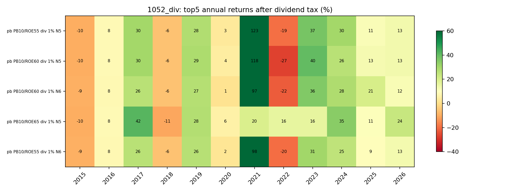
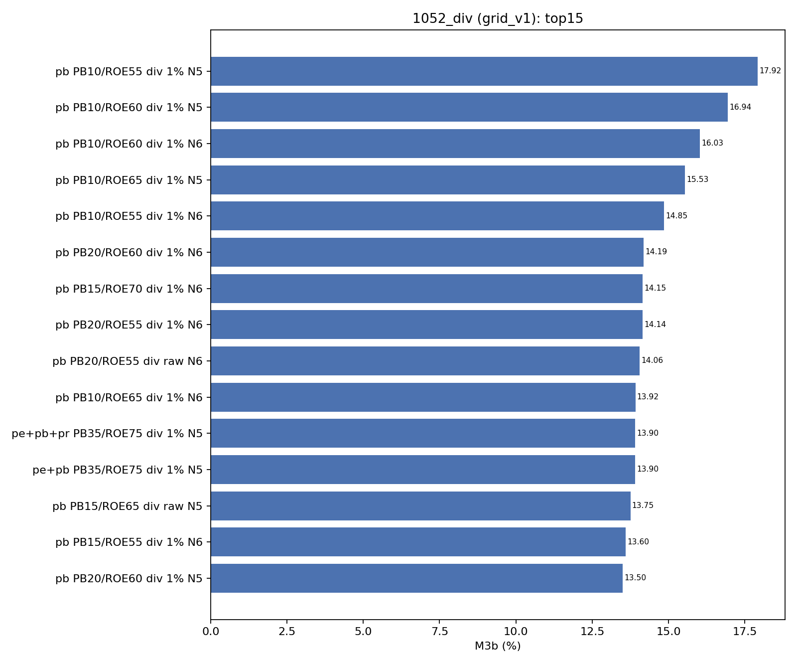
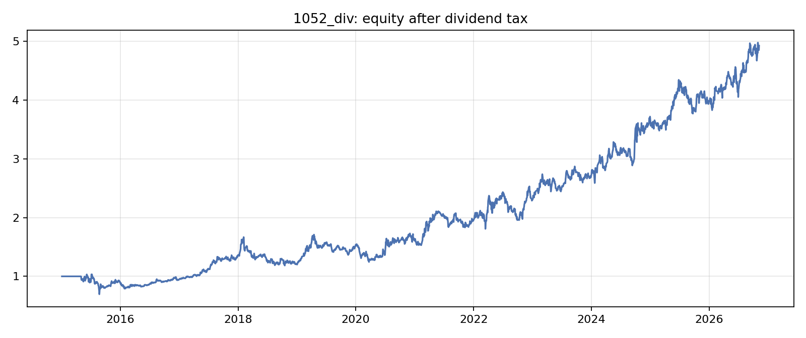
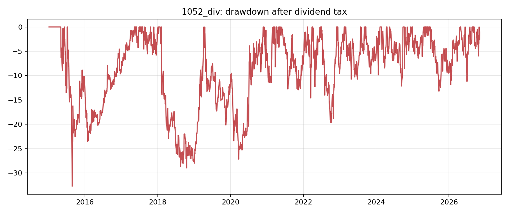

# grid_v1 · 1052 × 股息（2026-11）

> 池：1052；首买：2015-05；主指标：M3b；网格：grid_v1，138 行 / 138 distinct。
>
> **⚠️ 口径**：本页 15.45% 是**税后** `declared`（预案日 + 最终金额）；税前 15.53%。预案日选股合理，若最终金额≠初始预案则高估。`paid` 税后 12.12%，2020 以来 13.73%。详见 [股息口径审计](dividend-audit-2026-11.md)。
>
> 报告导航：[汇总](grid-v1-summary-2026-11.md) · [1052 非股息](grid-v1-1052-nodiv-2026-11.md) · [1052 股息](grid-v1-1052-div-2026-11.md) · [932 非股息](grid-v1-932-nodiv-2026-11.md) · [932 股息](grid-v1-932-div-2026-11.md)

## 0. 结论

- **推荐：PB10/ROE65 + 股息率，N5**，**税后 M3b 15.45%**，M1 14.99%，夏普 0.590，回撤 -32.8%（税前 15.53%）。
- 税后网格最高：PB10/ROE55，N5：M3b 17.85%（税前 17.92%）、回撤 -33.4%；ROE55 是网格下边界，不作默认。

## 1. Top 5（税后，按 M3b）

| # | 配置 | M3b（税后） | M1 | 夏普 | 回撤 | M3b（税前） |
|---:|---|---:|---:|---:|---:|---:|
| 1 | pb PB10/ROE55 div 1% N5 | **17.85%** | 17.31% | 0.678 | -33.4% | 17.92% |
| 2 | pb PB10/ROE60 div 1% N5 | 16.85% | 16.35% | 0.624 | -41.3% | 16.94% |
| 3 | pb PB10/ROE60 div 1% N6 | 15.94% | 15.46% | 0.618 | -37.1% | 16.03% |
| 4 | pb PB10/ROE65 div 1% N5 | 15.45% | 14.99% | 0.590 | -32.8% | 15.53% |
| 5 | pb PB10/ROE55 div 1% N6 | 14.78% | 14.33% | 0.569 | -34.2% | 14.85% |

## 2. 图表





> Top15 柱图仍是税前网格，用于展示网格宽度；Top5 表和净值/回撤为税后。





## 3. 2026 持仓

江苏银行（22%）、南京银行（20%）、齐鲁银行（18%）、招商银行（20%）、成都银行（20%）；2026 组合股息率 **4.74%**。

## 4. 本格子的特殊情况

- **ROE55 是网格下边界**：收益最高但 ROE 已低于“高 ROE”原意；默认用 ROE65，保留更高风险调整收益。
- 股息率 TTM 用“预案公告日 + 最终实施金额”，隐含“预案≈实施”；paid 口径对 ROE65 是 11.85%（M1）/12.21%（M3b）。
- 2021 年 +118% 是 ROE60 的边界案例：中绿电 +365%（20% 仓位，+73pp）；2022 -27%，回撤 -41.4%。
- 2023-2026 无股息版反超，因子阶段性失效。

## 5. 复现
```bash
cd backtesting
python run_matrix_cell_fast.py --pool union --mode div --workers 2 --specs grids/grid_v1_div.csv --out ../data/processed/backtesting/grid_v1_20261121/1052_div
```
