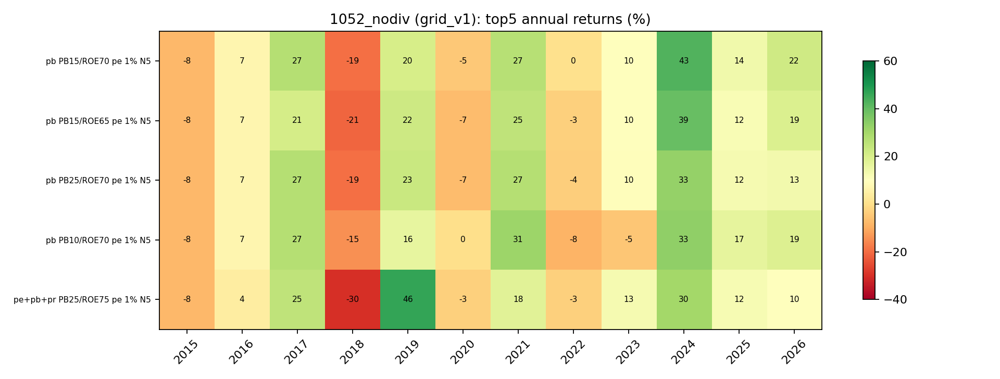
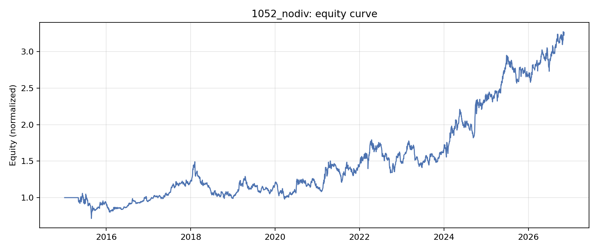
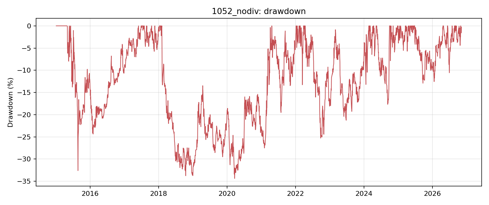

# grid_v1 · 1052 × 非股息（2026-11）

> 池：1052；首买：2015-05；主指标：M3b；网格：grid_v1，87 行 / 87 distinct。

## 0. 结论

- **推荐：PB15/ROE70 + PE 排名，N5**，M3b **11.25%**，M1 10.92%，夏普 0.401，回撤 -34.4%。

## 1. Top 5（按 M3b）

| # | 配置 | M3b | M1 | 夏普 | 回撤 |
|---:|---|---:|---:|---:|---:|
| 1 | pb PB15/ROE70 pe 1% N5 | 11.25% | 10.92% | 0.401 | -34.4% |
| 2 | pb PB15/ROE65 pe 1% N5 | 9.23% | 8.95% | 0.312 | -36.4% |
| 3 | pb PB25/ROE70 pe 1% N5 | 8.96% | 8.69% | 0.306 | -35.4% |
| 4 | pb PB10/ROE70 pe 1% N5 | 8.78% | 8.52% | 0.308 | -35.1% |
| 5 | pe+pb+pr PB25/ROE75 pe 1% N5 | 8.25% | 8.00% | 0.263 | -41.7% |

## 2. 图表








## 3. 2026 持仓

成都银行、江苏银行、杭州银行、常熟银行、招商银行。

## 4. 本格子的特殊情况

- union 池有成分股回推偏差；银行/钢铁集中，2015 银行股灾、2019/2022 钢铁是主要亏损来源。
- 非股息版没有分红信息；2026 持仓 5 只银行。
- grid_v1 非股息只保留 2 个关键过滤的阈值面，`pe+pb` 等组合只覆盖基线。

## 5. 复现
```bash
cd backtesting
python run_matrix_cell_fast.py --pool union --mode nodiv --workers 2 --specs grids/grid_v1_nodiv.csv --out ../data/processed/backtesting/grid_v1_20261121/1052_nodiv
```
