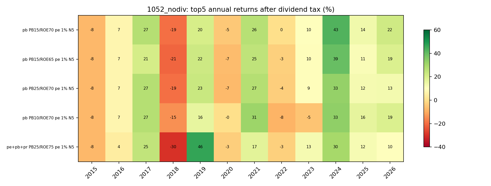
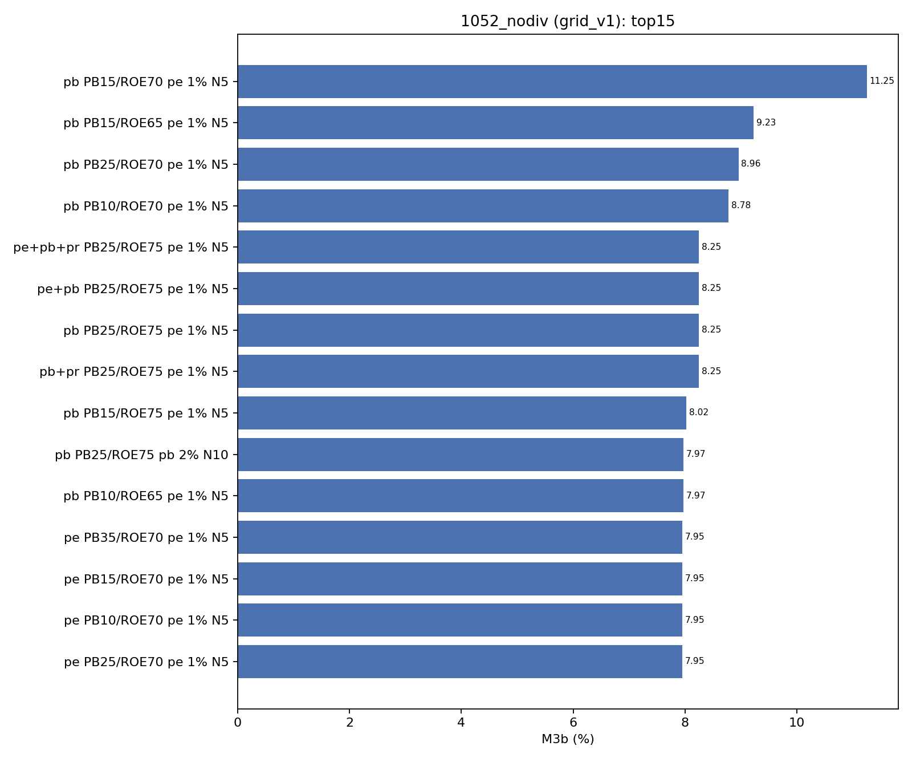
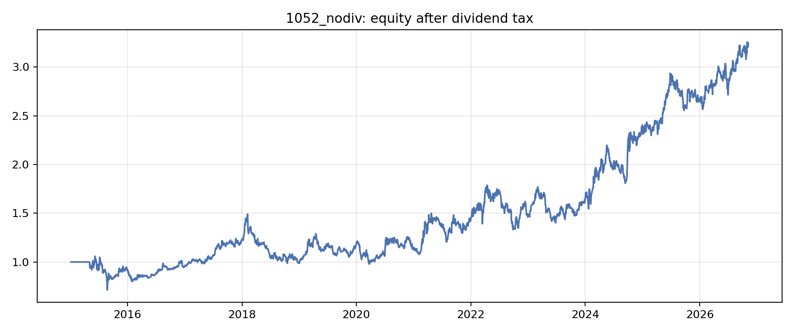
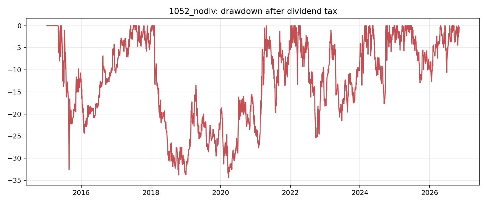

# grid_v1 · 1052 × 非股息（2026-11）

> 池：1052；首买：2015-05；主指标：M3b；网格：grid_v1，87 行 / 87 distinct。
>
> 报告导航：[汇总](grid-v1-summary-2026-11.md) · [1052 非股息](grid-v1-1052-nodiv-2026-11.md) · [1052 股息](grid-v1-1052-div-2026-11.md) · [932 非股息](grid-v1-932-nodiv-2026-11.md) · [932 股息](grid-v1-932-div-2026-11.md)

## 0. 结论

- **推荐：PB15/ROE70 + PE 排名，N5**，**税后 M3b 11.20%**，M1 10.87%，夏普 0.398，回撤 -34.4%（税前 11.25%）。
- 本页已默认计入红利税；税前仅作旧口径对照。

## 1. Top 5（税后，按 M3b）

| # | 配置 | M3b（税后） | M1 | 夏普 | 回撤 | M3b（税前） |
|---:|---|---:|---:|---:|---:|---:|
| 1 | pb PB15/ROE70 pe 1% N5 | **11.20%** | 10.87% | 0.398 | -34.4% | 11.25% |
| 2 | pb PB15/ROE65 pe 1% N5 | 9.17% | 8.89% | 0.309 | -36.5% | 9.23% |
| 3 | pb PB25/ROE70 pe 1% N5 | 8.89% | 8.63% | 0.303 | -35.4% | 8.96% |
| 4 | pb PB10/ROE70 pe 1% N5 | 8.68% | 8.42% | 0.304 | -35.1% | 8.78% |
| 5 | pe+pb+pr PB25/ROE75 pe 1% N5 | 8.16% | 7.92% | 0.259 | -41.6% | 8.25% |

## 2. 图表





> Top15 柱图仍是税前网格，用于展示网格宽度；Top5 表和净值/回撤为税后。





## 3. 2026 持仓

成都银行、江苏银行、杭州银行、常熟银行、招商银行。

## 4. 本格子的特殊情况

- union 池有成分股回推偏差；银行/钢铁集中，2015 银行股灾、2019/2022 钢铁是主要亏损来源。
- 非股息版没有分红信息；2026 持仓 5 只银行。
- grid_v1 非股息只保留 2 个关键过滤的阈值面，`pe+pb` 等组合只覆盖基线。

## 5. 复现
```bash
cd backtesting
python run_matrix_cell_fast.py --pool union --mode nodiv --workers 2 --specs grids/grid_v1_nodiv.csv --out ../data/processed/backtesting/grid_v1_20261121/1052_nodiv
```
