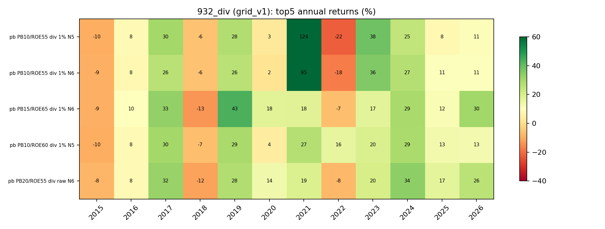
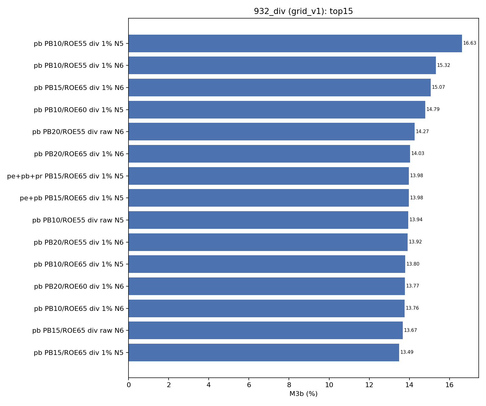
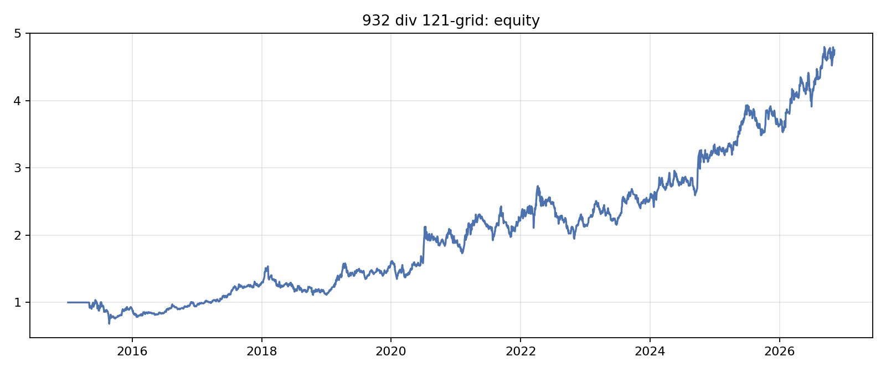
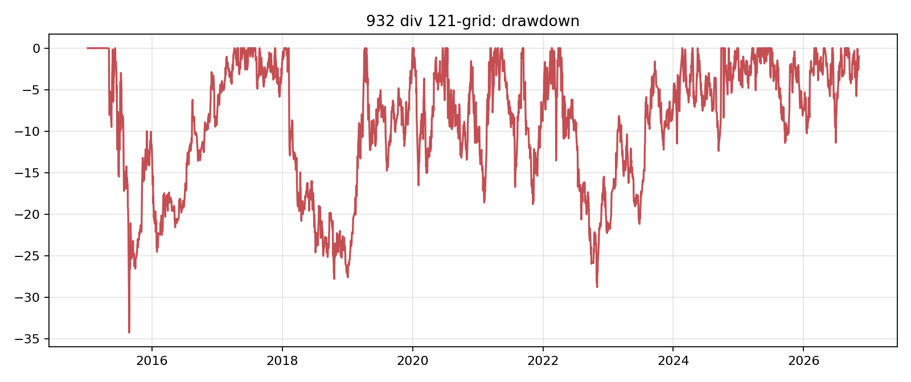

# grid_v1 · 932 × 股息（2026-11）

> 池：932；首买：2015-05；主指标：M3b；网格：grid_v1，138 行 / 138 distinct。
>
> **⚠️ 口径**：本页 15.07% 是 `declared`（预案日 + 最终金额）；预案日选股合理，若最终金额≠初始预案则高估。`paid` 9.36% 是保守下界，2020 以来 12.28%。详见 [股息口径审计](dividend-audit-2026-11.md)。
>
> 报告导航：[汇总](grid-v1-summary-2026-11.md) · [1052 非股息](grid-v1-1052-nodiv-2026-11.md) · [1052 股息](grid-v1-1052-div-2026-11.md) · [932 非股息](grid-v1-932-nodiv-2026-11.md) · [932 股息](grid-v1-932-div-2026-11.md)

## 0. 结论

- **推荐：PB15/ROE65 + 股息率，N6**，M3b **15.07%**，M1 14.62%，夏普 0.568，回撤 -34.2%。
- 网格最高：PB10/ROE55，N5：M3b 16.63%、回撤 -34.6%，但 ROE55 是网格下边界，不作默认。这是边界值，不作默认。

## 1. Top 5（按 M3b）

| # | 配置 | M3b | M1 | 夏普 | 回撤 |
|---:|---|---:|---:|---:|---:|
| 1 | pb PB10/ROE55 div 1% N5 | 16.63% | 16.13% | 0.624 | -34.6% |
| 2 | pb PB10/ROE55 div 1% N6 | 15.32% | 14.86% | 0.591 | -34.2% |
| 3 | pb PB15/ROE65 div 1% N6 | 15.07% | 14.62% | 0.568 | -34.2% |
| 4 | pb PB10/ROE60 div 1% N5 | 14.79% | 14.35% | 0.568 | -32.8% |
| 5 | pb PB20/ROE55 div 1% raw N6 | 14.27% | 13.84% | 0.562 | -31.8% |

## 2. 图表









## 3. 2026 持仓

江苏银行（17.3%）、南京银行（16.7%）、招商银行（16.2%）、齐鲁银行（16.7%）、杭州银行（16.5%）、成都银行（16.6%）；2026 组合股息率约 **4.57%**。

## 4. 本格子的特殊情况

- **ROE55 是网格下边界**：收益最高但 ROE 已低于“高 ROE”原意；默认用 15.07% 的 ROE65/N6。
- legacy 单期清单，幸存者偏差最重；
- 股息率 TTM 隐含“预案≈实施”；paid 口径对 13.80 版是 11.48%（M1）/11.83%（M3b），15.07 版未单独 paid 审计。
- 2021/2022 的 pilot 行为：2021 从 56% 降到 28%、2022 从 -22.9% 升到 +7.4%，波动下降。

## 5. 复现
```bash
cd backtesting
python run_matrix_cell_fast.py --pool legacy --mode div --workers 2 --specs grids/grid_v1_div.csv --out ../data/processed/backtesting/grid_v1_20261121/932_div
```
