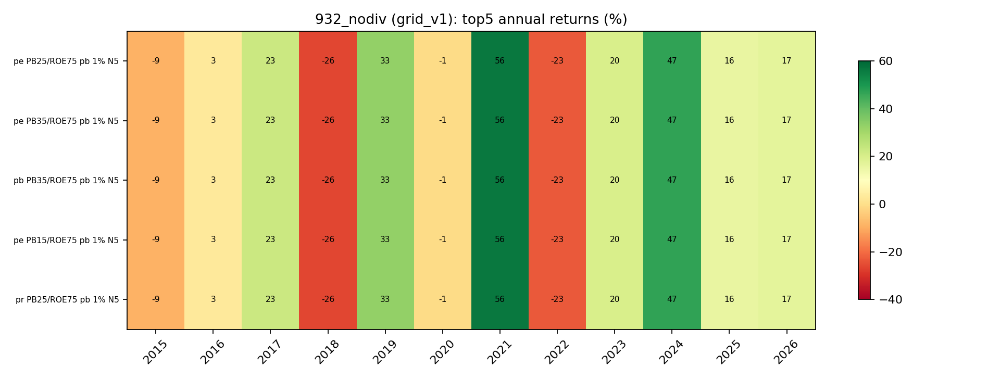
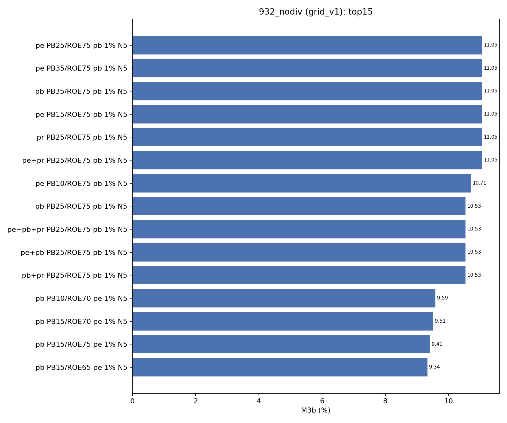
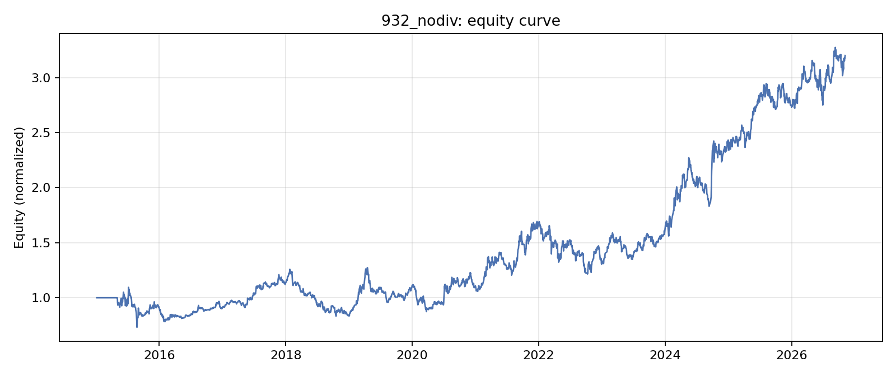
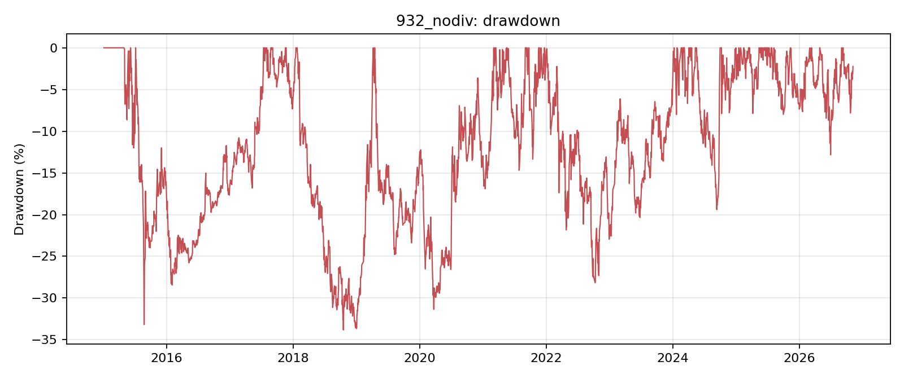

# grid_v1 · 932 × 非股息（2026-11）

> 池：932；首买：2015-05；主指标：M3b；网格：grid_v1，87 行 / 87 distinct。

## 0. 结论

- **推荐：PE25/ROE75 + PB 排名，N5**，M3b **11.05%**，M1 10.73%，夏普 0.392，回撤 -33.8%。

## 1. Top 5（按 M3b）

| # | 配置 | M3b | M1 | 夏普 | 回撤 |
|---:|---|---:|---:|---:|---:|
| 1 | pe PE25/ROE75 pb 1% N5 | 11.05% | 10.73% | 0.392 | -33.8% |
| 2 | pe PE35/ROE75 pb 1% N5 | 11.05% | 10.73% | 0.392 | -33.8% |
| 3 | pb PB35/ROE75 pb 1% N5 | 11.05% | 10.73% | 0.392 | -33.8% |
| 4 | pr PE25/ROE75 pb 1% N5 | 11.05% | 10.73% | 0.392 | -33.8% |
| 5 | pb PB25/ROE70 pe 1% N5 | 9.90% | 9.60% | 0.335 | -35.8% |

## 2. 图表









## 3. 2026 持仓

成都银行、杭州银行、常熟银行、中国人保、中国太保。

## 4. 本格子的特殊情况

- legacy 是单期旧清单，幸存者偏差最重；
- 2021 +56%、2022 -22.9%，高波动；
- 前 5 名有多个参数组合并列 11.05%，说明最优区域比较平，不是单点。

## 5. 复现
```bash
cd backtesting
python run_matrix_cell_fast.py --pool legacy --mode nodiv --workers 2 --specs grids/grid_v1_nodiv.csv --out ../data/processed/backtesting/grid_v1_20261121/932_nodiv
```
