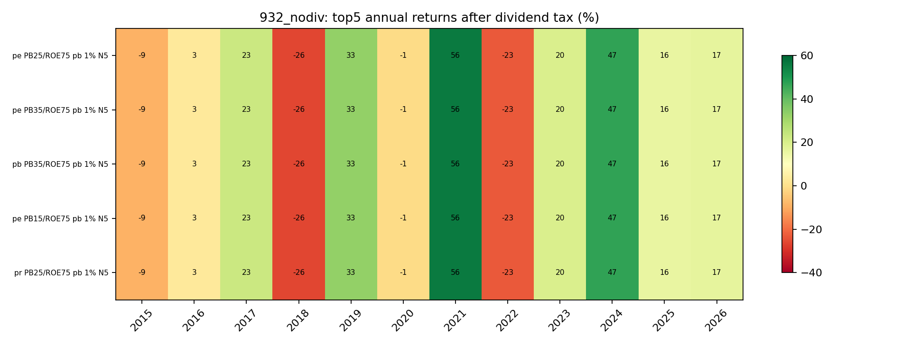
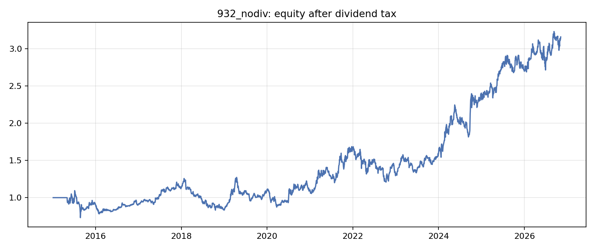
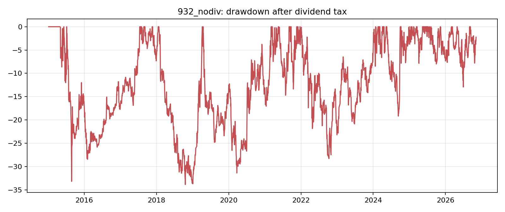

# grid_v1 · 932 × 非股息（2026-11）

> 池：932；首买：2015-05；主指标：M3b；网格：grid_v1，87 行 / 87 distinct。
>
> 报告导航：[汇总](grid-v1-summary-2026-11.md) · [1052 非股息](grid-v1-1052-nodiv-2026-11.md) · [1052 股息](grid-v1-1052-div-2026-11.md) · [932 非股息](grid-v1-932-nodiv-2026-11.md) · [932 股息](grid-v1-932-div-2026-11.md)

## 0. 结论

- **推荐：PE25/ROE75 + PB 排名，N5**，**税后 M3b 10.93%**，M1 10.61%，夏普 0.387，回撤 -33.9%（税前 11.05%）。
- 本页已默认计入红利税；税前仅作旧口径对照。

## 1. Top 5（税后，按 M3b）

| # | 配置 | M3b（税后） | M1 | 夏普 | 回撤 | M3b（税前） |
|---:|---|---:|---:|---:|---:|---:|
| 1 | pe PE25/ROE75 pb 1% N5 | **10.93%** | 10.61% | 0.387 | -33.9% | 11.05% |
| 2 | pe PE35/ROE75 pb 1% N5 | 10.93% | 10.61% | 0.387 | -33.9% | 11.05% |
| 3 | pb PB35/ROE75 pb 1% N5 | 10.93% | 10.61% | 0.387 | -33.9% | 11.05% |
| 4 | pe PE15/ROE75 pb 1% N5 | 10.93% | 10.61% | 0.387 | -33.9% | 11.05% |
| 5 | pr PR25/ROE75 pb 1% N5 | 10.93% | 10.61% | 0.387 | -33.9% | 11.05% |

## 2. 图表




> Top15 柱图仍是税前网格，用于展示网格宽度；Top5 表和净值/回撤为税后。





## 3. 2026 持仓

成都银行、杭州银行、常熟银行、中国人保、中国太保。

## 4. 本格子的特殊情况

- legacy 是单期旧清单，幸存者偏差最重；
- 2021 +56%、2022 -22.9%，高波动；
- 前 5 名有多个参数组合并列 11.05%，说明最优区域比较平，不是单点。

## 5. 复现
```bash
cd backtesting
python run_matrix_cell_fast.py --pool legacy --mode nodiv --workers 2 --specs grids/grid_v1_nodiv.csv --out ../data/processed/backtesting/grid_v1_20261121/932_nodiv
```
