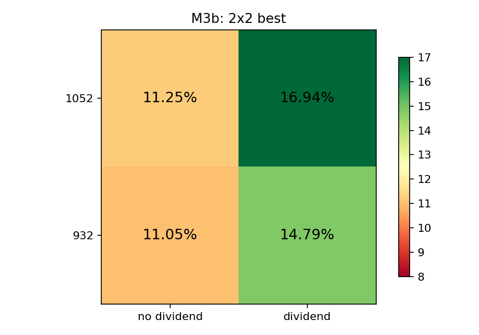
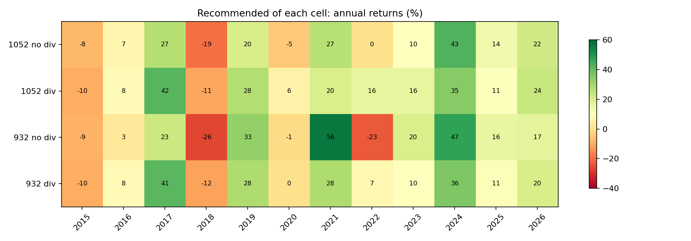
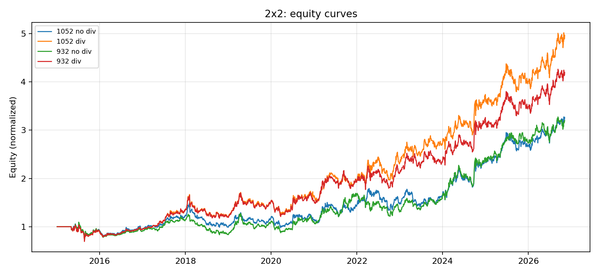
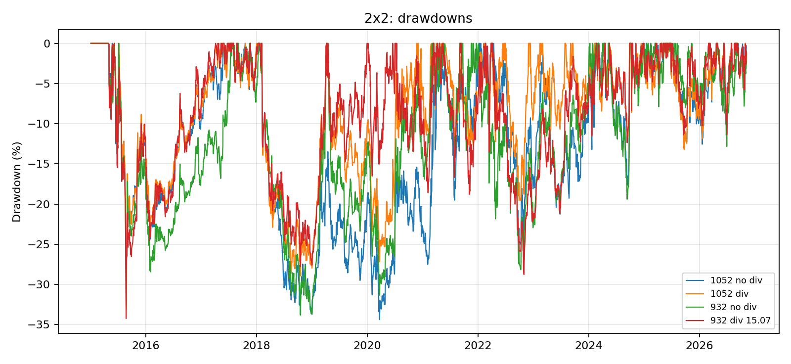

# grid_v1 · 2×2 汇总：1052/932 × 股息/非股息（2026-11）

> 主指标 M3b；首买 2015-05；网格 `grid_v1`。
>
> **计数**：股息 138 distinct/池；非股息 87 distinct/池；单池 225；两池 **450 distinct**（raw 460 行，去重 10 个）。

## 0. 四宫格推荐

| 格子 | 推荐配置 | M3b | M1 | 夏普 | 回撤 |
|---|---|---:|---:|---:|---:|
| 1052 × 非股息 | PB15/ROE70 + PE，N5 | 11.25% | 10.92% | 0.401 | -34.4% |
| 1052 × 股息 | PB10/ROE65 + 股息率，N5 | **15.53%** | 15.07% | 0.593 | -32.8% |
| 932 × 非股息 | PE25/ROE75 + PB，N5 | 11.05% | 10.73% | 0.392 | -33.8% |
| 932 × 股息 | PB15/ROE65 + 股息率，N6 | **15.07%** | 14.62% | 0.568 | -34.2% |

## 1. 网格最高 vs 推荐

| 格子 | 网格最高 | M3b | 回撤 | 为什么不用 |
|---|---|---:|---:|---|
| 1052 股息 | PB10/ROE55，N5 | 17.92% | -33.5% | ROE55 是 grid_v1 下边界，已偏离“高 ROE”原意 |
| 932 股息 | PB10/ROE55，N5 | 16.63% | -34.6% | 同上；ROE55 是边界，不是平台 |

> 这是一个重要发现：**2015-2026 里，把 ROE 从 75% 降到 55% 反而提高收益**。说明“高 ROE”在这个样本里不是收益来源，低 PB + 中等 ROE 更像价值/周期暴露。  
> 但这是**边界最优**，不能直接当默认；默认仍用 ROE65 的非边界版本。若以后要把 ROE55 当正式策略，应先把网格扩到 ROE45/50，确认是否继续单调，而不是在边界上宣布最优。

## 2. 四格当前持仓对比（2026-05-06）

| 格子 | 持仓 |
|---|---|
| 1052 × 非股息 | 成都银行、江苏银行、杭州银行、常熟银行、招商银行 |
| 1052 × 股息（ROE65） | 江苏银行、南京银行、齐鲁银行、招商银行、成都银行 |
| 932 × 非股息 | 成都银行、杭州银行、常熟银行、中国人保、中国太保 |
| 932 × 股息（ROE65/N6） | 成都银行、江苏银行、南京银行、杭州银行、齐鲁银行、招商银行 |

- 1052 两格都偏银行；股息版把杭州/常熟换成南京/齐鲁。
- 932 非股息含保险，股息版切到 6 只银行。
- 四格都没有离开“低估值 + 银行/周期”的风格。

## 3. 净值、回撤、股息率

## 4. 子报告

- [grid_v1 · 1052 非股息](grid-v1-1052-nodiv-2026-11.md)
- [grid_v1 · 1052 股息](grid-v1-1052-div-2026-11.md)
- [grid_v1 · 932 非股息](grid-v1-932-nodiv-2026-11.md)
- [grid_v1 · 932 股息](grid-v1-932-div-2026-11.md)

## 5. 数据与口径

- 价格/财务：2026-11-20 快照，统一截止 2026-11-06。
- 股息率：AkShare 分红面板 2014-2025，TTM = 过去 365 天预案分红 / 4·30 `close_na`。
- M3b = 2015-05-04 起算；M1/M2/M3 仅辅助。
- 交易成本：佣金 0.03%（最低 5 元）、印花税 0.1%（卖出）、滑点 0.1%、100 股整手。
