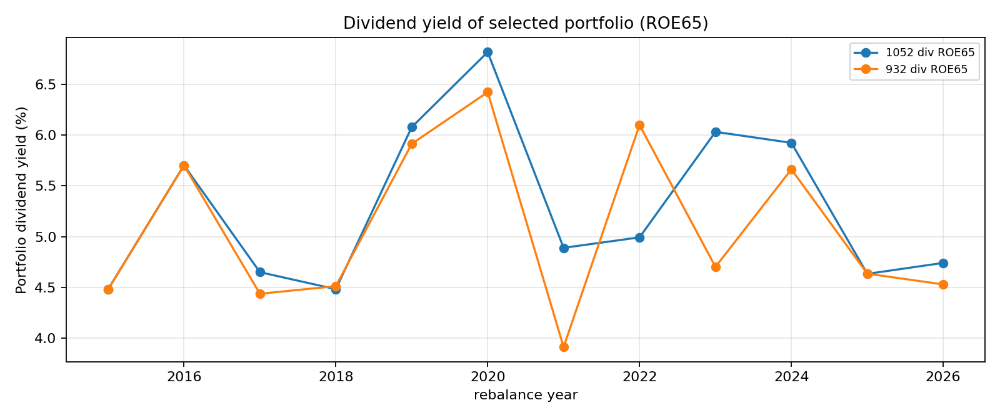

# grid_v1 · 2×2 汇总：1052/932 × 股息/非股息（2026-11）

> 主指标 M3b；首买 2015-05；网格 `grid_v1`。
>
> **计数**：股息 138 distinct/池；非股息 87 distinct/池；单池 225；两池 **450 distinct**（raw 460 行，去重 10 个）。

## 0. 四宫格推荐

| 格子 | 推荐配置 | M3b | M1 | 夏普 | 回撤 |
|---|---|---:|---:|---:|---:|
| 1052 × 非股息 | PB15/ROE70 + PE，N5 | 11.25% | 10.92% | 0.401 | -34.4% |
| 1052 × 股息 | PB10/ROE65 + 股息率，N5 | **15.53%** | 15.07% | 0.593 | -32.8% |
| 932 × 非股息 | PE25/ROE75 + PB，N5 | 11.05% | 10.73% | 0.392 | -33.8% |
| 932 × 股息 | PB15/ROE65 + 股息率，N6 | **15.07%** | 14.62% | 0.568 | -34.2% |

## 1. 网格最高 vs 推荐

| 格子 | 网格最高 | M3b | 回撤 | 为什么不用 |
|---|---|---:|---:|---|
| 1052 股息 | PB10/ROE55，N5 | 17.92% | -33.5% | ROE55 是 grid_v1 下边界，已偏离“高 ROE”原意 |
| 932 股息 | PB10/ROE55，N5 | 16.63% | -34.6% | 同上；ROE55 是边界，不是平台 |

> 这是一个重要发现：**2015-2026 里，把 ROE 从 75% 降到 55% 反而提高收益**。说明“高 ROE”在这个样本里不是收益来源，低 PB + 中等 ROE 更像价值/周期暴露。  
> 但这是**边界最优**，不能直接当默认；默认仍用 ROE65 的非边界版本。若以后要把 ROE55 当正式策略，应先把网格扩到 ROE45/50，确认是否继续单调，而不是在边界上宣布最优。

## 2. 四格当前持仓对比（2026-05-06）

| 格子 | 持仓 |
|---|---|
| 1052 × 非股息 | 成都银行、江苏银行、杭州银行、常熟银行、招商银行 |
| 1052 × 股息（ROE65） | 江苏银行、南京银行、齐鲁银行、招商银行、成都银行 |
| 932 × 非股息 | 成都银行、杭州银行、常熟银行、中国人保、中国太保 |
| 932 × 股息（ROE65/N6） | 成都银行、江苏银行、南京银行、杭州银行、齐鲁银行、招商银行 |

- 1052 两格都偏银行；股息版把杭州/常熟换成南京/齐鲁。
- 932 非股息含保险，股息版切到 6 只银行。
- 四格都没有离开“低估值 + 银行/周期”的风格。

## 3. 净值、回撤、股息率

## 4. 子报告

- [grid_v1 · 1052 非股息](grid-v1-1052-nodiv-2026-11.md)
- [grid_v1 · 1052 股息](grid-v1-1052-div-2026-11.md)
- [grid_v1 · 932 非股息](grid-v1-932-nodiv-2026-11.md)
- [grid_v1 · 932 股息](grid-v1-932-div-2026-11.md)

## 5. 剔除 2021 的稳健性检验

用 2016-2020 + 2022-2025 这 9 个完整年度做几何年化（完全剔除 2021）：

| 池 | 策略 | 2021 单年 | 剔除 2021 年化 | 全期 M3b | 回撤 |
|---|---|---:|---:|---:|---:|
| 1052 | **pe+pb，PB35/ROE75，N5** | +14.2% | **16.65%** | 13.90% | -31.2% |
| 1052 | PB10/ROE65，N5 | +19.9% | 15.70% | 15.53% | -32.8% |
| 1052 | PB10/ROE55，N5（grid 最高） | **+123.6%** | 12.14% | 17.92% | -33.5% |
| 932 | **PB10/ROE60，N5** | +27.2% | **15.34%** | 14.79% | -32.8% |
| 932 | PB15/ROE65，N6 | +17.8% | 14.46% | 15.07% | -34.2% |
| 932 | PB10/ROE55，N5（grid 最高） | **+123.6%** | 10.89% | 16.63% | -34.6% |

结论：

- **ROE55 的最高值确实是 2021 驱动**：两个池子 2021 都是 +123.6%，剔除后只有 12.14%/10.89%，低于 ROE65/ROE60。
- **剔除 2021 后 1052 最优**：`pe+pb`，PB35/ROE75，N5，trim1%，剔除 2021 年化 16.65%，回撤 -31.2%。它 2021 只有 +14.2%，不依赖大牛市。
- **剔除 2021 后 932 最优**：PB10/ROE60，N5，trim1%，剔除 2021 年化 15.34%，全期 14.79%，回撤 -32.8%。
- 1052 的 PB10/ROE65 是“全期 M3b 最高（15.53%）+ 剔除 2021 第二（15.70%）”的折中；如果目标是稳健而非单年弹性，它仍是最适合当默认的。

### 5.1 剔除自身最高年（2016-2025，各策略各剔一年）

每个策略在 2016-2025 十个完整年度里找到自己收益最高的那一年，剔除，剩下 9 年做几何年化：

| 池 | 策略 | 自己最高年 | 该年收益 | 剔除后年化 | 全期 M3b | 回撤 |
|---|---|---|---:|---:|---:|---:|
| **1052** | **PB10/ROE65，N5** | 2017 | +41.9% | **13.56%** | 15.53% | -32.8% |
| 1052 | pe+pb，PB35/ROE75 | 2025 | +61.9% | 12.21% | 13.90% | -31.2% |
| 1052 | PB10/ROE55，N5 | 2021 | +123.6% | 12.14% | 17.92% | -33.5% |
| **932** | **PB10/ROE60，N5** | 2017 | +30.3% | **15.03%** | 14.79% | -32.8% |
| 932 | PB15/ROE65，N6 | 2019 | +43.2% | 12.01% | 15.07% | -34.2% |
| 932 | PB10/ROE55，N5 | 2021 | +123.6% | 10.89% | 16.63% | -34.6% |

关键差别：

- **1052 的 ex-2021 最优是 PB35/ROE75，但它自己最高年是 2025（+61.9%）**；剔除 2021 不影响它，剔除 2025 就掉到 12.21%。
- **1052 PB10/ROE65 自己最高年是 2017（+41.9%）**；剔除后仍有 13.56%，是唯一在两个稳健性口径都靠前的：ex-2021 15.70%、剔除自身最高年 13.56%、全期 15.53%。
- **932 PB10/ROE60 两个口径都第一**：ex-2021 15.34%、剔除自身最高年 15.03%、全期 14.79%、回撤 -32.8%。

结论：

- 1052 继续用 **PB10/ROE65** 作默认最稳；PB35/ROE75 只在“统一剔除 2021”口径下好看，剔除自己 2025 就弱。
- 932 建议从 15.07/N6 切到 **PB10/ROE60**：全期只低 0.28pp，但两个稳健性口径都明显更好（15.34/15.03 vs 14.46/12.01）。

## 6. 数据与口径

- 价格/财务：2026-11-20 快照，统一截止 2026-11-06。
- 股息率：AkShare 分红面板 2014-2025，TTM = 过去 365 天预案分红 / 4·30 `close_na`。
- M3b = 2015-05-04 起算；M1/M2/M3 仅辅助。
- 交易成本：佣金 0.03%（最低 5 元）、印花税 0.1%（卖出）、滑点 0.1%、100 股整手。
