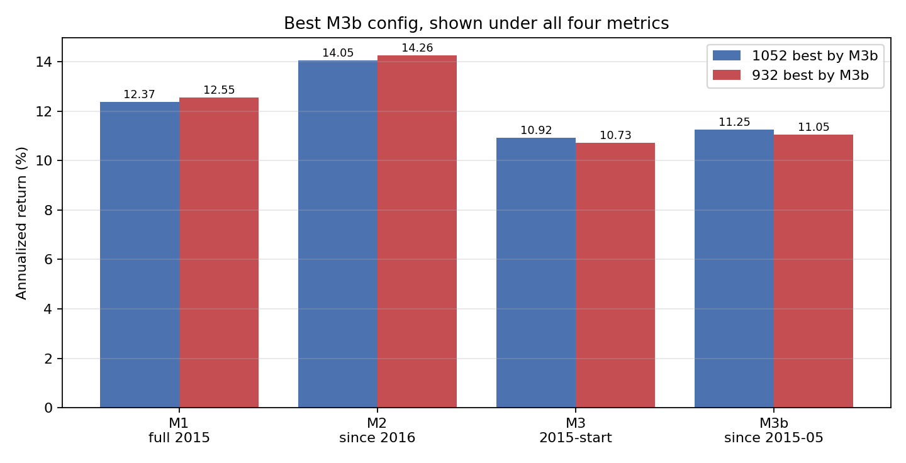
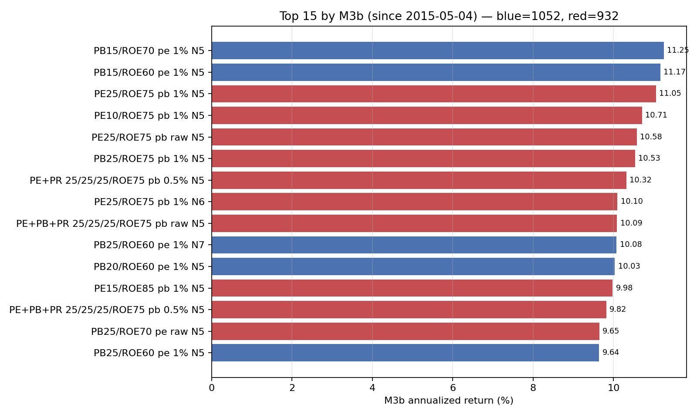
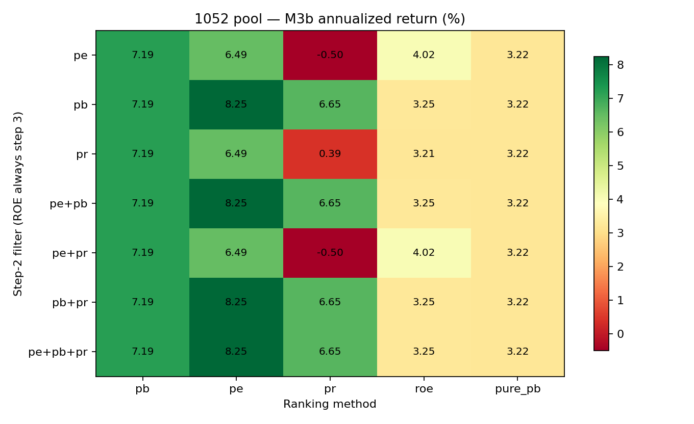
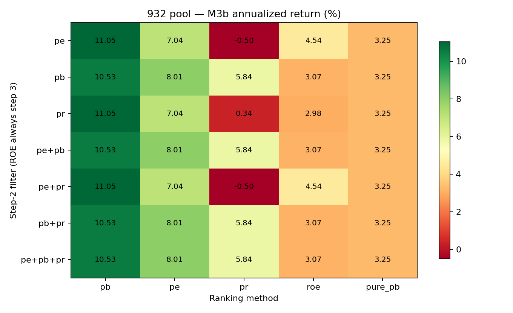
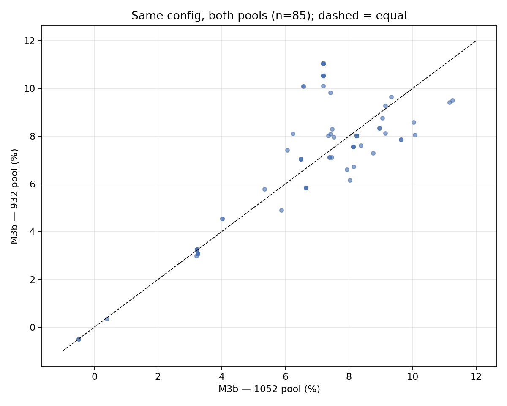
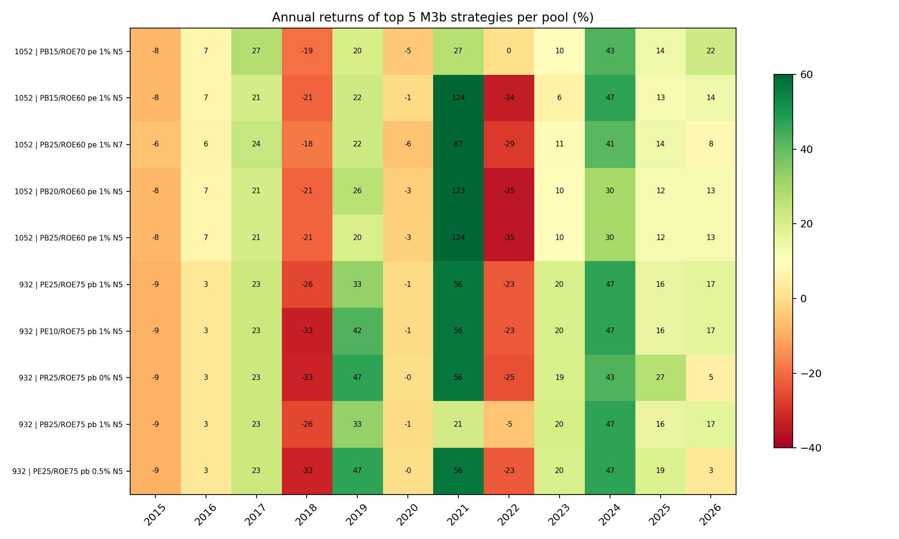

# M3b 主口径：1052 vs 932 全量回测报告（2026-11）

- **主指标 M3b**：2015 年 5 月首个交易日建仓（2014 年报披露后），从实际建仓日起算的年化收益。
- 辅助指标：M1（2015 含空仓）、M2（2016 建仓以来）、M3（2015 全期）。
- 样本：**250 组年度配置**（1052: 125，932: 125）
- 数据：2026-11-20 价格快照，统一截止 **2026-11-06**。

## 0. 结论

1. **M3b 全场最佳**：`refine_union_annual_pb_pe_trim1pct_N5_pe0.15-pb0.15-pr0.25-roe0.7`，M3b **11.25%**，夏普 0.410，回撤 -34.38%。
2. **932 最佳**：`core_legacy_annual_pe_pb_trim1pct_N5_pe0.25-pb0.25-pr0.25-roe0.75`，M3b **11.05%**，夏普 0.401，回撤 -33.83%。
3. **M3b 下 1052 略高**（11.25% vs 11.05%），与 M1 下 932 更高（12.55% vs 12.37%）相反；M3b 把 2015 年股灾计入后，1052 最佳配置的 2015 损失更小。
4. **参数不能跨池套用**：1052 最佳在 932 的 M3b 是 9.51%，932 最佳在 1052 的 M3b 只有 7.19%。
5. **经典 2% 仍是最稳的跨池基准**：M3b 1052 8.14%、932 7.56%。



## 1. 口径与数据

| 指标 | 起点 | 含义 |
|---|---|---|
| **M3b（主）** | 2015-05-04 | 2014 年报后首次建仓，满仓起算 |
| M1 | 2015-01-05 | 含 2015 年 1-4 月空仓 |
| M2 | 2016-05-03 | 跳过 2015 股灾 |
| M3 | 2015-01-05 | 2015 全期，含 1-4 月空仓 |

2014 年报覆盖：1052 只财务文件中有 **730 只**含 2014-12-31 年报且 `ann_available_date <= 2015-04-30`；缺失的基本是 2014 年后上市的新股。2015 年 5 月建仓时同时可利用 2015 一季报（750 只），所以“知道 2014 年报后建仓”这个前提成立。

## 2. M3b 参数网格总排行榜（前 20）

只含参数网格（核心网格、裁尾、持仓数、阈值、细化），不含止损/纯 PB 等特殊实验；同分只保留一个代表。

|   池子 | 配置                               | M3b    | M1     | M3     |   M3b 夏普 |   M3b 回撤 |
|-------:|:-----------------------------------|:-------|:-------|:-------|-----------:|-----------:|
|   1052 | PB15/ROE70 pe 1% N5                | 11.25% | 12.37% | 10.92% |      0.41  |     -0.344 |
|   1052 | PB15/ROE60 pe 1% N5                | 11.17% | 12.26% | 10.84% |      0.386 |     -0.449 |
|    932 | PE25/ROE75 pb 1% N5                | 11.05% | 12.55% | 10.73% |      0.401 |     -0.338 |
|    932 | PE10/ROE75 pb 1% N5                | 10.71% | 12.29% | 10.39% |      0.385 |     -0.404 |
|    932 | PE25/ROE75 pb raw N5               | 10.58% | 12.08% | 10.27% |      0.38  |     -0.403 |
|    932 | PB25/ROE75 pb 1% N5                | 10.53% | 12.06% | 10.22% |      0.4   |     -0.338 |
|    932 | PE+PR 25/25/25/ROE75 pb 0.5% N5    | 10.32% | 11.83% | 10.01% |      0.366 |     -0.403 |
|    932 | PE25/ROE75 pb 1% N6                | 10.10% | 11.87% | 9.80%  |      0.36  |     -0.379 |
|    932 | PE+PB+PR 25/25/25/ROE75 pb raw N5  | 10.09% | 11.59% | 9.79%  |      0.379 |     -0.403 |
|   1052 | PB25/ROE60 pe 1% N7                | 10.08% | 11.10% | 9.78%  |      0.359 |     -0.379 |
|   1052 | PB20/ROE60 pe 1% N5                | 10.03% | 11.16% | 9.73%  |      0.339 |     -0.457 |
|    932 | PE15/ROE85 pb 1% N5                | 9.98%  | 10.40% | 9.68%  |      0.321 |     -0.437 |
|    932 | PE+PB+PR 25/25/25/ROE75 pb 0.5% N5 | 9.82%  | 11.33% | 9.53%  |      0.364 |     -0.403 |
|    932 | PB25/ROE70 pe raw N5               | 9.65%  | 10.81% | 9.36%  |      0.336 |     -0.417 |
|   1052 | PB25/ROE60 pe 1% N5                | 9.64%  | 10.75% | 9.35%  |      0.321 |     -0.456 |
|    932 | PE25/ROE75 pb 1% N10               | 9.62%  | 11.19% | 9.34%  |      0.349 |     -0.348 |
|    932 | PE25/ROE85 pb 1% N5                | 9.51%  | 9.92%  | 9.23%  |      0.299 |     -0.478 |
|    932 | PB15/ROE70 pe 1% N5                | 9.51%  | 10.61% | 9.23%  |      0.338 |     -0.367 |
|    932 | PB15/ROE60 pe 1% N5                | 9.42%  | 10.54% | 9.14%  |      0.328 |     -0.364 |
|   1052 | PB25/ROE70 pe raw N5               | 9.32%  | 10.39% | 9.05%  |      0.33  |     -0.354 |



## 3. 分池前 10（M3b，参数网格）

### 1052 池

| 配置                 | M3b    | M1     | M3     |   M3b 夏普 |   M3b 回撤 |
|:---------------------|:-------|:-------|:-------|-----------:|-----------:|
| PB15/ROE70 pe 1% N5  | 11.25% | 12.37% | 10.92% |      0.41  |     -0.344 |
| PB15/ROE60 pe 1% N5  | 11.17% | 12.26% | 10.84% |      0.386 |     -0.449 |
| PB25/ROE60 pe 1% N7  | 10.08% | 11.10% | 9.78%  |      0.359 |     -0.379 |
| PB20/ROE60 pe 1% N5  | 10.03% | 11.16% | 9.73%  |      0.339 |     -0.457 |
| PB25/ROE60 pe 1% N5  | 9.64%  | 10.75% | 9.35%  |      0.321 |     -0.456 |
| PB25/ROE70 pe raw N5 | 9.32%  | 10.39% | 9.05%  |      0.33  |     -0.354 |
| PB15/ROE65 pe 1% N5  | 9.23%  | 10.47% | 8.95%  |      0.32  |     -0.364 |
| PB25/ROE55 pe 1% N5  | 9.15%  | 10.30% | 8.87%  |      0.306 |     -0.438 |
| PB15/ROE65 pe 1% N6  | 9.06%  | 10.31% | 8.79%  |      0.32  |     -0.352 |
| PB25/ROE70 pe 1% N5  | 8.96%  | 10.03% | 8.69%  |      0.314 |     -0.354 |

### 932 池

| 配置                               | M3b    | M1     | M3     |   M3b 夏普 |   M3b 回撤 |
|:-----------------------------------|:-------|:-------|:-------|-----------:|-----------:|
| PE25/ROE75 pb 1% N5                | 11.05% | 12.55% | 10.73% |      0.401 |     -0.338 |
| PE10/ROE75 pb 1% N5                | 10.71% | 12.29% | 10.39% |      0.385 |     -0.404 |
| PR25/ROE75 pb 0% N5                | 10.58% | 12.08% | 10.27% |      0.38  |     -0.403 |
| PB25/ROE75 pb 1% N5                | 10.53% | 12.06% | 10.22% |      0.4   |     -0.338 |
| PE25/ROE75 pb 0.5% N5              | 10.32% | 11.83% | 10.01% |      0.366 |     -0.403 |
| PE25/ROE75 pb 1% N6                | 10.10% | 11.87% | 9.80%  |      0.36  |     -0.379 |
| PE+PB+PR 25/25/25/ROE75 pb 0% N5   | 10.09% | 11.59% | 9.79%  |      0.379 |     -0.403 |
| PE15/ROE85 pb 1% N5                | 9.98%  | 10.40% | 9.68%  |      0.321 |     -0.437 |
| PE+PB+PR 25/25/25/ROE75 pb 0.5% N5 | 9.82%  | 11.33% | 9.53%  |      0.364 |     -0.403 |
| PB25/ROE70 pe raw N5               | 9.65%  | 10.81% | 9.36%  |      0.336 |     -0.417 |

## 4. 核心网格（M3b）

核心网格固定为 Step2 25% / ROE 75% / 裁尾 1% / N=5，是基线；整体最佳来自第 5 节的阈值细化（1052 的 PB15/ROE70）。

### 1052 池

| 过滤     | pb    | pe    | pr     | roe   | pure_pb   |
|:---------|:------|:------|:-------|:------|:----------|
| pe       | 7.19% | 6.49% | -0.50% | 4.02% | 3.22%     |
| pb       | 7.19% | 8.25% | 6.65%  | 3.25% | 3.22%     |
| pr       | 7.19% | 6.49% | 0.39%  | 3.21% | 3.22%     |
| pe+pb    | 7.19% | 8.25% | 6.65%  | 3.25% | 3.22%     |
| pe+pr    | 7.19% | 6.49% | -0.50% | 4.02% | 3.22%     |
| pb+pr    | 7.19% | 8.25% | 6.65%  | 3.25% | 3.22%     |
| pe+pb+pr | 7.19% | 8.25% | 6.65%  | 3.25% | 3.22%     |



### 932 池

| 过滤     | pb     | pe    | pr     | roe   | pure_pb   |
|:---------|:-------|:------|:-------|:------|:----------|
| pe       | 11.05% | 7.04% | -0.50% | 4.54% | 3.25%     |
| pb       | 10.53% | 8.01% | 5.84%  | 3.07% | 3.25%     |
| pr       | 11.05% | 7.04% | 0.34%  | 2.98% | 3.25%     |
| pe+pb    | 10.53% | 8.01% | 5.84%  | 3.07% | 3.25%     |
| pe+pr    | 11.05% | 7.04% | -0.50% | 4.54% | 3.25%     |
| pb+pr    | 10.53% | 8.01% | 5.84%  | 3.07% | 3.25%     |
| pe+pb+pr | 10.53% | 8.01% | 5.84%  | 3.07% | 3.25%     |



## 5. 裁尾 / 持仓数 / 阈值（M3b）

### 5.1 经典配置的裁尾

|   池子 | 裁尾   | M3b    | M1     |   M3b 夏普 |
|-------:|:-------|:-------|:-------|-----------:|
|    932 | 0.0    | 10.09% | 11.59% |      0.379 |
|   1052 | 0.0    | 6.57%  | 8.04%  |      0.212 |
|    932 | 0.005  | 9.82%  | 11.33% |      0.364 |
|   1052 | 0.005  | 7.42%  | 8.79%  |      0.248 |
|   1052 | 0.01   | 7.19%  | 8.63%  |      0.232 |
|    932 | 0.01   | 10.53% | 12.06% |      0.4   |
|   1052 | 0.015  | 7.93%  | 9.36%  |      0.266 |
|    932 | 0.015  | 6.60%  | 8.06%  |      0.214 |
|   1052 | 0.02   | 8.14%  | 9.55%  |      0.275 |
|    932 | 0.02   | 7.56%  | 9.02%  |      0.246 |
|    932 | 0.025  | 6.16%  | 7.73%  |      0.186 |
|   1052 | 0.025  | 8.03%  | 9.44%  |      0.271 |
|    932 | 0.03   | 7.41%  | 8.86%  |      0.241 |
|   1052 | 0.03   | 6.07%  | 7.49%  |      0.182 |
|    932 | 0.04   | 8.11%  | 9.53%  |      0.272 |
|   1052 | 0.04   | 6.24%  | 7.75%  |      0.192 |
|   1052 | 0.05   | 7.46%  | 8.92%  |      0.245 |
|    932 | 0.05   | 7.11%  | 8.54%  |      0.229 |
|    932 | raw    | 10.09% | 11.59% |      0.379 |
|   1052 | raw    | 6.57%  | 8.04%  |      0.212 |

### 5.2 持仓数 N

|   池子 |   N | M3b    | M1     |   M3b 夏普 |   M3b 回撤 |
|-------:|----:|:-------|:-------|-----------:|-----------:|
|   1052 |   1 | -0.16% | 0.15%  |     -0.389 |     -0.204 |
|   1052 |   2 | 1.08%  | 1.69%  |     -0.097 |     -0.26  |
|   1052 |   3 | 5.25%  | 5.65%  |      0.224 |     -0.296 |
|   1052 |   4 | 5.56%  | 6.51%  |      0.19  |     -0.336 |
|   1052 |   5 | 8.25%  | 9.37%  |      0.27  |     -0.417 |
|   1052 |   6 | 8.91%  | 9.80%  |      0.303 |     -0.399 |
|   1052 |   7 | 7.64%  | 8.82%  |      0.249 |     -0.412 |
|   1052 |   8 | 6.98%  | 8.12%  |      0.221 |     -0.415 |
|   1052 |   9 | 7.24%  | 7.98%  |      0.232 |     -0.42  |
|   1052 |  10 | 6.64%  | 7.84%  |      0.205 |     -0.405 |
|    932 |   1 | 1.93%  | 2.19%  |     -0.014 |     -0.07  |
|    932 |   2 | 2.58%  | 3.14%  |      0.06  |     -0.172 |
|    932 |   3 | 3.70%  | 4.80%  |      0.116 |     -0.215 |
|    932 |   4 | 7.64%  | 9.30%  |      0.297 |     -0.282 |
|    932 |   5 | 11.05% | 12.55% |      0.401 |     -0.338 |
|    932 |   6 | 10.10% | 11.87% |      0.36  |     -0.379 |
|    932 |   7 | 8.42%  | 10.22% |      0.292 |     -0.372 |
|    932 |   8 | 7.93%  | 9.71%  |      0.269 |     -0.37  |
|    932 |   9 | 9.04%  | 10.66% |      0.32  |     -0.363 |
|    932 |  10 | 9.62%  | 11.19% |      0.349 |     -0.348 |

### 5.3 阈值细化（前 12，M3b）

|   池子 | 配置                | M3b    | M1     | M3     |
|-------:|:--------------------|:-------|:-------|:-------|
|   1052 | PB15/ROE70 pe 1% N5 | 11.25% | 12.37% | 10.92% |
|   1052 | PB15/ROE60 pe 1% N5 | 11.17% | 12.26% | 10.84% |
|    932 | PE25/ROE75 pb 1% N5 | 11.05% | 12.55% | 10.73% |
|    932 | PE40/ROE75 pb 1% N5 | 11.05% | 12.55% | 10.73% |
|    932 | PE35/ROE75 pb 1% N5 | 11.05% | 12.55% | 10.73% |
|    932 | PE30/ROE75 pb 1% N5 | 11.05% | 12.55% | 10.73% |
|    932 | PE20/ROE75 pb 1% N5 | 11.05% | 12.55% | 10.73% |
|    932 | PE15/ROE75 pb 1% N5 | 11.05% | 12.55% | 10.73% |
|    932 | PE10/ROE75 pb 1% N5 | 10.71% | 12.29% | 10.39% |
|   1052 | PB25/ROE60 pe 1% N7 | 10.08% | 11.10% | 9.78%  |
|   1052 | PB20/ROE60 pe 1% N5 | 10.03% | 11.16% | 9.73%  |
|    932 | PE15/ROE85 pb 1% N5 | 9.98%  | 10.40% | 9.68%  |

### 5.4 特殊实验（M3b）

|   池子 | 实验                                                                       | M3b    | M1     |   M3b 夏普 |
|-------:|:---------------------------------------------------------------------------|:-------|:-------|-----------:|
|   1052 | special_union_annual_pb_pe_raw_N5_pe0.25-pb0.25-pr0.25-roe0.75             | 8.47%  | 9.67%  |      0.295 |
|   1052 | special_union_annual_pe+pb+pr_pb_trim2pct_N5_pe0.25-pb0.25-pr0.25-roe0.75  | 8.14%  | 9.55%  |      0.275 |
|   1052 | special_union_annual_pb_pe_trim1pct_N5_pe0.25-pb0.25-pr0.25-roe0.75_sl     | 7.35%  | 8.33%  |      0.228 |
|   1052 | special_union_annual_nofilter_pure_pb_raw_N5_pe0.25-pb0.25-pr0.25-roe0.75  | 3.22%  | 6.22%  |      0.055 |
|    932 | special_legacy_annual_pe_pb_raw_N5_pe0.25-pb0.25-pr0.25-roe0.75            | 10.58% | 12.08% |      0.38  |
|    932 | special_legacy_annual_pe_pb_trim1pct_N5_pe0.25-pb0.25-pr0.25-roe0.75_sl    | 10.12% | 11.09% |      0.348 |
|    932 | special_legacy_annual_pe+pb+pr_pb_trim2pct_N5_pe0.25-pb0.25-pr0.25-roe0.75 | 7.56%  | 9.02%  |      0.246 |
|    932 | special_legacy_annual_nofilter_pure_pb_raw_N5_pe0.25-pb0.25-pr0.25-roe0.75 | 3.25%  | 6.25%  |      0.057 |

## 6. 1052 vs 932 同配置对比

两池可匹配的年度配置：**85 组**。

| 配置      | 1052 M3b   | 932 M3b   | 差(932-1052)   |
|:----------|:-----------|:----------|:---------------|
| 1052 最佳 | 11.25%     | 9.51%     | -1.74pp        |
| 932 最佳  | 7.19%      | 11.05%    | +3.86pp        |
| 经典 1%   | 7.19%      | 10.53%    | +3.34pp        |
| 经典 2%   | 8.14%      | 7.56%     | -0.57pp        |
| 经典 raw  | 6.57%      | 10.09%    | +3.51pp        |



## 7. 逐年收益（M3b 前 5 / 池）



### 7.1 2022 的 0 与 2026 的 22%

**2022 年不是空仓。** 全年 0.28%，热力图四舍五入显示 0。2021 篮子 1-4 月 16.58%，2022 篮子 5-12 月 -13.98%，一正一负抵消。

**2026 年至今 21.88%**：1-5 月持有 2025 篮子 11.41%，5-11 月持有 2026 篮子 9.40%。

当前持仓（2026-05-06 建仓，当前权重按最新收盘价漂移）：

|   代码 | 名称     | 调仓权重   | 当前权重   |
|-------:|:---------|:-----------|:-----------|
| 601838 | 成都银行 | 19.96%     | 20.75%     |
| 600919 | 江苏银行 | 21.99%     | 23.32%     |
| 600926 | 杭州银行 | 20.11%     | 19.16%     |
| 601128 | 常熟银行 | 20.02%     | 18.11%     |
| 600036 | 招商银行 | 17.55%     | 18.66%     |

## 8. 与 M1 的排序一致性

- 1052：Spearman **0.9869**，M1 前 10 与 M3b 前 10 重叠 **9/10**。
- 932：Spearman **0.9954**，M1 前 10 与 M3b 前 10 重叠 **10/10**。

## 9. 建议

1. **主口径用 M3b**：它对应“2014 年报后、2015 年 5 月建仓”的真实路径。
2. **1052 实际使用**：1052 最佳（PB15/ROE70 + PE 排名 + 1% 裁尾 + N5，M3b 11.25%）。
3. **稳健基准**：经典 2%（M3b 1052 8.14% / 932 7.56%），跨池最稳。
4. **不要套用 932 最佳**：它在 1052 的 M3b 只有 7.19%。
5. **未来 2027 回测**：先跑标准 + 2015-start 两套矩阵，再用 `build_m3b_dataset.py` + 本报告脚本，M3b 自动成为主表。

## 10. 复现

```bash
cd backtesting
# 标准矩阵
../.venv/bin/python universe_compare.py --pool union --end-date <最新交易日>
../.venv/bin/python universe_compare.py --pool legacy --end-date <最新交易日>
# 2015-start 矩阵
../.venv/bin/python universe_compare.py --pool union --end-date <最新交易日> --ignore-first-new-stock
../.venv/bin/python universe_compare.py --pool legacy --end-date <最新交易日> --ignore-first-new-stock
# 汇总 + M3b 报告
../.venv/bin/python build_consolidated_metrics.py
../.venv/bin/python build_m3b_dataset.py
../.venv/bin/python build_m3b_report.py
```

## 11. 文件

- M3b 年度数据集：[m3b_annual.csv](../data/processed/backtesting/m3b_20261120/m3b_annual.csv)
- 合并总表：[consolidated.csv](../data/processed/backtesting/consolidated_20261120/consolidated.csv)
- 三口径报告：[three-start-metrics-2026-11.md](three-start-metrics-2026-11.md)
- 1052 报告：[universe-backtest-2026-11.md](universe-backtest-2026-11.md)
- 932 报告：[universe-backtest-932-2026-11.md](universe-backtest-932-2026-11.md)