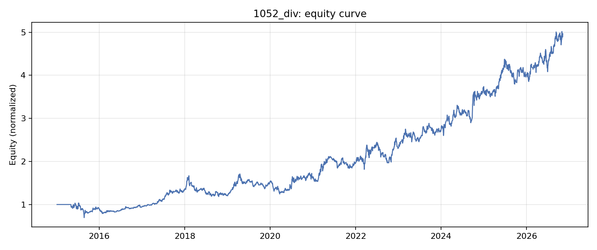
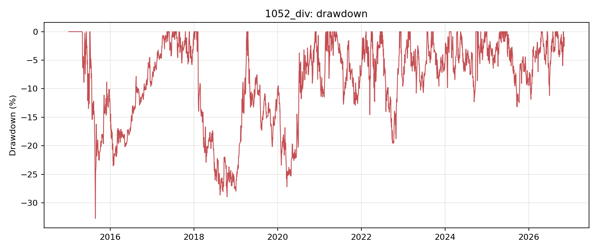
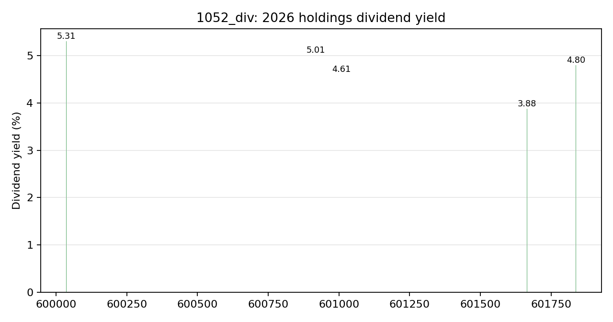

# 1052 × 股息：标准网格（2026-11）

> 池：1052；首买：2015-05；主指标：M3b。

## 0. 结论

- **推荐：PB10/ROE65 + 股息率**，M3b **15.53%**，M1 15.07%，回撤 -32.8%。
- 网格最高是 PB10/ROE60：M3b 16.94%，但 ROE60 是下边界，2021 +118%（中绿电 +365%、+73pp）、2022 -27%、回撤 -41.4%，属于 boom/bust，不作默认。

## 1. 网格

15 组股息 pilot + 121 组标准网格；pilot 覆盖 PB10-20 × ROE60-80，标准网格与非股息格同一套 spec；过滤 1 种、排名 1 种、PB 0.1, 0.15, 0.2、ROE 0.6, 0.65, 0.7, 0.75, 0.8、裁尾 ['0.01']、N 5。

## 2. Top 10

| # | 配置 | M3b | M1 | 夏普 | 回撤 |
|---:|---|---:|---:|---:|---:|
| 1 | pb PB10/ROE60 div 1% N5 | 16.94% | 16.43% | 0.628 | -41.4% |
| 2 | pb PB10/ROE65 div 1% N5 | 15.53% | 15.07% | 0.593 | -32.8% |
| 3 | pb PB20/ROE60 div 1% N5 | 13.50% | 13.09% | 0.499 | -33.0% |
| 4 | pb PB15/ROE70 div 1% N5 | 13.23% | 12.83% | 0.482 | -32.8% |
| 5 | pb PB15/ROE65 div 1% N5 | 12.99% | 12.60% | 0.475 | -32.8% |
| 6 | pb PB20/ROE65 div 1% N5 | 12.96% | 12.57% | 0.478 | -33.5% |
| 7 | pb PB20/ROE70 div 1% N5 | 12.91% | 12.53% | 0.481 | -32.8% |
| 8 | pb PB20/ROE75 div 1% N5 | 12.52% | 12.15% | 0.462 | -33.3% |
| 9 | pb PB10/ROE70 div 1% N5 | 12.43% | 12.06% | 0.472 | -32.8% |
| 10 | pb PB15/ROE60 div 1% N5 | 12.28% | 11.91% | 0.439 | -33.0% |

## 3. Top5 年度收益


### 3.1 净值与回撤





## 4. 2026 持仓

### 4.1 网格最高（ROE60，16.94%）

600919 江苏银行（24%）、601009 南京银行（21%）、600741 华域汽车（19%）、600036 招商银行（20%）、601838 成都银行（16%）。

### 4.2 风险调整推荐（ROE65，15.53%）

600919 江苏银行（22%）、601009 南京银行（20%）、601665 齐鲁银行（18%）、600036 招商银行（20%）、601838 成都银行（20%）。

### 4.3 股息率


2026-05-06 组合股息率 **4.74%**：

| 股票 | 权重 | 股息率 |
|---|---:|---:|
| 600919 江苏银行 | 22.4% | 5.01% |
| 601009 南京银行 | 19.8% | 4.61% |
| 601665 齐鲁银行 | 18.1% | 3.88% |
| 600036 招商银行 | 19.7% | 5.31% |
| 601838 成都银行 | 20.0% | 4.80% |



## 5. 本格子的特殊情况

- 股息率 TTM 用“预案公告日 + 最终实施金额”，隐含“预案≈实施”假设；
- paid 口径（只算已派息）在 ROE65 推荐版上是 11.85%（M1）/12.21%（M3b），仍高于同起点无股息；
- 2023-2026 无股息版反超，因子阶段性失效；
- 最佳 ROE60 的 2026 持仓含华域汽车；推荐 ROE65 的 2026 持仓是 5 只银行（江苏/南京/齐鲁/招商/成都）。

### 5.1 2021 年 +118% 的持仓拆解

2021 自然年 = 1-4 月持有 2020 年篮子 + 5-12 月持有 2021 年篮子。

**1-4 月（2020 篮子）：+26.6%**

| 股票 | 权重 | 2021-01→05 | 贡献 |
|---|---:|---:|---:|
| 000932 华菱钢铁 | 20% | +74.4% | +14.9pp |
| 600282 南钢股份 | 20% | +41.3% | +8.3pp |
| 600188 兖矿能源 | 20% | +36.1% | +7.2pp |
| 600971 恒源煤电 | 20% | -8.1% | -1.6pp |
| 600016 民生银行 | 19% | -9.6% | -1.8pp |

**5-12 月（2021 篮子）：+72.4%**

| 股票 | 权重 | 2021-05→12 | 贡献 |
|---|---:|---:|---:|
| 000537 中绿电 | 20% | **+365.0%** | **+73.0pp** |
| 600755 厦门国贸 | 20% | +11.2% | +2.2pp |
| 600325 华发股份 | 20% | +2.4% | +0.5pp |
| 600064 南京高科 | 20% | +0.8% | +0.2pp |
| 600606 绿地控股 | 20% | -18.5% | -3.7pp |

- 2021 全年：`1.266 × 1.724 - 1 ≈ +118.3%`。
- **中绿电一只股票 +365%、20% 仓位，贡献 +73pp**，是整个 118% 的核心；这是典型的单票/单主题行情，不是可复制的因子。
- 2022 年 -27%、最大回撤 -41.4%，基本把这段还回去；所以只推荐 ROE65 的 15.53% / -32.8% 版本。

## 6. 复现
```bash
cd backtesting
../.venv/bin/python run_matrix_cell.py --pool union --mode div --out ../data/processed/backtesting/matrix_20261121/1052_div
```

## 7. 121 组标准网格补充

121 组标准网格最佳是 **PB35/ROE75，M3b 13.90%**（M1 13.49%，夏普 0.503，回撤 -31.2%），低于 pilot 的 15.53%。

| # | 配置 | M3b | M1 | 夏普 | 回撤 |
|---:|---|---:|---:|---:|---:|
| 1 | pb PB35/ROE75 div 1% N5 | 13.90% | 13.49% | 0.503 | -31.2% |
| 2 | pb PB20/ROE60 div 1% N5 | 13.50% | 13.09% | 0.499 | -33.0% |
| 3 | pb PB15/ROE70 div 1% N5 | 13.23% | 12.83% | 0.482 | -32.8% |
| 4 | pb PB15/ROE65 div 1% N6 | 12.99% | 12.61% | 0.479 | -34.2% |
| 5 | pb PB15/ROE65 div 1% N5 | 12.99% | 12.60% | 0.475 | -32.8% |

**为什么仍用 pilot 的 15.53% 作推荐？**

- 121 标准网格的 spec 来自原来的 1052 标准网格，**没有覆盖 PB10/ROE65**；pilot 正好补了这个区域。
- 15.53% 的 PB10/ROE65 是实测配置，回撤 -32.8%，比 121 最佳 13.90% 的收益高、夏普高（0.593 vs 0.503），回撤只深 1.6pp。
- 所以 1052 股息格继续推荐 **PB10/ROE65 15.53%**，121 的 13.90% 作为“标准网格内最佳”记录。
