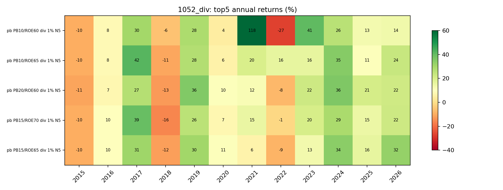
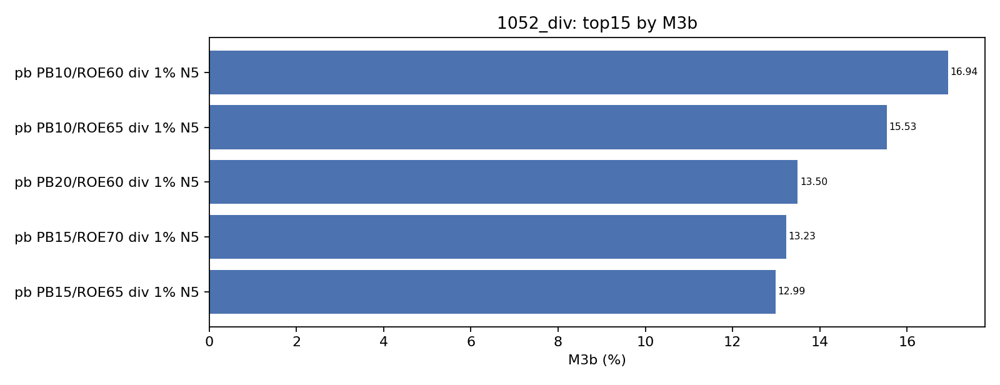

# 1052 × 股息：标准网格（2026-11）

> 池：1052；首买：2015-05；主指标：M3b。

## 0. 结论

- 最佳：`pb PB10/ROE60 div 1% N5`
- M3b **16.94%**，M1 16.43%，夏普 0.628，回撤 -41.4%
- **注意：ROE60 是网格下边界**，M3b 最高但回撤更深；风险调整推荐 PB10/ROE65（1052 15.53% / -32.8%，932 13.80% / -32.8%）。

## 1. 网格

15 组股息 pilot 网格（PB10-20 × ROE60-80；全量 121 组待补）；过滤 1 种、排名 1 种、PB 0.1, 0.15, 0.2、ROE 0.6, 0.65, 0.7, 0.75, 0.8、裁尾 ['0.01']、N 5。

## 2. Top 10

| # | 配置 | M3b | M1 | 夏普 | 回撤 |
|---:|---|---:|---:|---:|---:|
| 1 | pb PB10/ROE60 div 1% N5 | 16.94% | 16.43% | 0.628 | -41.4% |
| 2 | pb PB10/ROE65 div 1% N5 | 15.53% | 15.07% | 0.593 | -32.8% |
| 3 | pb PB20/ROE60 div 1% N5 | 13.50% | 13.09% | 0.499 | -33.0% |
| 4 | pb PB15/ROE70 div 1% N5 | 13.23% | 12.83% | 0.482 | -32.8% |
| 5 | pb PB15/ROE65 div 1% N5 | 12.99% | 12.60% | 0.475 | -32.8% |
| 6 | pb PB20/ROE65 div 1% N5 | 12.96% | 12.57% | 0.478 | -33.5% |
| 7 | pb PB20/ROE70 div 1% N5 | 12.91% | 12.53% | 0.481 | -32.8% |
| 8 | pb PB20/ROE75 div 1% N5 | 12.52% | 12.15% | 0.462 | -33.3% |
| 9 | pb PB10/ROE70 div 1% N5 | 12.43% | 12.06% | 0.472 | -32.8% |
| 10 | pb PB15/ROE60 div 1% N5 | 12.28% | 11.91% | 0.439 | -33.0% |

## 3. Top5 年度收益





## 4. 2026 持仓

600919江苏银行、601009南京银行、600741华域汽车、600036招商银行、601838成都银行

## 5. 本格子的特殊情况

- 股息率 TTM 用“预案公告日 + 最终实施金额”，隐含“预案≈实施”假设；
- paid 口径（只算已派息）为 11.85%（M1）/12.21%（M3b），仍高于同起点无股息；
- 2023-2026 无股息版反超，因子阶段性失效；
- 2026 持仓为江苏/南京/齐鲁/招商/成都，仍是银行。

## 6. 复现
```bash
cd backtesting
../.venv/bin/python run_matrix_cell.py --pool union --mode div --out ../data/processed/backtesting/matrix_20261121/1052_div
```
