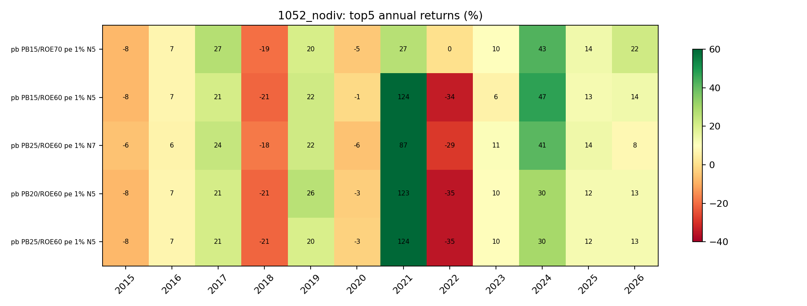
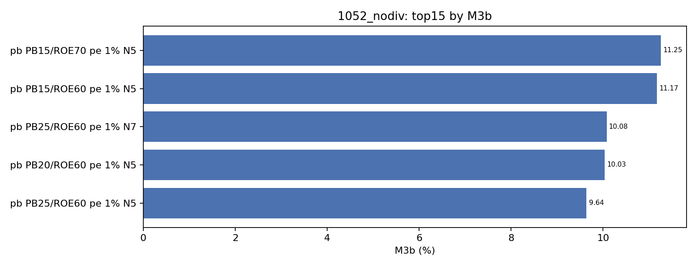

# 1052 × 非股息：标准网格（2026-11）

> 池：1052；首买：2015-05；主指标：M3b。

## 0. 结论

- 最佳：`pb PB15/ROE70 pe 1% N5`
- M3b **11.25%**，M1 12.37%，夏普 0.401，回撤 -34.4%

## 1. 网格

121 组标准网格；过滤 7 种、排名 5 种、PB 0.1, 0.15, 0.2, 0.25, 0.3, 0.35, 0.4、ROE 0.55, 0.6, 0.65, 0.7, 0.75, 0.8, 0.85, 0.9、裁尾 ['0.0', '0.005', '0.01', '0.015', '0.02', '0.025', '0.03', '0.04', '0.05', 'raw']、N 1, 2, 3, 4, 5, 6, 7, 8, 9, 10。

## 2. Top 10

| # | 配置 | M3b | M1 | 夏普 | 回撤 |
|---:|---|---:|---:|---:|---:|
| 1 | pb PB15/ROE70 pe 1% N5 | 11.25% | 12.37% | 0.401 | -34.4% |
| 2 | pb PB15/ROE60 pe 1% N5 | 11.17% | 12.26% | 0.377 | -44.9% |
| 3 | pb PB25/ROE60 pe 1% N7 | 10.08% | 11.10% | 0.351 | -37.9% |
| 4 | pb PB20/ROE60 pe 1% N5 | 10.03% | 11.16% | 0.331 | -45.7% |
| 5 | pb PB25/ROE60 pe 1% N5 | 9.64% | 10.75% | 0.314 | -45.6% |
| 6 | pb PB25/ROE60 pe 1% N5 | 9.64% | 10.75% | 0.314 | -45.6% |
| 7 | pb PB25/ROE70 pe raw N5 | 9.32% | 10.39% | 0.322 | -35.4% |
| 8 | pb PB15/ROE65 pe 1% N5 | 9.23% | 10.47% | 0.312 | -36.4% |
| 9 | pb PB25/ROE55 pe 1% N5 | 9.15% | 10.30% | 0.298 | -43.8% |
| 10 | pb PB25/ROE55 pe raw N5 | 9.15% | 10.30% | 0.298 | -43.8% |

## 3. Top5 年度收益





## 4. 2026 持仓

601838成都银行、600919江苏银行、600926杭州银行、601128常熟银行、600036招商银行

## 5. 本格子的特殊情况

- union 池含历史清单，仍有成分股回推偏差；
- 银行/钢铁集中度高，2015 银行股灾、2019/2022 钢铁是主要亏损来源；
- 非股息版没有分红信息，2026 持仓含 5 只银行。

## 6. 复现
```bash
cd backtesting
../.venv/bin/python run_matrix_cell.py --pool union --mode div --out ../data/processed/backtesting/matrix_20261121/1052_nodiv
```
