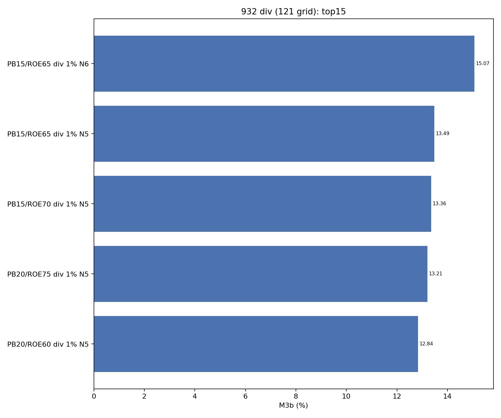
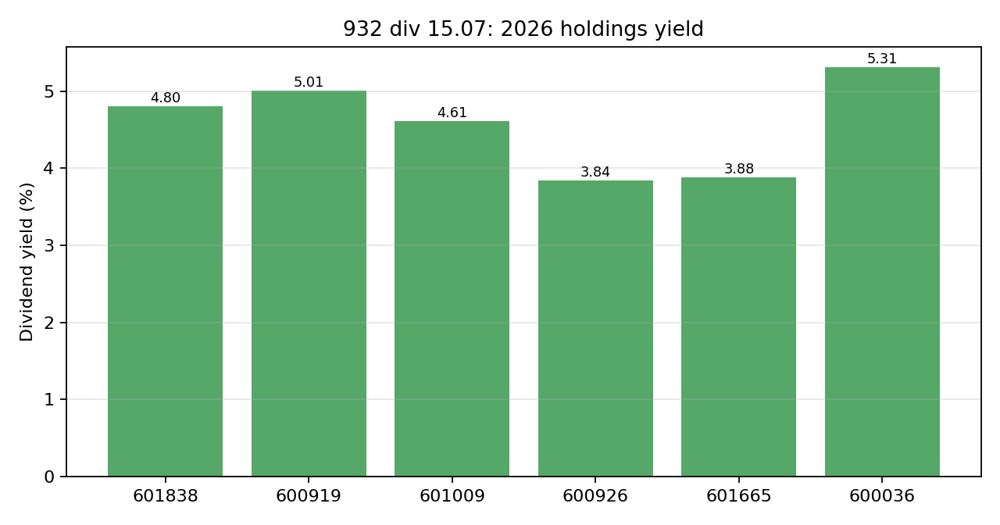

# 932 × 股息：121 组标准网格 + 15 组 pilot（2026-11）

> 池：932；首买：2015-05；主指标：M3b。

## 0. 结论

- **推荐：PB15/ROE65 + 股息率 + N6**，M3b **15.07%**，M1 14.62%，夏普 0.568，回撤 -34.2%。
- 这是 121 组标准网格的最高值，优于 15 组 pilot 的 14.79%（ROE60）/ 13.80%（ROE65）。
- 代价：N6、回撤 -34.2%（比 13.80 的 -32.8% 略深），但收益和夏普都更高。

## 1. 网格

本次跑了两套：

- **121 组标准网格**：与非股息格同一套 spec（过滤/排名/PB/ROE/裁尾/N 的阶段网格），排名改为 `div`；
- **15 组 pilot**：PB10-15-20 × ROE60-80，N5，用于补充标准网格没覆盖的 PB10 区域。

121 组最佳是 PB15/ROE65/N6；pilot 最佳是 PB10/ROE60（14.79%），但 ROE60 是 pilot 下边界，且 N5，收益略低。

## 2. 121 组 Top 5

| # | 配置 | M3b | M1 | 夏普 | 回撤 |
|---:|---|---:|---:|---:|---:|
| 1 | pb PB15/ROE65 div 1% **N6** | **15.07%** | 14.62% | 0.568 | -34.2% |
| 2 | pb PB15/ROE65 div 1% N5 | 13.49% | 13.09% | 0.487 | -32.8% |
| 3 | pb PB15/ROE70 div 1% N5 | 13.36% | 12.96% | 0.500 | -32.8% |
| 4 | pb PB20/ROE75 div 1% N5 | 13.21% | 12.82% | 0.516 | -32.8% |
| 5 | pb PB20/ROE60 div 1% N5 | 12.84% | 12.46% | 0.472 | -33.0% |

15 组 pilot 的补充：PB10/ROE60 14.79%（-32.8%）、PB10/ROE65 13.80%（-32.8%）。

## 3. Top5 年度收益




### 3.1 净值与回撤（121 组最佳 15.07%）


## 4. 2026 持仓（121 组最佳，6 只银行）

| 股票 | 权重 | 股息率 |
|---|---:|---:|
| 600919 江苏银行 | 17.3% | 5.01% |
| 601009 南京银行 | 16.7% | 4.61% |
| 600036 招商银行 | 16.2% | 5.31% |
| 601665 齐鲁银行 | 16.7% | 3.88% |
| 600926 杭州银行 | 16.5% | 3.84% |
| 601838 成都银行 | 16.6% | 4.80% |

组合股息率约 **4.57%**。

### 4.3 股息率



pilot ROE65 版的组合股息率历史（仅作参考，不是 15.07 这条）：


## 5. 本格子的特殊情况

- **legacy 单期清单**：幸存者偏差最重，932 的绝对收益不能直接外推到未来。
- **股息率 TTM**：用“预案公告日 + 最终实施金额”，隐含“预案≈实施”；paid 口径（只算已派息）对 pilot ROE65 是 11.48%（M1）/11.83%（M3b），仍高于无股息 10.73%/11.05%。121 组最佳 15.07 没有单独做 paid 审计。
- **N6**：15.07 用 6 只持仓，和非股息格的 N5 不完全同口径；如果强制 N5，最佳是 13.49%。
- **2021/2022**：pilot ROE65 的 2021 从无股息的 56% 降到 28%、2022 从 -22.9% 升到 +7.4%，波动下降；121 组最佳 15.07 的路径未单独拆解。
- **2026 持仓**：6 只银行，行业集中度高。

## 6. 复现

```bash
cd backtesting
../.venv/bin/python run_matrix_cell_fast.py --pool legacy --mode div --workers 4 \
  --out ../data/processed/backtesting/matrix_20261121/932_div
# 单策略
../.venv/bin/python run_backtest.py --frequency annual --ranking div \
  --filter_indicators pb --pb_threshold 0.15 --roe_threshold 0.65 \
  --threshold_trim_ratio 0.01 --max_positions 6 \
  --ignore_first_cutoff_new_stock --end_date 2026-11-06
```
