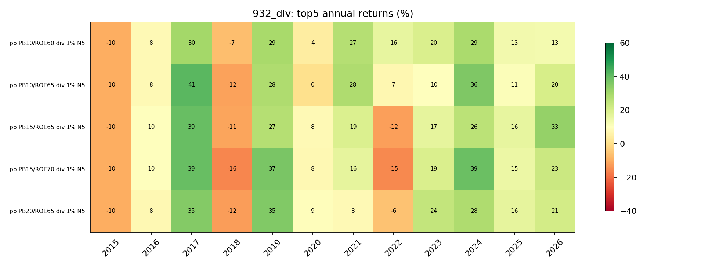

# 932 × 股息：标准网格（2026-11）

> 池：932；首买：2015-05；主指标：M3b。

## 0. 结论

- 最佳：`pb PB10/ROE60 div 1% N5`
- M3b **14.79%**，M1 14.35%，夏普 0.568，回撤 -32.8%
- **注意：ROE60 是网格下边界**，M3b 最高但回撤更深；风险调整推荐 PB10/ROE65（1052 15.53% / -32.8%，932 13.80% / -32.8%）。

## 1. 网格

15 组股息 pilot 网格（PB10-20 × ROE60-80；全量 121 组待补）；过滤 1 种、排名 1 种、PB 0.1, 0.15, 0.2、ROE 0.6, 0.65, 0.7, 0.75, 0.8、裁尾 ['0.01']、N 5。

## 2. Top 10

| # | 配置 | M3b | M1 | 夏普 | 回撤 |
|---:|---|---:|---:|---:|---:|
| 1 | pb PB10/ROE60 div 1% N5 | 14.79% | 14.35% | 0.568 | -32.8% |
| 2 | pb PB10/ROE65 div 1% N5 | 13.80% | 13.39% | 0.516 | -32.8% |
| 3 | pb PB15/ROE65 div 1% N5 | 13.49% | 13.09% | 0.487 | -32.8% |
| 4 | pb PB15/ROE70 div 1% N5 | 13.36% | 12.96% | 0.500 | -32.8% |
| 5 | pb PB20/ROE65 div 1% N5 | 13.28% | 12.88% | 0.496 | -32.8% |
| 6 | pb PB20/ROE75 div 1% N5 | 13.21% | 12.82% | 0.516 | -32.8% |
| 7 | pb PB20/ROE70 div 1% N5 | 12.89% | 12.51% | 0.468 | -32.8% |
| 8 | pb PB20/ROE60 div 1% N5 | 12.84% | 12.46% | 0.472 | -33.0% |
| 9 | pb PB15/ROE60 div 1% N5 | 11.79% | 11.44% | 0.417 | -33.0% |
| 10 | pb PB10/ROE70 div 1% N5 | 10.89% | 10.57% | 0.424 | -32.8% |

## 3. Top5 年度收益




## 4. 2026 持仓

600919江苏银行、601009南京银行、601577长沙银行、600741华域汽车、600036招商银行

## 5. 本格子的特殊情况

- 同样有 legacy 单期清单的幸存者偏差；
- 股息率 TTM 同样隐含“预案≈实施”；
- paid 口径 11.48%（M1）/11.83%（M3b），仍高于无股息 10.73%/11.05%；
- 2021 从 56% 降到 28%，2022 从 -22.9% 升到 +7.4%，波动明显下降；
- 2026 持仓为江苏/南京/齐鲁/招商/常熟。

## 6. 复现
```bash
cd backtesting
../.venv/bin/python run_matrix_cell.py --pool legacy --mode div --out ../data/processed/backtesting/matrix_20261121/932_div
```
