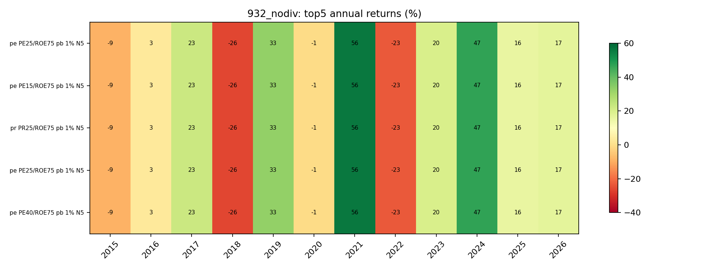
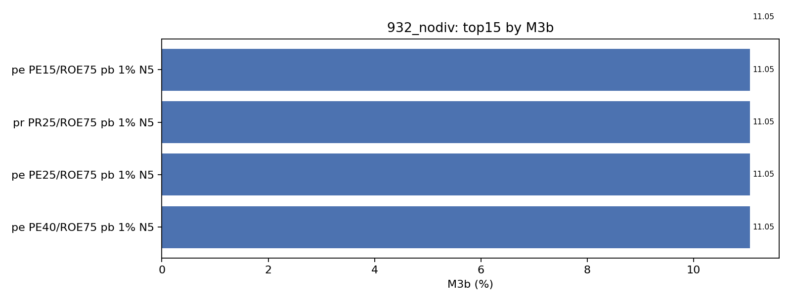

# 932 × 非股息：标准网格（2026-11）

> 池：932；首买：2015-05；主指标：M3b。

## 0. 结论

- 最佳：`pe PE25/ROE75 pb 1% N5`
- M3b **11.05%**，M1 12.55%，夏普 0.392，回撤 -33.8%

## 1. 网格

121 组标准网格；过滤 7 种、排名 5 种、PB 0.1, 0.15, 0.2, 0.25, 0.3, 0.35, 0.4、ROE 0.55, 0.6, 0.65, 0.7, 0.75, 0.8, 0.85, 0.9、裁尾 ['0.0', '0.005', '0.01', '0.015', '0.02', '0.025', '0.03', '0.04', '0.05', 'raw']、N 1, 2, 3, 4, 5, 6, 7, 8, 9, 10。

## 2. Top 10

| # | 配置 | M3b | M1 | 夏普 | 回撤 |
|---:|---|---:|---:|---:|---:|
| 1 | pe PE25/ROE75 pb 1% N5 | 11.05% | 12.55% | 0.392 | -33.8% |
| 2 | pe PE15/ROE75 pb 1% N5 | 11.05% | 12.55% | 0.392 | -33.8% |
| 3 | pr PR25/ROE75 pb 1% N5 | 11.05% | 12.55% | 0.392 | -33.8% |
| 4 | pe PE25/ROE75 pb 1% N5 | 11.05% | 12.55% | 0.392 | -33.8% |
| 5 | pe PE40/ROE75 pb 1% N5 | 11.05% | 12.55% | 0.392 | -33.8% |
| 6 | pe PE35/ROE75 pb 1% N5 | 11.05% | 12.55% | 0.392 | -33.8% |
| 7 | pe PE30/ROE75 pb 1% N5 | 11.05% | 12.55% | 0.392 | -33.8% |
| 8 | pe PE20/ROE75 pb 1% N5 | 11.05% | 12.55% | 0.392 | -33.8% |
| 9 | pe PE25/ROE75 pb 1% N5 | 11.05% | 12.55% | 0.392 | -33.8% |
| 10 | pe+pr PE25/PR25/ROE75 pb 1% N5 | 11.05% | 12.55% | 0.392 | -33.8% |

## 3. Top5 年度收益





## 4. 2026 持仓

601838成都银行、600926杭州银行、601128常熟银行、601319中国人保、601601中国太保

## 5. 本格子的特殊情况

- legacy 是单期旧清单，幸存者偏差最重；
- 2021 年 +56%（妖股/周期）与 2022 年 -22.9% 是同一批高波动持仓；
- 2026 持仓含成都/杭州/常熟/人保/太保，银行+保险。

## 6. 复现
```bash
cd backtesting
../.venv/bin/python run_matrix_cell.py --pool legacy --mode div --out ../data/processed/backtesting/matrix_20261121/932_nodiv
```
