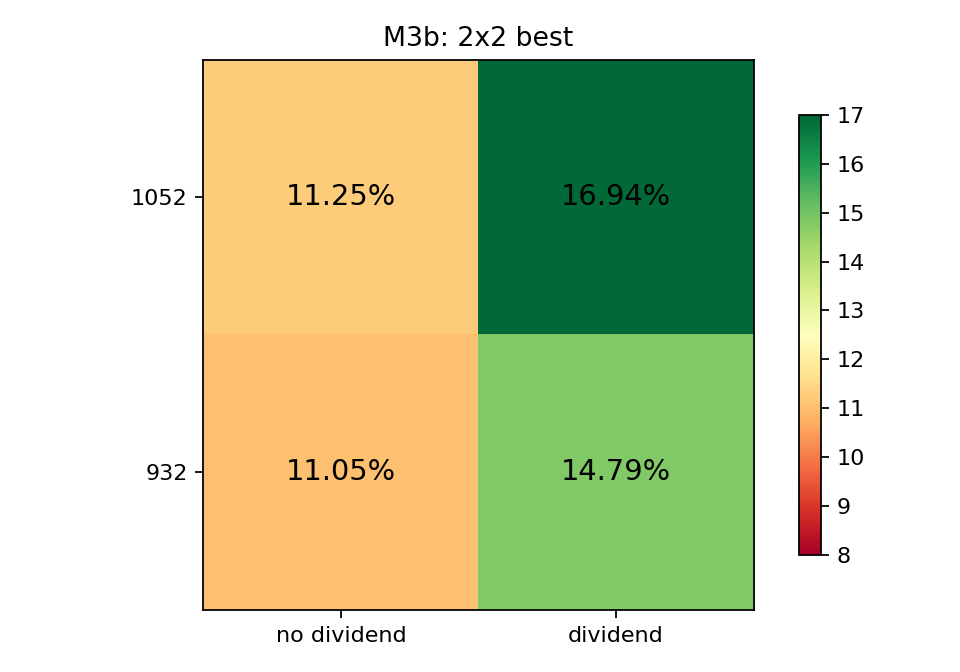
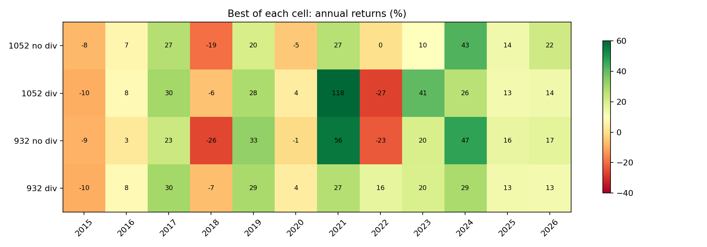

# 2×2 汇总：1052/932 × 股息/非股息（2026-11）

> 主指标 M3b；非股息 121 组标准网格，股息 15 组 pilot；首买 2015-05。

## 0. 四宫格最佳

| 格子 | 最佳配置 | M3b | M1 | 夏普 | 回撤 |
|---|---|---:|---:|---:|---:|
| 1052 × 非股息 | pb PB15/ROE70 pe 1% N5 | 11.25% | 12.37% | 0.401 | -34.4% |
| 1052 × 股息 | pb PB10/ROE60 div 1% N5 | 16.94% | 16.43% | 0.628 | -41.4% |
| 932 × 非股息 | pe PE25/ROE75 pb 1% N5 | 11.05% | 12.55% | 0.392 | -33.8% |
| 932 × 股息 | pb PB10/ROE60 div 1% N5 | 14.79% | 14.35% | 0.568 | -32.8% |

### 推荐（风险调整）

| 格子 | 推荐配置 | M3b | 回撤 |
|---|---|---:|---:|
| 1052 × 股息 | PB10/ROE65 + 股息率 | **15.53%** | -32.8% |
| 932 × 股息 | PB10/ROE65 + 股息率 | **13.80%** | -32.8% |

> 表 0 的 16.94% / 14.79% 是 ROE60 边界值：2021 年 +118% / +27%、2022 年 -27% / +16%，回撤 -41.4% / -32.8%；这是 boom/bust 路径，不建议作为默认。默认用上面的 ROE65 版本。

## 1. 子报告

- [1052 × 非股息](matrix-1052-nodiv-2026-11.md)
- [1052 × 股息](matrix-1052-div-2026-11.md)
- [932 × 非股息](matrix-932-nodiv-2026-11.md)
- [932 × 股息](matrix-932-div-2026-11.md)

## 2. 跨格子观察

- 股息率版在 1052 和 932 都提高了 M3b；但 2023-2026 无股息版反超，属于阶段性因子。
- 932 的绝对收益更低、波动更大；legacy 单期清单的幸存者偏差最重。
- 非股息格子是 121 组标准网格；股息格子目前是 15 组 pilot（覆盖 PB10-20/ROE60-80），全量 121 组可后续补齐。
- 股息格的最高 M3b 落在 ROE60 边界，回撤更深；风险调整建议用 PB10/ROE65（1052 15.53% / 932 13.80%，回撤 -32.8%）。
- 股息率版的“预案≈实施”假设需要持续监控；paid 口径是保守下界。

## 3. 数据与口径

- 价格/财务：2026-11-20 快照，统一截止 2026-11-06。
- 股息率：AkShare 分红面板 2014-2025，TTM = 过去 365 天预案分红 / 4·30 close_na。
- M3b = 2015-05-04 起算；M1/M2/M3 仅辅助。