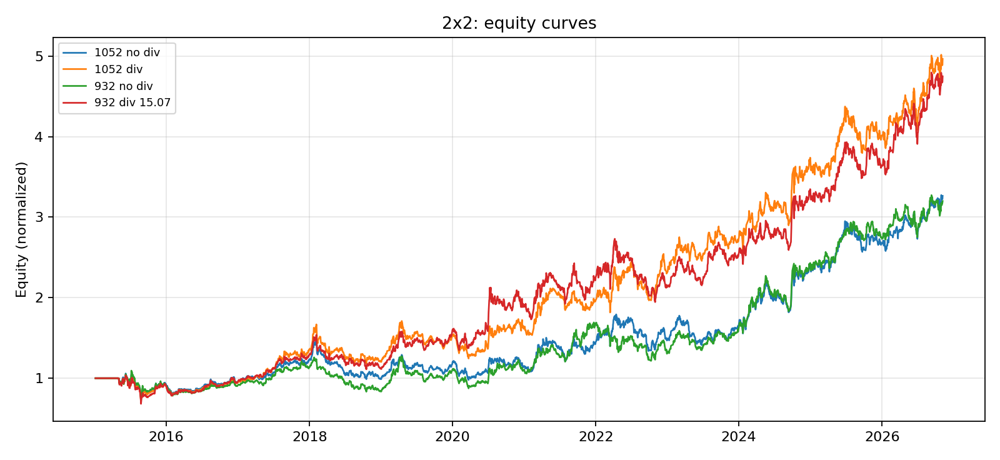

# 2×2 汇总：1052/932 × 股息/非股息（2026-11）

> 主指标 M3b；非股息 121 组；股息 121 组 + 15 组 pilot；首买 2015-05。

## 0. 四宫格推荐

| 格子 | 推荐配置 | M3b | M1 | 夏普 | 回撤 |
|---|---|---:|---:|---:|---:|
| 1052 × 非股息 | pb PB15/ROE70 pe 1% N5 | 11.25% | 12.37% | 0.401 | -34.4% |
| 1052 × 股息 | pb PB10/ROE65 div 1% N5 | **15.53%** | 15.07% | 0.593 | -32.8% |
| 932 × 非股息 | pe PE25/ROE75 pb 1% N5 | 11.05% | 12.55% | 0.392 | -33.8% |
| 932 × 股息 | pb PB15/ROE65 div 1% **N6** | **15.07%** | 14.62% | 0.568 | -34.2% |

> **1052 股息**：121 标准网格最佳 13.90%（PB35/ROE75），但 pilot 的 PB10/ROE65 15.53% 更高、夏普更好，所以推荐 15.53%；ROE60 的 16.94% 是边界值（2021 +118%，中绿电 +365%、+73pp；2022 -27%，回撤 -41.4%），不作默认。
>
> **932 股息**：121 标准网格最佳 **15.07%**（PB15/ROE65/N6），高于 pilot 的 14.79%/13.80%，所以 932 改用 15.07%。

## 1. 子报告

- [1052 × 非股息](matrix-1052-nodiv-2026-11.md)
- [1052 × 股息](matrix-1052-div-2026-11.md)
- [932 × 非股息](matrix-932-nodiv-2026-11.md)
- [932 × 股息](matrix-932-div-2026-11.md)

## 2. 四格当前持仓对比（2026-05-06）

| 格子 | 持仓 |
|---|---|
| 1052 × 非股息 | 成都银行、江苏银行、杭州银行、常熟银行、招商银行 |
| 1052 × 股息（ROE65） | 江苏银行、南京银行、齐鲁银行、招商银行、成都银行 |
| 932 × 非股息 | 成都银行、杭州银行、常熟银行、中国人保、中国太保 |
| 932 × 股息（15.07%，N6） | 成都银行、江苏银行、南京银行、杭州银行、齐鲁银行、招商银行 |

- 1052 两个格子都偏银行；股息版把杭州/常熟换成南京/齐鲁，股息率更高。
- 932 非股息含保险，股息版切到 6 只银行。
- 四个格子都没有离开“低估值 + 高 ROE + 银行/周期”这个风格。

### 2.1 净值与回撤

### 2.2 股息率

## 3. 跨格子观察

- 股息率版在 1052 和 932 都提高了 M3b；但 2023-2026 无股息版反超，属于阶段性因子。
- 932 的绝对收益更低、波动更大；legacy 单期清单的幸存者偏差最重。
- 非股息、股息格子都跑了 121 组标准网格；股息额外补了 15 组 pilot（PB10-20/ROE60-80），用来覆盖标准网格没包含的 PB10 区域。
- 股息格的最高 M3b 落在 ROE60 边界，回撤更深；风险调整建议用 PB10/ROE65（1052 15.53% / 932 13.80%，回撤 -32.8%）。
- 股息率版的“预案≈实施”假设需要持续监控；paid 口径是保守下界。

## 4. 数据与口径

- 价格/财务：2026-11-20 快照，统一截止 2026-11-06。
- 股息率：AkShare 分红面板 2014-2025，TTM = 过去 365 天预案分红 / 4·30 close_na。
- M3b = 2015-05-04 起算；M1/M2/M3 仅辅助。