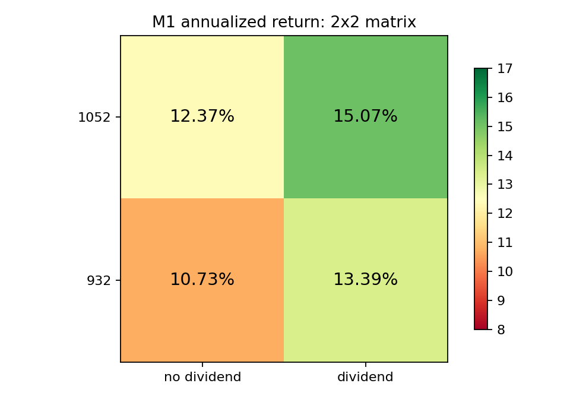
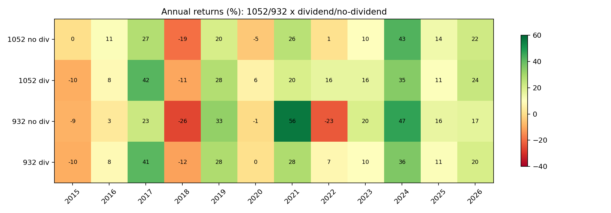
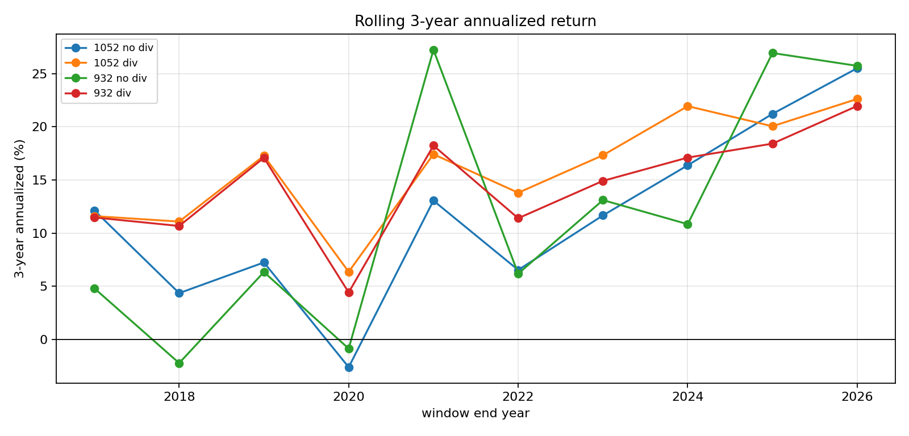
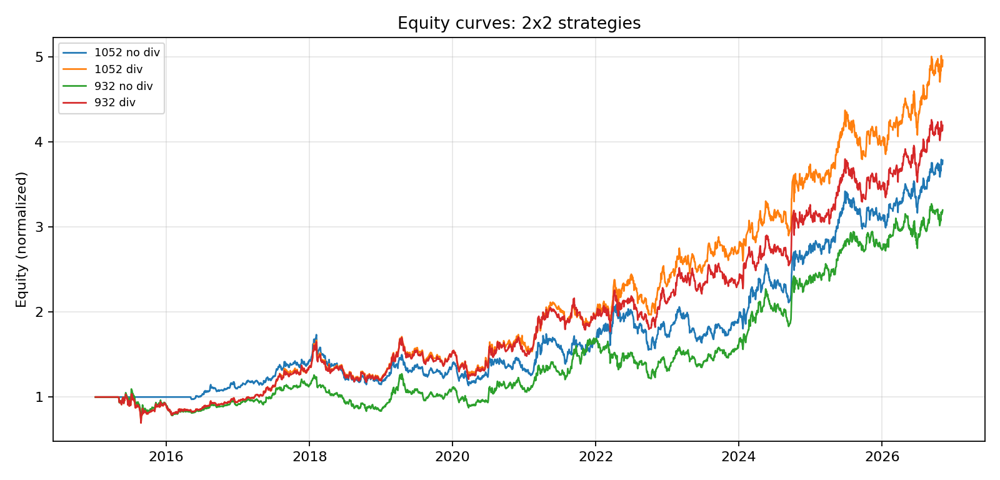
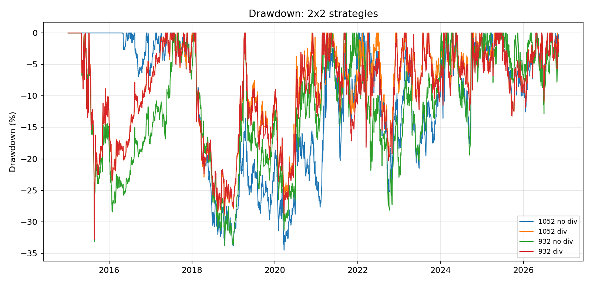
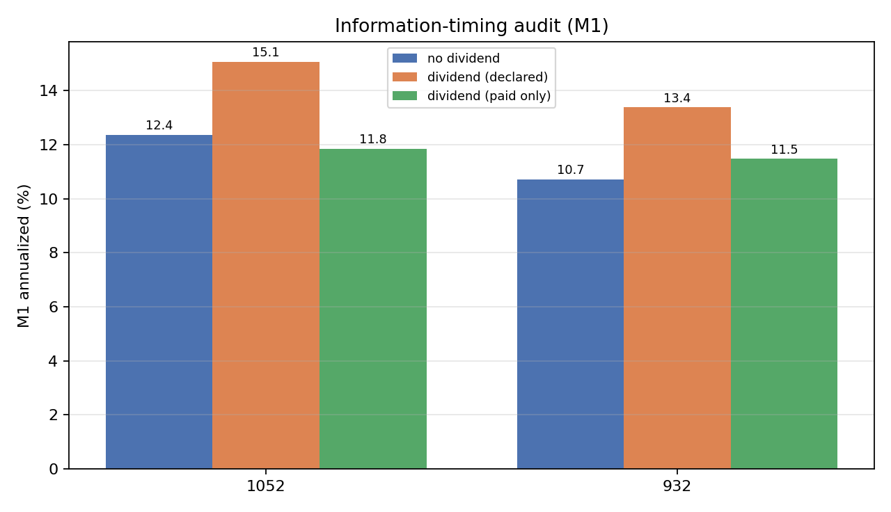

# 2×2 总览：1052 / 932 × 不用股息率 / 用股息率（2026-11）

> 数据：2026-11-20 快照，统一截止 2026-11-06。
> 四宫格：横向“不用股息率 / 用股息率”，纵向 1052 / 932。

## 0. 结论

1. **全期看，股息率版赢**：M1 口径，1052 从 12.37% 提到 15.07%，932 从 10.73% 提到 13.39%。
2. **但最近两年反过来了**：2023-2026、2024-2026 两段，两个池子都是“不用股息率”更高。
3. **信息时点审计**：只用已派息时，1052 股息率版 M1 11.85%，低于无股息版 12.37%；932 是 11.48%，高于 10.73%。所以审计不是全面通过。
4. **结论：暂不切换默认**。股息率版是强候选/第二因子，但还不是已经验证的替代品；默认仍用无股息版。
5. 如果只看 2015-2022，股息率版明显更强；2023 之后优势消失。这是“因子阶段性有效”，不是永久 alpha。



## 1. 四宫格定义

| 格子 | 池 | Step 2 | Step 3 | 排名 | 首买 |
|---|---|---|---|---|---|
| 1052 无股息 | union | PB < 15% | ROE > 70% | PE 最低 | 2016-05 |
| 1052 股息率 | union | PB < 10% | ROE > 65% | 股息率最高 | 2015-05 |
| 932 无股息 | legacy | PE < 25% | ROE > 75% | PB 最低 | 2015-05 |
| 932 股息率 | legacy | PB < 10% | ROE > 65% | 股息率最高 | 2015-05 |

> 1052 无股息是标准口径（2016 首买），所以它的 M3b 不适用；表中用 M1，M2 另列。

## 2. 指标矩阵

### 2.1 M1（2015 日历年，四个格子都可比）

| 池 | 不用股息率 | 用股息率 | 差 |
|---|---:|---:|---:|
| 1052 | 12.37% | **15.07%** | +2.70pp |
| 932 | 10.73% | **13.39%** | +2.66pp |

### 2.2 M3b / M2

| 池 | 不用股息率 | 用股息率 |
|---|---:|---:|
| 1052 | M3b 不适用；M2 14.05% | **M3b 15.53%** |
| 932 | M3b 11.05% | **M3b 13.80%** |

### 2.3 风险

| 池 | 不用股息率 夏普 / 回撤 | 用股息率 夏普 / 回撤 |
|---|---:|---:|
| 1052 | 0.516 / -34.5% | **0.593 / -32.8%** |
| 932 | 0.392 / -33.8% | **0.516 / -32.8%** |

## 3. 年度收益热力图



| 年份 | 1052 无 | 1052 股息 | 932 无 | 932 股息 |
|---|---:|---:|---:|---:|
| 2015 | 0.0% | -9.6% | -9.1% | -9.6% |
| 2016 | +10.8% | +8.4% | +3.2% | +8.4% |
| 2017 | +27.2% | **+41.9%** | +22.7% | **+41.4%** |
| 2018 | -19.4% | **-10.9%** | -26.1% | **-11.6%** |
| 2019 | +20.2% | **+27.5%** | +32.7% | +28.3% |
| 2020 | -4.7% | **+5.9%** | -0.6% | +0.3% |
| 2021 | +26.1% | +19.9% | **+56.1%** | +28.3% |
| 2022 | +0.6% | **+16.1%** | -22.9% | **+7.4%** |
| 2023 | +9.8% | **+16.0%** | **+20.1%** | +10.1% |
| 2024 | **+42.7%** | +34.6% | **+46.9%** | +35.8% |
| 2025 | **+13.7%** | +10.8% | **+15.8%** | +11.0% |
| 2026 | +21.8% | +23.6% | +16.8% | **+20.3%** |

- 股息率版在 2017/2018/2019/2022/2023 明显更好；
- 无股息版在 2021（932）、2024、2025 更好；
- 2023 之后，股息率版的优势基本消失。

## 4. Walk-forward

### 4.1 滚动 3 年



- 1052：2018-2022 的每个 3 年窗口，股息率版都高于无股息版；2024 之后无股息版反超。
- 932：2017-2022 股息率版领先；2023 之后无股息版反超。

### 4.2 扩展样本外（固定规则，不重新选参）

| 测试期 | 1052 无 | 1052 股息 | 932 无 | 932 股息 |
|---|---:|---:|---:|---:|
| 2020-2026 | 14.77% | **17.82%** | **16.19%** | 15.62% |
| 2021-2026 | 18.38% | **19.94%** | **19.25%** | 18.38% |
| 2022-2026 | 16.90% | **19.94%** | 12.99% | **16.48%** |
| 2023-2026 | **21.37%** | 20.93% | **24.30%** | 18.88% |
| 2024-2026 | **25.50%** | 22.61% | **25.72%** | 21.95% |

**读法**：越靠下，越是“最近”的样本。2022 以前股息率版赢，2023 以后无股息版赢。

### 4.3 净值与回撤





## 5. 信息时点审计

| 池 | 无股息 M1 | 股息 declared M1 | 股息 paid M1 |
|---|---:|---:|---:|
| 1052 | **12.37%** | **15.07%** | 11.85% |
| 932 | 10.73% | **13.39%** | **11.48%** |



- 如果接受“大公司预案≈实施”，declared 是有效的，1052/932 都改善。
- 如果严格只用已派息，1052 反而低于无股息版；932 仍改善。
- 所以“审计通过”只在 declared 口径下成立；paid 口径下 1052 不通过。

## 6. 2026 持仓

| 格子 | 持仓 |
|---|---|
| 1052 无股息 | 成都银行、江苏银行、杭州银行、常熟银行、招商银行 |
| 1052 股息率 | 江苏银行、南京银行、齐鲁银行、招商银行、成都银行 |
| 932 无股息 | 成都银行、杭州银行、常熟银行、中国人保、中国太保 |
| 932 股息率 | 江苏银行、南京银行、齐鲁银行、招商银行、常熟银行 |

## 7. 结论与默认

- **全期**：股息率版更强（M1 +2.7pp；M3b 15.53/13.80）。
- **最近两年**：无股息版更强（2023-2026、2024-2026 两个池子都是）。
- **严格审计**：paid 口径下 1052 不通过，932 通过。
- **建议**：默认仍用“1052 PB15/ROE70 + PE”或“932 PE25/ROE75 + PB”；股息率版作为**候选/第二排序因子**，不建议现在整体替换。
- 如果你更看重 2015-2022 的规律、并接受 declared 口径，可以把 1052 换成“PB10/ROE65 + 股息率”；但要知道 2023 之后它没有超额。

## 8. 复现

```bash
cd backtesting
../.venv/bin/python build_strategy_matrix.py   # 跑四宫格
../.venv/bin/python run_backtest.py --frequency annual --ranking div \
  --filter_indicators pb --pb_threshold 0.10 --roe_threshold 0.65 \
  --threshold_trim_ratio 0.01 --ignore_first_cutoff_new_stock \
  --dividend_mode declared --end_date 2026-11-06
```

数据：`data/processed/backtesting/strategy_matrix_20261121/`。
