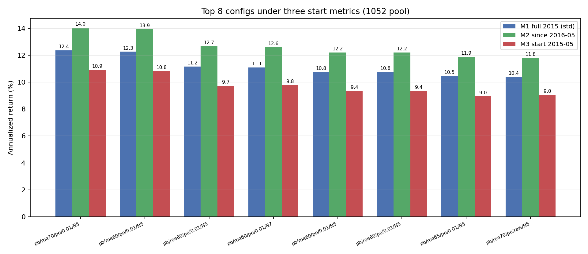
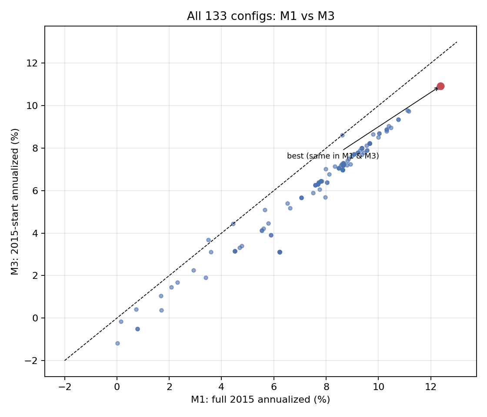

# 三个起点口径：M1 / M2 / M3（2026-11）

> 背景：原来的年化 M1 从 2015-01-05 开始算，但 2015 年因为“新股过滤 + 数据起点”误判，全年空仓，收益 0。
> 这引出两个补充口径：从首次建仓起算（M2），以及让 2015 年也能建仓后从 2015 起算（M3）。
> 本文回答：按 M2 / M3 排名，最好的策略还是不是原来那个。

---

## 0. 结论

1. **M2 不改变排序。** 它只是把 M1 的时间轴从 2015-01 平移到 2016-05，所有标准回测共享同一个首次建仓日，Spearman 相关系数 **0.9999**，前几名完全一致。
2. **M3 也不改变第一名。** 2015 起投后，最佳仍是 **PB15 + ROE70 + PE 排名 + 裁尾 1% + N=5**，只是年化从 **12.37%** 降到 **10.92%**（建仓以来 11.25%）。
3. M3 与 M1 的排序相关 **0.9784**，前 10 名重叠 **9/10**；主要变化是 N5 与 N7 互换，以及少数“2015 年没怎么持仓”的配置排名上升。
4. **M3 的差异几乎全部来自 2015 年 5-12 月的股灾。** 最佳配置 2015 年收益 **-7.91%**，把全期年化拉低约 1.45pp。
5. 建议：**M1 做主比较，M2 用于披露“满仓以来”，M3 只做稳健性检查**；不要单独用 M3 选参数，否则会奖励“2015 年空仓”这种 regime 效应。



---

## 1. 三个指标的定义

| 指标 | 含义 | 起点 | 对应代码 |
|---|---|---|---|
| **M1** | 原报告口径，含 2015 空仓 | 2015-01-05 | `annual_return` |
| **M2** | 标准回测中从首次建仓起算 | 2016-05-03 | `annual_return_since_first_investment` |
| **M3** | 2015 首个截面跳过新股过滤后的回测，全期口径 | 2015-01-05（首次建仓 2015-05-04） | 2015-start 回测的 `annual_return` |
| **M3b** | 2015 起投版本中从首次建仓起算 | 2015-05-04 | 2015-start 的 `annual_return_since_first_investment` |

M1 与 M2 的换算关系（同一批标准回测）：

```text
M2 = (1 + M1) ** (2877 / 2554) - 1
```

2877 是 2015-01-05 到 2026-11-06 的交易日数，2554 是 2016-05-03 到 2026-11-06 的交易日数。因为是单调变换，**排序不变**。

---

## 2. 为什么 2015 原来是 0，以及怎么修

`is_new_stock()` 用价格文件里的最早日期当作上市日。回测价格数据从 2015-01-05 开始，2015-04-30 距起点只有约 79 个估算交易日 < 120，所以**所有股票都被判定为新股**，2015 年选股为空。

修复方式是只对**第一个截面**跳过新股过滤：

- 选股层：`select_stocks(..., ignore_new_stock=True)`
- 买入执行层：同样跳过 `is_new_stock` 检查（否则选出来也买不进）
- CLI：
  - `run_backtest.py --ignore_first_cutoff_new_stock`
  - `universe_compare.py --ignore-first-new-stock`

修复后 2015-04-30 截面：

- 558 只有正估值
- PB25% / ROE75% 下 Step2 140 只、Step3 27 只
- 2015-05-04 建仓，最佳配置买的是：工商银行、农业银行、浦发银行、建设银行、兴业银行

2015 年 5-12 月这批银行下跌，最佳配置 2015 年收益 **-7.91%**。

---

## 3. 三口径下的前 10 名

按 M1 排序（1052 池，133 组去重后前 10）：

| 条件 | M1 | M2 | M3 | M3b | 2015 |
|---|---:|---:|---:|---:|---:|
| PB15 / ROE70 / pe / 1% / N5 | **12.37%** | **14.05%** | **10.92%** | **11.25%** | -7.91% |
| PB15 / ROE60 / pe / 1% / N5 | 12.26% | 13.93% | 10.84% | 11.17% | -7.91% |
| PB20 / ROE60 / pe / 1% / N5 | 11.16% | 12.68% | 9.73% | 10.03% | -7.91% |
| PB25 / ROE60 / pe / 1% / N7 | 11.10% | 12.60% | 9.78% | 10.08% | -5.98% |
| PB25 / ROE60 / pe / 1% / N5 | 10.75% | 12.21% | 9.35% | 9.64% | -7.91% |
| PB15 / ROE65 / pe / 1% / N5 | 10.47% | 11.89% | 8.95% | 9.23% | -7.91% |
| PB25 / ROE70 / pe / raw / N5 | 10.39% | 11.80% | 9.05% | 9.32% | -7.91% |
| PB15 / ROE65 / pe / 1% / N6 | 10.31% | 11.70% | 8.79% | 9.06% | -7.48% |
| PB25 / ROE55 / pe / 1% / N5 | 10.30% | 11.69% | 8.87% | 9.15% | -7.91% |
| PB25 / ROE70 / pe / 1% / N5 | 10.03% | 11.39% | 8.69% | 8.96% | -7.91% |

三口径的第一名都是同一个配置。

按 M3 排序时，前 8 名里只有 N5 与 N7 互换：

- M3 第 1：PB15 / ROE70 / pe / 1% / N5（10.92%）
- M3 第 2：PB15 / ROE60 / pe / 1% / N5（10.84%）
- M3 第 3：PB25 / ROE60 / pe / 1% / N7（9.78%）
- M3 第 4：PB20 / ROE60 / pe / 1% / N5（9.73%）

---

## 4. 排名变化

| 统计 | 数值 |
|---|---:|
| M1 vs M2 Spearman | 0.9999 |
| M1 vs M3 Spearman | 0.9784 |
| M1 前 10 与 M3 前 10 重叠 | 9 / 10 |
| M1 第一名与 M3 第一名 | 同一配置 |

排名变化最大的几类：

- **M3 下大幅上升**：`q3` 调仓（M1 第 66 → M3 第 15）。原因是它 2015 年 10 月才第一次建仓，5-9 月空仓，躲过了股灾；这不是选股能力，是 regime 效应。
- **M3 下明显下降**：纯 PB（pure_pb，第 102 → 第 118）。它 2015 年满仓低 PB 股，股灾损失更大。
- **N=7** 在 M3 下略好于 N=5，因为 2015 年单只权重更低、损失略小；但在 M1 下 N=5 更好。



散点全部在 45° 线下方，说明 2015 起投对几乎所有配置都是负贡献；但斜率接近 1，排序结构基本保留。

---

## 5. 持仓数 N 的三口径对比

| N | M1 | M3 | M3b |
|---:|---:|---:|---:|
| 1 | 0.15% | -0.16% | -0.16% |
| 2 | 1.69% | 1.05% | 1.08% |
| 3 | 5.65% | 5.10% | 5.25% |
| 4 | 6.51% | 5.40% | 5.56% |
| **5** | **9.37%** | **8.00%** | **8.25%** |
| 6 | 9.80% | 8.65% | 8.91% |
| 7 | 8.82% | 7.42% | 7.64% |
| 8 | 8.12% | 6.78% | 6.98% |
| 9 | 7.98% | 7.02% | 7.24% |
| 10 | 7.84% | 6.44% | 6.64% |

注意：这里 N 扫描用的是 PB25/ROE75 + PE 排名配置（`positions` 阶段），不是最佳配置；但结论一致——N5/N6 最好，N1-N4 仓位不足。

---

## 6. 建议

1. **继续用 M1 做主比较**：它和 932 旧记录、历史报告一致，便于横向对比。
2. **报告里同时给 M2**：这是“真正满仓以来”的收益，比 M1 高约 1.2-1.7pp，更适合对外表述。
3. **M3 作为稳健性检查**：如果某个配置只在 M1 好、M3 明显掉队，说明它依赖 2015 年之后的样本；但不要因为 M3 奖励“2015 空仓”就去选 q3 或低仓位。
4. 下一轮 2027-04 更新时，三个口径可以一起出：M1 主表、M2 附加列、M3 作为附录。

---

## 7. 代码与复现

新增/修改：

- `performance.py`
  - `compute_since_first_investment()`：从首次买入日计算累计收益与年化
  - `calculate_performance()` 新增 `annual_return_since_first_investment` 等字段
  - `performance_summary.csv` 新增对应行
- `stock_selector.py`：`select_stocks(..., ignore_new_stock=False)`
- `backtest_engine.py`：`run_backtest(..., ignore_first_cutoff_new_stock=False)`
- `run_backtest.py`：`--ignore_first_cutoff_new_stock`
- `universe_compare.py`：`--ignore-first-new-stock`，并在 id 加 `_2015start`
- `enrich_summary_metrics.py`：给已有 `summary.csv` 补 M2（不重跑回测）
- `compare_three_metrics.py`：合并标准/2015 两套结果，输出三口径排名

复现：

```bash
cd backtesting

# 1) 2015 起投全量矩阵（1052 池，统一截止 2026-11-06）
../.venv/bin/python -c "
import config
config.PRICE_DATA_DIR='/tmp/bt_snapshot_20261120/price'
config.FINANCIAL_DATA_DIR='/tmp/bt_snapshot_20261120/financial'
import universe_compare as uc
uc.main()
" --pool union --end-date 2026-11-06 --ignore-first-new-stock \
  --output-root ../data/processed/backtesting/universe_compare_2015start_20261120

# 2) 给两套 summary 补 M2
../.venv/bin/python enrich_summary_metrics.py \
  --output-root ../data/processed/backtesting/universe_compare_20261107_101219
../.venv/bin/python enrich_summary_metrics.py \
  --output-root ../data/processed/backtesting/universe_compare_2015start_20261120

# 3) 三口径排名对比
../.venv/bin/python compare_three_metrics.py \
  --standard-root ../data/processed/backtesting/universe_compare_20261107_101219 \
  --start2015-root ../data/processed/backtesting/universe_compare_2015start_20261120 \
  --out ../data/processed/backtesting/universe_compare_2015start_20261120/three_metrics_comparison.csv
```

输出：

- 2015 起投汇总：[summary.csv](../data/processed/backtesting/universe_compare_2015start_20261120/summary.csv)
- 三口径对比：[three_metrics_comparison.csv](../data/processed/backtesting/universe_compare_2015start_20261120/three_metrics_comparison.csv)
- 图表：[three-metrics-2026-11](img/three-metrics-2026-11/)

---

## 8. 限制

1. 2015 是单一极端年份（股灾），M3 与 M1 的差异主要来自它，不能把 M3 当成“更正确”的收益。
2. 2015 首个截面的新股过滤是“忽略”，不是“精确修复”；真实上市日仍然未知，2015 年选出的股票里可能混有真正的新股。
3. 2015 起投只跑了 1052 池，932 池未跑；跨池结论仍以 M1 为准。
4. 数据用 2026-11-20 的快照，但统一截断到 2026-11-06，和已有结果可比；等另一 session 更新完，可以统一刷新到最新交易日。
