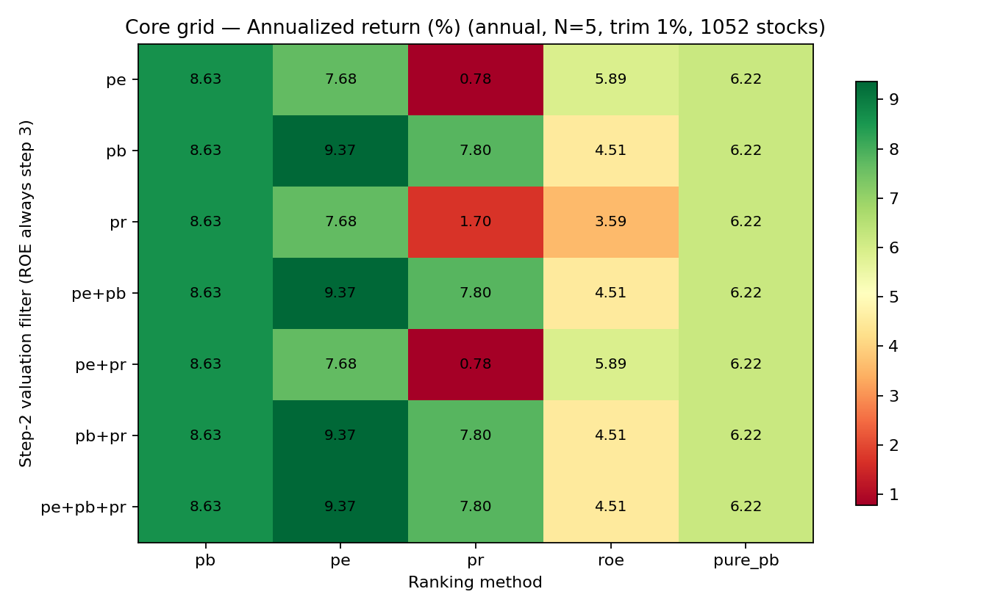
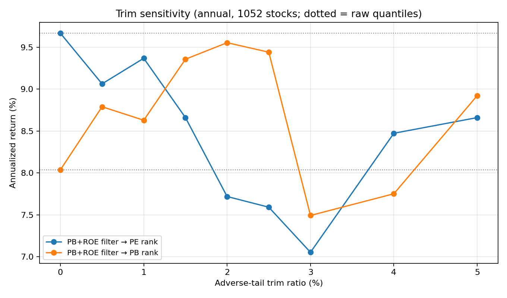
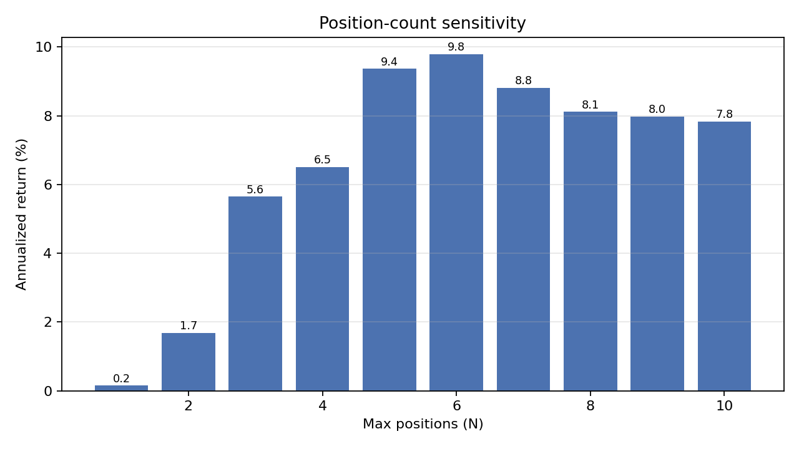
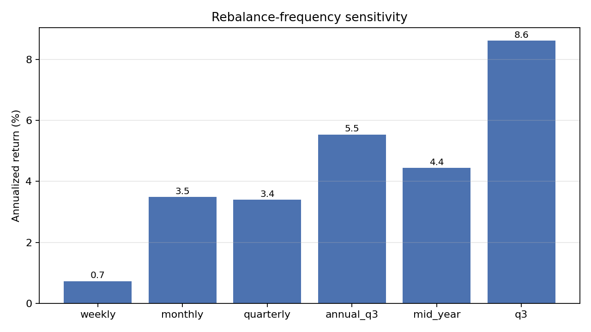
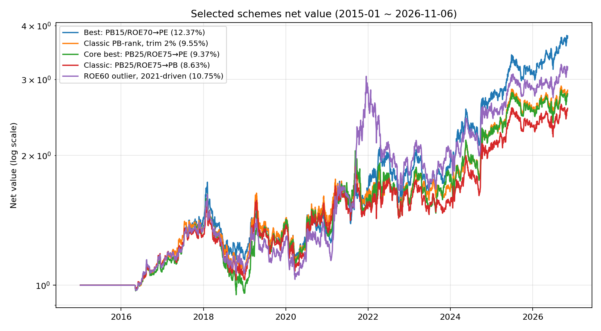
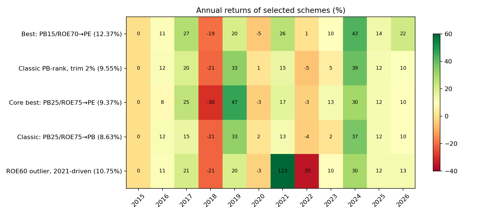

# 1052 只合并股票池：全角度回测对比与最佳选股方案

- 生成时间：2026-11-07 16:03
- 回测区间：2015-01-01 ~ 2026-11-06（今天为周六，实际最后交易日为 2026-11-06）
- 股票池：历史各期指数清单并集，去重后 **1052 只**
- 实验数量：137 组（含股票池口径校验；同参数重复项在排行榜中已去重）
- 成本：佣金 0.03%（最低 5 元）、印花税 0.1%（卖出）、滑点 0.1%、100 股整手
- 基准：报告只做策略间横向比较；引擎内置等权基准的实现有偏差，未用于结论
- 原始结果目录：`data/processed/backtesting/universe_compare_20261107_101219`

> 说明：用户提到的 1050 / 1032 只与当前配置实际加载的 1052 只不一致。
> 当前 `config.py` 合并 7 个指数池的全部历史清单（14 个文件），去重后 1053 只，
> 再排除 AkShare 无法取数的 689009，实际回测池为 **1052 只**。
> 本报告全部结论基于这 1052 只。

- 相关报告：932 旧池的同口径 131 组对比见 [universe-backtest-932-2026-11.md](universe-backtest-932-2026-11.md)。

## 1. 结论速览

1. **最佳方案**：`refine_union_annual_pb_pe_trim1pct_N5_pe0.15-pb0.15-pr0.25-roe0.7`。年化 **12.37%**，夏普 0.516，最大回撤 -34.51%，剔除最好年份后仍有 9.65%，正收益 9/11 年。它在收益、夏普、稳健性三个维度同时排第一。
2. **核心网格（年度、N=5、裁尾 1%）**：新池上 **PE 排名反超 PB 排名**（9.37% vs 8.63%），但 PE 排名回撤更深（-41.6% vs -33.9%）。过滤层里只要含 PB，选出的 5 只就完全相同，PE/PR 过滤是冗余的——真正决定结果的是排名方式。
3. **股票池扩容的影响**：旧 932 池 + 原始阈值 + PB 排名是 11.59%，同一套放到 1052 池只剩 8.04%；换成 PE 排名后回到 9.67%。扩容主要破坏了 PB 的相对排序，没有破坏“低 PE”这条线。
4. **经典方案在新池上的位置**：PB 排名 + 裁尾 2% 是 9.55%（回撤 -33.7%，比 PE 排名浅），高于新池同配置 1% 裁尾的 8.63%，但仍明显低于旧 932 池记录的 11.37%。如果更看重平滑度而不是最高年化，这仍是可用的默认值。
5. **风险提示**：12.37% 是全期参数扫描的产物，且当前 5 只持仓全是银行。近两年 20%+ 的年化有相当一部分来自银行估值修复，不能当作未来预期。

## 2. 股票池版本对比：932 → 953 → 1052

同一套参数（PB 过滤 + PE 排名、裁尾 1%、N=5）、同一段数据、同一截止日，只改变股票池版本，用于分离“指数清单扩容”本身的影响。

| 池子   |   股票数 | 过滤   | 排名   |   裁尾 |   N | 年化   |   夏普 | 最大回撤   |   平均持仓 |
|:-------|---------:|:-------|:-------|-------:|----:|:-------|-------:|:-----------|-----------:|
| legacy |      932 | pb     | pe     |   0.01 |   5 | 9.20%  |  0.385 | -41.49%    |        4.8 |
| latest |      953 | pb     | pe     |   0.01 |   5 | 8.98%  |  0.343 | -37.95%    |        5   |
| union  |     1052 | pb     | pe     |   0.01 |   5 | 9.37%  |  0.356 | -41.63%    |        5.1 |

口径校验：旧 932 池 + 原始阈值（不裁尾）+ 数据截止 2026-04-30，复现年化 **11.37%**、夏普 0.5025、最大回撤 -40.34%，与历史记录 11.37% / 0.5025 / -40.34% 完全一致。说明本次重跑与旧结论可直接对比。

关键发现：股票池扩容对 **PB 排名**的伤害远大于 PE 排名。用原始阈值（不裁尾）比较：旧 932 池 + PB 排名是 11.59%，同一套放到 1052 池只剩 8.04%；换成 PE 排名后回到 9.67%。新进池的股票改变了 PB 的相对排序，但没有改变“低 PE”这一条线。

## 3. 核心网格：Step2 过滤 × 排名方式

| Step2 过滤   | pb    | pe    | pr    | roe   | pure_pb   |
|:-------------|:------|:------|:------|:------|:----------|
| pe           | 8.63% | 7.68% | 0.78% | 5.89% | 6.22%     |
| pb           | 8.63% | 9.37% | 7.80% | 4.51% | 6.22%     |
| pr           | 8.63% | 7.68% | 1.70% | 3.59% | 6.22%     |
| pe+pb        | 8.63% | 9.37% | 7.80% | 4.51% | 6.22%     |
| pe+pr        | 8.63% | 7.68% | 0.78% | 5.89% | 6.22%     |
| pb+pr        | 8.63% | 9.37% | 7.80% | 4.51% | 6.22%     |
| pe+pb+pr     | 8.63% | 9.37% | 7.80% | 4.51% | 6.22%     |

同一排名下，只要过滤含 PB，结果就与是否再加 PE/PR 无关（选出的是同一批 5 只）；只有完全不含 PB 时（PE、PR、PE+PR）结果才会变。在 PB/PE/PR 排名下，PB 过滤是唯一起作用的估值约束。

| 排名    | 过滤条件   | 年化   |   夏普 | 最大回撤   | 2015-2020   | 2021-2026   |
|:--------|:-----------|:-------|-------:|:-----------|:------------|:------------|
| pb      | 全部并列   | 8.63%  |  0.334 | -33.85%    | 5.95%       | 12.13%      |
| pe      | 含 PB      | 9.37%  |  0.356 | -41.63%    | 5.60%       | 13.99%      |
| pr      | 含 PB      | 7.80%  |  0.284 | -42.24%    | 2.13%       | 14.25%      |
| roe     | 不含 PB    | 5.89%  |  0.155 | -62.02%    | 8.01%       | 3.23%       |
| pure_pb | 忽略过滤   | 6.22%  |  0.224 | -34.98%    | 4.87%       | 7.61%       |

## 4. 阈值裁尾（0% ~ 5%）

| 裁尾   | PB+ROE → PB rank   | PB+ROE → PE rank   |
|:-------|:-------------------|:-------------------|
| raw    | 8.04%              | 9.67%              |
| 0%     | 8.04%              | 9.67%              |
| 0.5%   | 8.79%              | 9.06%              |
| 1%     | 8.63%              | 9.37%              |
| 1.5%   | 9.36%              | 8.66%              |
| 2%     | 9.55%              | 7.72%              |
| 2.5%   | 9.44%              | 7.59%              |
| 3%     | 7.49%              | 7.05%              |
| 4%     | 7.75%              | 8.47%              |
| 5%     | 8.92%              | 8.66%              |

裁尾比例与收益不是单调关系：小幅裁尾（1%~2%）能修正极端值造成的分位偏移，超过 3% 后开始偏离原策略的估值定义。PB 排名在 1.5%~2.5% 形成平台（9.36%~9.55%），PE 排名则在 0%~1% 更好（9.37%~9.67%），两者对裁尾的敏感方向不同。

## 5. 最大持仓数 N

|   N | 年化   |   夏普 | 最大回撤   | 平均仓位   | 2021-2026 年化   |
|----:|:-------|-------:|:-----------|:-----------|:-----------------|
|   1 | 0.15%  | -0.365 | -20.23%    | 19.33%     | 0.77%            |
|   2 | 1.69%  | -0.037 | -25.87%    | 39.09%     | 1.95%            |
|   3 | 5.65%  |  0.276 | -29.54%    | 60.46%     | 8.77%            |
|   4 | 6.51%  |  0.268 | -33.41%    | 82.23%     | 10.30%           |
|   5 | 9.37%  |  0.356 | -41.63%    | 99.57%     | 13.99%           |
|   6 | 9.80%  |  0.385 | -40.00%    | 99.12%     | 14.41%           |
|   7 | 8.82%  |  0.336 | -41.58%    | 99.16%     | 12.40%           |
|   8 | 8.12%  |  0.305 | -41.63%    | 98.45%     | 10.96%           |
|   9 | 7.98%  |  0.298 | -41.96%    | 98.56%     | 11.73%           |
|  10 | 7.84%  |  0.294 | -40.53%    | 98.15%     | 12.31%           |

N<5 时受 20% 单股上限约束，平均仓位只有 19%~82%；N=5 与 N=6 最接近（9.37% / 9.80%），N≥7 开始被稀释。N=5 仍是与原策略一致性最好的选择，N=6 可以作为备选。

## 6. 估值分位与 ROE 分位

|   估值分位 |   ROE 分位 | 年化   |   夏普 | 最大回撤   |   平均持仓 |
|-----------:|-----------:|:-------|-------:|:-----------|-----------:|
|       0.25 |       0.6  | 10.75% |  0.409 | -45.70%    |        5   |
|       0.15 |       0.65 | 10.47% |  0.422 | -36.45%    |        5   |
|       0.25 |       0.7  | 10.03% |  0.409 | -35.48%    |        5   |
|       0.25 |       0.75 | 9.37%  |  0.356 | -41.63%    |        5.1 |
|       0.15 |       0.75 | 9.20%  |  0.389 | -35.17%    |        4.5 |
|       0.2  |       0.75 | 8.86%  |  0.355 | -41.63%    |        4.9 |
|       0.25 |       0.65 | 8.64%  |  0.342 | -35.54%    |        5   |
|       0.1  |       0.75 | 8.57%  |  0.397 | -29.98%    |        3.9 |
|       0.25 |       0.8  | 5.78%  |  0.204 | -44.92%    |        4.5 |
|       0.3  |       0.75 | 5.60%  |  0.176 | -42.02%    |        5   |
|       0.35 |       0.65 | 5.53%  |  0.178 | -37.70%    |        5   |
|       0.35 |       0.75 | 4.77%  |  0.137 | -43.67%    |        5   |
|       0.4  |       0.75 | 4.69%  |  0.132 | -43.67%    |        5   |
|       0.25 |       0.85 | 2.93%  |  0.066 | -36.67%    |        3.3 |
|       0.35 |       0.85 | 2.31%  |  0.016 | -42.86%    |        4.5 |
|       0.15 |       0.85 | 2.08%  |  0.007 | -31.11%    |        2.4 |
|       0.25 |       0.9  | 0.02%  | -0.187 | -36.14%    |        2.3 |

估值分位放宽会显著增加入选股票数，但也会把质量较差的低估值股带进来；ROE 分位收紧到 0.85 以上则候选不足、仓位下降。

### 6.1 阈值细化（PB 过滤 + PE 排名）

|   估值分位 |   ROE 分位 | 裁尾   |   N | 年化   |   夏普 | 最大回撤   | 剔除最好年份   | 最差年份   |
|-----------:|-----------:|:-------|----:|:-------|-------:|:-----------|:---------------|:-----------|
|       0.15 |       0.7  | 0.01   |   5 | 12.37% |  0.516 | -34.51%    | 9.65%          | -19.38%    |
|       0.15 |       0.6  | 0.01   |   5 | 12.26% |  0.48  | -45.06%    | 5.31%          | -34.11%    |
|       0.2  |       0.6  | 0.01   |   5 | 11.16% |  0.432 | -45.62%    | 4.15%          | -35.11%    |
|       0.25 |       0.6  | 0.01   |   7 | 11.10% |  0.462 | -37.89%    | 5.95%          | -28.61%    |
|       0.25 |       0.6  | 0.01   |   5 | 10.75% |  0.409 | -45.70%    | 3.69%          | -35.19%    |
|       0.25 |       0.7  | raw    |   5 | 10.39% |  0.427 | -35.48%    | 8.58%          | -19.38%    |
|       0.15 |       0.65 | 0.01   |   6 | 10.31% |  0.43  | -35.21%    | 7.78%          | -19.77%    |
|       0.25 |       0.55 | 0.01   |   5 | 10.30% |  0.395 | -43.80%    | 3.22%          | -33.66%    |
|       0.25 |       0.55 | raw    |   5 | 10.30% |  0.395 | -43.80%    | 3.22%          | -33.66%    |
|       0.25 |       0.7  | 0.01   |   5 | 10.03% |  0.409 | -35.48%    | 8.20%          | -19.38%    |
|       0.25 |       0.6  | 0.01   |   6 | 10.00% |  0.393 | -41.00%    | 4.21%          | -31.10%    |
|       0.25 |       0.6  | raw    |   5 | 9.54%  |  0.382 | -36.51%    | 7.94%          | -20.96%    |
|       0.25 |       0.6  | 0.02   |   5 | 9.29%  |  0.335 | -51.89%    | 1.45%          | -41.25%    |
|       0.25 |       0.65 | raw    |   5 | 8.67%  |  0.344 | -35.54%    | 7.03%          | -20.96%    |
|       0.25 |       0.65 | 0.01   |   5 | 8.64%  |  0.342 | -35.54%    | 7.01%          | -20.96%    |
|       0.25 |       0.55 | 0.02   |   5 | 8.64%  |  0.311 | -49.89%    | 0.78%          | -40.17%    |
|       0.25 |       0.7  | 0.02   |   5 | 8.60%  |  0.332 | -35.70%    | 6.26%          | -20.88%    |
|       0.25 |       0.6  | 0.01   |   5 | 7.97%  |  0.297 | -44.02%    | 2.25%          | -28.61%    |
|       0.25 |       0.65 | 0.02   |   5 | 6.62%  |  0.235 | -35.54%    | 4.35%          | -20.96%    |

注意：`ROE 0.60` 一类方案年化看似很高，但 2021 年单年 +123%，剔除后年化只剩 3%~5%，属于单年驱动，不应采用。`估值 0.15 + ROE 0.70` 的分布更平滑：最好年份 2024 +43%，剔除后仍有约 9.7%，2016-2026 有 9 年正收益，是这批细化实验里最可用的点。但它同样是在全期数据上扫描出来的，换一段历史未必复现。

## 7. 调仓频率

| 频率      | 年化   |   夏普 | 最大回撤   |   交易次数 |
|:----------|:-------|-------:|:-----------|-----------:|
| q3        | 8.61%  |  0.327 | -37.72%    |         93 |
| annual_q3 | 5.53%  |  0.173 | -42.33%    |        149 |
| mid_year  | 4.44%  |  0.12  | -39.56%    |         87 |
| monthly   | 3.49%  |  0.068 | -42.26%    |        385 |
| quarterly | 3.39%  |  0.068 | -47.10%    |        181 |
| weekly    | 0.73%  | -0.059 | -42.51%    |        701 |

年度调仓仍然最优。周度/月度/季度被交易成本和噪音拖垮（周度年化仅 0.73%）；只在 10 月底做一次 Q3 调仓（q3）能到 8.61%，但回撤略大，且依赖三季报。

## 8. 单点实验

| 过滤     | 排名    | 裁尾   | 止损   | 年化   |   夏普 | 最大回撤   |   平均持仓 |
|:---------|:--------|:-------|:-------|:-------|-------:|:-----------|-----------:|
| pb       | pe      | 0.01   | True   | 8.33%  |  0.299 | -40.14%    |        5.1 |
| pb       | pe      | raw    | False  | 9.67%  |  0.396 | -41.49%    |        4.9 |
| none     | pure_pb | raw    | False  | 6.22%  |  0.224 | -34.98%    |        5   |
| pe+pb+pr | pb      | 0.02   | False  | 9.55%  |  0.382 | -33.69%    |        5   |

止损再次验证为负贡献（9.67% → 8.33%）：年度调仓下被止损后要等一年才回场，错过反弹的代价大于控制回撤的收益。纯 PB（不做估值/ROE 过滤）只有 6.22%。

## 9. 全实验排行榜与稳健性

| 实验                                                                  | 年化   |   夏普 | 最大回撤   | 2015-2020   | 2021-2026   | 剔除最好年份   | 最差年份   |   正收益年数 |   总年数 |   平均持仓 |
|:----------------------------------------------------------------------|:-------|-------:|:-----------|:------------|:------------|:---------------|:-----------|-------------:|---------:|-----------:|
| refine_union_annual_pb_pe_trim1pct_N5_pe0.15-pb0.15-pr0.25-roe0.7     | 12.37% |  0.516 | -34.51%    | 5.14%       | 20.53%      | 9.65%          | -19.38%    |            9 |       11 |        5   |
| refine_union_annual_pb_pe_trim1pct_N5_pe0.15-pb0.15-pr0.25-roe0.6     | 12.26% |  0.48  | -45.06%    | 4.62%       | 20.77%      | 5.31%          | -34.11%    |            8 |       11 |        5   |
| refine_union_annual_pb_pe_trim1pct_N5_pe0.2-pb0.2-pr0.25-roe0.6       | 11.16% |  0.432 | -45.62%    | 4.83%       | 18.13%      | 4.15%          | -35.11%    |            8 |       11 |        5   |
| refine_union_annual_pb_pe_trim1pct_N7_pe0.25-pb0.25-pr0.25-roe0.6     | 11.10% |  0.462 | -37.89%    | 4.81%       | 18.08%      | 5.95%          | -28.61%    |            8 |       11 |        7   |
| threshold_union_annual_pb_pe_trim1pct_N5_pe0.25-pb0.25-pr0.25-roe0.6  | 10.75% |  0.409 | -45.70%    | 4.04%       | 18.16%      | 3.69%          | -35.19%    |            8 |       11 |        5   |
| threshold_union_annual_pb_pe_trim1pct_N5_pe0.15-pb0.15-pr0.15-roe0.65 | 10.47% |  0.422 | -36.45%    | 3.68%       | 18.14%      | 7.97%          | -20.96%    |            8 |       11 |        5   |
| refine_union_annual_pb_pe_raw_N5_pe0.25-pb0.25-pr0.25-roe0.7          | 10.39% |  0.427 | -35.48%    | 4.99%       | 16.44%      | 8.58%          | -19.38%    |            8 |       11 |        5   |
| refine_union_annual_pb_pe_trim1pct_N6_pe0.15-pb0.15-pr0.25-roe0.65    | 10.31% |  0.43  | -35.21%    | 4.60%       | 17.02%      | 7.78%          | -19.77%    |            8 |       11 |        6   |
| refine_union_annual_pb_pe_trim1pct_N5_pe0.25-pb0.25-pr0.25-roe0.55    | 10.30% |  0.395 | -43.80%    | 3.84%       | 17.42%      | 3.22%          | -33.66%    |            8 |       11 |        5   |
| refine_union_annual_pb_pe_raw_N5_pe0.25-pb0.25-pr0.25-roe0.55         | 10.30% |  0.395 | -43.80%    | 3.84%       | 17.42%      | 3.22%          | -33.66%    |            8 |       11 |        5   |
| threshold_union_annual_pb_pe_trim1pct_N5_pe0.25-pb0.25-pr0.25-roe0.7  | 10.03% |  0.409 | -35.48%    | 4.99%       | 15.67%      | 8.20%          | -19.38%    |            8 |       11 |        5   |
| refine_union_annual_pb_pe_trim1pct_N6_pe0.25-pb0.25-pr0.25-roe0.6     | 10.00% |  0.393 | -41.00%    | 4.46%       | 16.13%      | 4.21%          | -31.10%    |            8 |       11 |        6   |
| positions_union_annual_pb_pe_trim1pct_N6_pe0.25-pb0.25-pr0.25-roe0.75 | 9.80%  |  0.385 | -40.00%    | 6.01%       | 14.41%      | 6.84%          | -28.54%    |            8 |       11 |        6.1 |
| trim_union_annual_pb_pe_trim0pct_N5_pe0.25-pb0.25-pr0.25-roe0.75      | 9.67%  |  0.396 | -41.49%    | 6.69%       | 13.42%      | 6.69%          | -30.63%    |            8 |       11 |        4.9 |
| trim_union_annual_pe+pb_pe_trim0pct_N5_pe0.25-pb0.25-pr0.25-roe0.75   | 9.67%  |  0.396 | -41.49%    | 6.69%       | 13.42%      | 6.69%          | -30.63%    |            8 |       11 |        4.9 |

“剔除最好年份”用于检查收益是否由单一年份驱动。年化排名靠前但剔除后大幅下滑的方案（如 ROE 0.60 系列），更适合视为参数巧合，而不是可复制的优势。

## 10. 参数挑选的样本外检验

用同一份结果做“前五年挑参数、后六年验证”的简单走查，判断全期最优是否只是事后拟合：

| 挑选方式               | 方案          | 2015-2020   | 2021-2026   | 全期年化   |
|:-----------------------|:--------------|:------------|:------------|:-----------|
| 按 2015-2020 表现挑选  | pr + roe      | 16.34%      | -8.75%      | 3.59%      |
| 按全期表现挑选（事后） | pe+pb+pr + pe | 5.60%       | 13.99%      | 9.37%      |

前五年表现最好的 `PR 过滤 + ROE 排名` 在后六年年化为 -8.75%，说明“在某段历史里挑参数”并不可靠；反过来也提醒我们，12.37% 的阈值组合同样是在全期数据上挑出来的，需要打折看待。

## 11. 推荐方案与当前持仓

综合收益、剔除最好年份后的表现和夏普，推荐：**`refine_union_annual_pb_pe_trim1pct_N5_pe0.15-pb0.15-pr0.25-roe0.7`**。

- 全期年化 12.37%，夏普 0.516，最大回撤 -34.51%
- 2015-2020 年化 5.14%，2021-2026 年化 20.53%
- 剔除最好年份后年化 9.65%，最差年份 -19.38%，正收益 9/11 年

该方案在回测中最后一次年度调仓后的持仓：

调仓日 `2026-05-06`，共 5 只。当前权重按 2026-11-06 后复权收盘价推算，会随价格漂移：

|   代码 | 名称     | 调仓时权重   | 当前权重(11-06)   |   参考价(不复权) |
|-------:|:---------|:-------------|:------------------|-----------------:|
| 601838 | 成都银行 | 20.0%        | 20.8%             |            20.18 |
| 600919 | 江苏银行 | 22.0%        | 23.4%             |            12.74 |
| 600926 | 杭州银行 | 20.2%        | 19.3%             |            17.09 |
| 601128 | 常熟银行 | 20.0%        | 18.1%             |             6.36 |
| 600036 | 招商银行 | 17.3%        | 18.4%             |            42.88 |

**行业集中度提醒**：这 5 只全部是银行。低 PB + 高 ROE 的筛法在 2024-2026 年把仓位持续集中在银行股上，近两年 20%+ 的年化有很大一部分来自银行估值修复。如果银行行情逆转，组合回撤会明显大于历史平均。

年度策略的下一次截面是 2027-04-30（年报披露后），执行日为 2027 年 5 月第一个交易日。在此之前不应因短期波动换股。

## 12. 参数敏感性小结

- 排名：PE ≈ PB > ROE > PR。PE 收益略高但回撤更深；PB 更平滑。
- 过滤：只要含 PB，最终 5 只完全相同；PE/PR 过滤是冗余的。
- 裁尾：PB 排名下 1.5%~2.5% 形成平台（9.4%~9.6%）；PE 排名下 0%~1% 更好（9.4%~9.7%），≥2% 明显变差。
- 阈值：PB 15%~25% + ROE 65%~75% 是有效区间；ROE 0.60 的高收益来自 2021 单年，不可复制。
- 持仓数：N=5 与 N=6 接近，N<5 仓位不足，N≥7 稀释。
- 频率：年度最优；周/月/季被成本拖累，Q3 单次调仓接近但回撤更大。

## 13. 未纳入本次重跑的历史实验

下面这些实验在 932 旧池上已经做过，但它们由独立脚本实现（自定义排序/加权/DCA），不经过本次统一的“过滤 × 排名 × 阈值 × 裁尾 × N × 频率”接口。在旧池上它们都显著落后，因此本次没有重跑，避免把不同口径的结果混在一起：

| 实验 | 旧池结果 | 结论 |
|---|---|---|
| 阈值 + 综合打分排名 | 6.40% | 加入 PE/PR/ROE 分数稀释了 PB 信号 |
| 纯打分制（无硬阈值） | 5.61% | 去掉硬阈值后选到“各方面都一般”的股票 |
| 前 12 月跌幅二次排序 | 6.41% | 跌幅不等于便宜，胜率降到 46% |
| PE 趋势预筛（9 轮） | 最佳 10.06% | 丢掉反转牛股的代价大于避开价值陷阱 |
| PE TTM ≥ 50 排除 | 10.04% | 回撤略降，胜率从 80% 降到 60% |
| 7 种 PB 倾斜加权 | 等权最好 11.37% | 越集中越差，价值陷阱集中风险 |
| 月度定投/回撤加仓 | — | 资金流策略，和选股方案不是同一维度 |

如果要把这些也迁移到 1052 池，需要把各脚本里的股票池、日期区间和成本参数统一到本次口径；那是下一轮工作。

## 14. 使用限制

1. 这是同一段历史上的参数比较，存在过拟合风险；不要把 12.37% 当作未来收益预期。
2. 股票池是“历史清单并集”，但清单期数有限（每池 2 期），早期年份仍可能包含后来才进入指数的股票。
3. 数据截止 2026-11-06（今天为周六，最后一个交易日是 2026-11-06）。
4. 回测不包含分红再投资的税费差异、停牌复牌滑点、涨跌停无法成交等真实摩擦。
5. 当前持仓高度集中于银行，行业风险没有在回测中被约束。
6. 引擎自带的等权基准存在资金分配偏差（长期年化仅 0.8%），报告中不使用其超额收益指标。