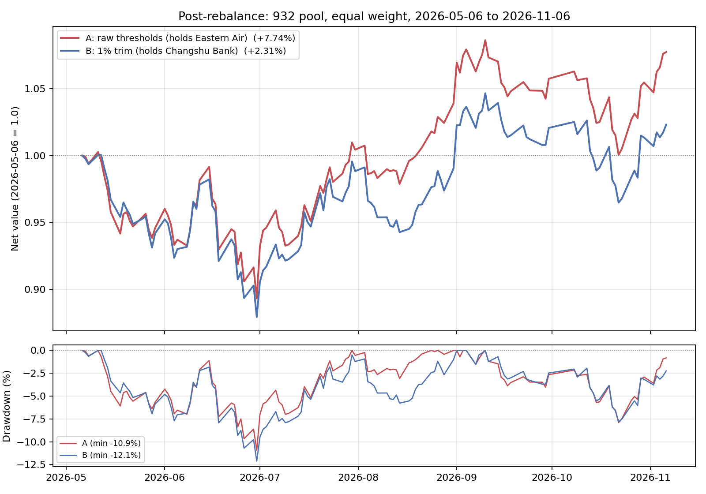
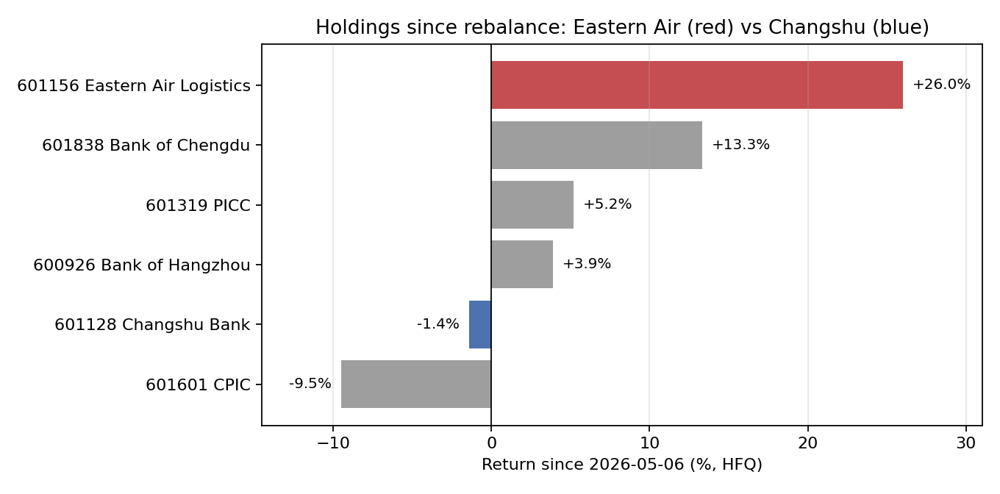
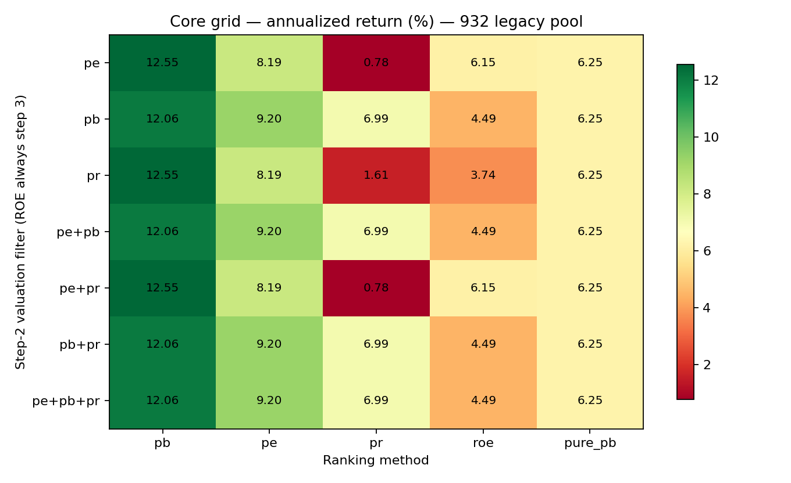
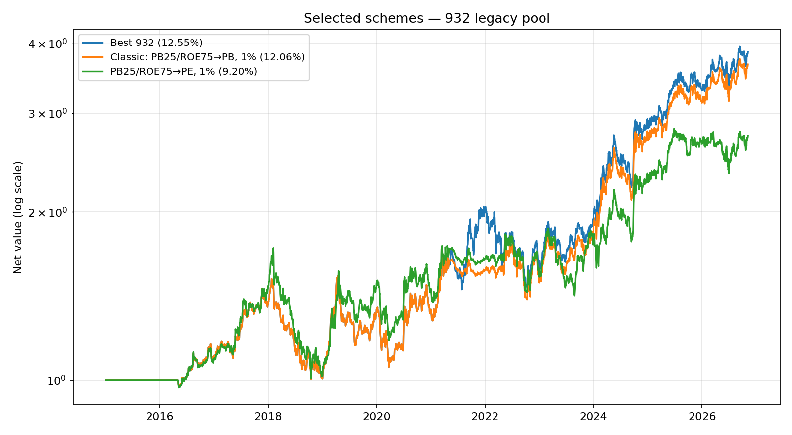
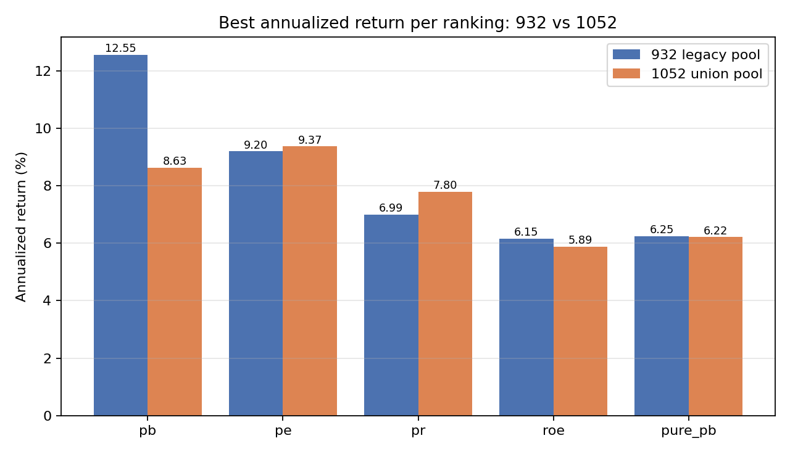
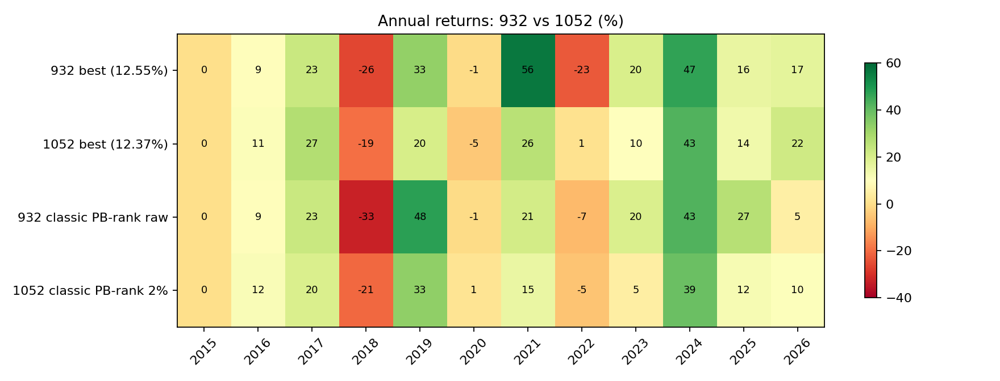

# 932 只旧股票池（932 版）：全角度回测、最佳条件与 1052 池对比

- 生成时间：2026-11-07 16:03
- 回测区间：2015-01-01 ~ 2026-11-06
- 股票池：**932 只**，由 7 份单期清单（2025-12 ~ 2026-03）直接并集，不含后来新增的历史清单
- 实验数量：131 组
- 成本、数据、引擎与 1052 池那轮完全一致

> 先澄清：上一轮跑的不是 1050 只，而是 7 个指数池全部 14 份清单的并集 **1052 只**。本报告是用户要求的 932 旧池版本，用于和 1052 池做同条件对比。
> 932 池只用了一期清单，本质上是“今天还留在指数里的股票”，幸存者偏差比 1052 并集更重，因此它的绝对收益会天然偏高。

## 1. 932 池的最佳条件

筛选方法：131 组参数组合，统一引擎、数据（截至 2026-11-06）、成本与 2015-01-01 起点。先跑核心网格（7 种 Step2 过滤 × 5 种排名，固定裁尾 1%、N=5）共 35 组；再围绕核心优胜者扫描裁尾 0~5%、N=1~10、估值分位 10%~40%、ROE 分位 60%~90%、7 种调仓频率、止损和纯 PB。按全期年化收益排序（同分看夏普），并用 2015-2020 / 2021-2026 分段、剔除最好年份、正收益年数和回撤做稳健性检查。

**收益最高**：`core_legacy_annual_pe_pb_trim1pct_N5_pe0.25-pb0.25-pr0.25-roe0.75`，年化 **12.55%**，夏普 0.526，最大回撤 -33.84%，剔除最好年份后 9.20%，正收益 8/11 年。
**风险调整最优**：`core_legacy_annual_pb+pr_pb_trim1pct_N5_pe0.25-pb0.25-pr0.25-roe0.75`，夏普 0.539，年化 12.06%。
**核心网格最佳**：`pe 过滤 + pb 排名`，年化 12.55%。
注意：最佳条件的估值分位在 15%~40% 之间结果完全相同，说明真正起作用的是“排除高 PE/高 PR”这道粗筛，具体分位点并不敏感；决定选股的是 PB 最低排名。

**最佳条件写法**：

| 维度 | 取值 |
|---|---|
| 调仓频率 | 年度（4 月底截面，5 月第一个交易日执行） |
| Step2 过滤 | PE < 25% 分位（15%~40% 结果相同） |
| Step3 ROE | ROE > 75% 分位 |
| 排名 | PB 最低，取前 5 |
| 阈值裁尾 | 单边 1% |
| 最大持仓 | 5 只等权 |
| 回测结果 | 年化 12.55%，夏普 0.526，回撤 -33.84% |

### 1.1 推荐方案当前持仓

调仓日 `2026-05-06`，共 5 只。当前权重按 2026-11-06 后复权收盘价推算，会随价格漂移：

|   代码 | 名称     | 调仓时权重   | 当前权重(11-06)   |   参考价(不复权) |
|-------:|:---------|:-------------|:------------------|-----------------:|
| 601838 | 成都银行 | 20.0%        | 22.2%             |            20.18 |
| 600926 | 杭州银行 | 20.0%        | 20.3%             |            17.09 |
| 601128 | 常熟银行 | 20.0%        | 19.3%             |             6.36 |
| 601319 | 中国人保 | 20.0%        | 20.6%             |             7.26 |
| 601601 | 中国太保 | 19.9%        | 17.6%             |            31.86 |

### 1.2 为什么这次是常熟银行，而不是东航物流？

2026-04-30 截面、932 池、846 只有估值数据的股票。两种阈值下的分位线：

| 阈值 | 原始分位（无裁尾） | 单边裁尾 1% |
|---|---:|---:|
| PE 25% 分位 | < 15.38 | < 15.56 |
| PB 25% 分位 | < 1.352 | < 1.373 |
| PR 25% 分位 | < 1.187 | < 1.214 |
| ROE 75% 分位 | > 14.105 | > 13.855 |

| 股票 | PE | PB | PR | ROE |
|---|---:|---:|---:|---:|
| 601128 常熟银行 | 5.63 | 0.780 | 0.400 | 14.090 |
| 601156 东航物流 | 9.36 | 1.314 | 0.657 | 14.250 |

- **原始阈值**：常熟银行 ROE 14.090，比 14.105 的门槛低 **0.015 个百分点**，Step 3 被剔除；恰好只有 5 只通过四步，东航物流是第 5 只，所以全部持有。
- **裁尾 1%**：ROE 门槛降到 13.855，常熟银行入选；共 7 只通过，按 PB 排序常熟 0.780 排第 1，东航 1.314 排第 6（第 7 是京能电力 1.367），东航被挤出前 5。
- 过滤条件在这个截面也不影响结果：只用 PE 过滤与 PE+PB+PR 三指标过滤，在原始阈值和 1% 裁尾下选出的 5 只完全相同，所以不是“PE 过滤换掉了东航”。
- 所以差别来自**裁尾**，不是股票池：常熟银行和东航物流在 932 池和 1052 池里都有。这也说明在“恰好 5 只通过”的年份，组合对阈值极其敏感——0.015pp 的 ROE 差异就能换掉一只持仓。

### 1.3 两套持仓从 2026-05-06 到 2026-11-06 的实际走势

| 组合 | 区间收益 | 最大回撤 |
|---|---:|---:|
| A：原始阈值（持有东航物流） | **+7.74%** | -10.93% |
| B：裁尾 1%（持有常熟银行） | **+2.31%** | -12.12% |

差异全部来自第 5 只股票：东航物流 +26.04%，常熟银行 -1.41%，各占 20% 权重。其余 4 只完全相同：成都银行 +13.35%、中国人保 +5.19%、杭州银行 +3.88%、中国太保 -9.49%。

也就是说，12.55% 的历史优势在这 5 个月里没有兑现。两套组合只差一只股票，短期胜负的随机性很大，不能据此判断哪套规则更好。

## 2. 核心网格：过滤 × 排名

| Step2 过滤   | pb     | pe    | pr    | roe   | pure_pb   |
|:-------------|:-------|:------|:------|:------|:----------|
| pe           | 12.55% | 8.19% | 0.78% | 6.15% | 6.25%     |
| pb           | 12.06% | 9.20% | 6.99% | 4.49% | 6.25%     |
| pr           | 12.55% | 8.19% | 1.61% | 3.74% | 6.25%     |
| pe+pb        | 12.06% | 9.20% | 6.99% | 4.49% | 6.25%     |
| pe+pr        | 12.55% | 8.19% | 0.78% | 6.15% | 6.25%     |
| pb+pr        | 12.06% | 9.20% | 6.99% | 4.49% | 6.25%     |
| pe+pb+pr     | 12.06% | 9.20% | 6.99% | 4.49% | 6.25%     |

932 池的结论和 1052 池不一样：这里 **PE/PR 过滤（不含 PB）+ PB 排名** 是 12.55%，而含 PB 的过滤组合是 12.06%。原因是 PE/PR 先排除了高估值的股票，PB 排名再从中选最便宜的 5 只；如果过滤层已经要求低 PB，反而会把一些低 PE 但 PB 略高的股票提前剔除。

| 过滤     | 排名   | 年化   |   夏普 | 最大回撤   | 2015-2020   | 2021-2026   |   平均持仓 |
|:---------|:-------|:-------|-------:|:-----------|:------------|:------------|-----------:|
| pe       | pb     | 12.55% |  0.526 | -33.84%    | 5.14%       | 21.35%      |        5.1 |
| pr       | pb     | 12.55% |  0.526 | -33.84%    | 5.14%       | 21.35%      |        5.1 |
| pe+pr    | pb     | 12.55% |  0.526 | -33.84%    | 5.14%       | 21.35%      |        5.1 |
| pb+pr    | pb     | 12.06% |  0.539 | -33.84%    | 5.14%       | 20.27%      |        4.8 |
| pe+pb    | pb     | 12.06% |  0.539 | -33.84%    | 5.14%       | 20.27%      |        4.8 |
| pb       | pb     | 12.06% |  0.539 | -33.84%    | 5.14%       | 20.27%      |        4.8 |
| pe+pb+pr | pb     | 12.06% |  0.539 | -33.84%    | 5.14%       | 20.27%      |        4.8 |
| pe+pb    | pe     | 9.20%  |  0.385 | -41.49%    | 6.69%       | 12.43%      |        4.8 |
| pb+pr    | pe     | 9.20%  |  0.385 | -41.49%    | 6.69%       | 12.43%      |        4.8 |
| pb       | pe     | 9.20%  |  0.385 | -41.49%    | 6.69%       | 12.43%      |        4.8 |

## 3. 阈值裁尾

| 裁尾   | PE+ROE → PB rank   | PB+ROE → PB rank   |
|:-------|:-------------------|:-------------------|
| raw    | 12.08%             | 11.59%             |
| 0%     | 12.08%             | 11.59%             |
| 0.5%   | 11.83%             | 11.33%             |
| 1%     | 12.55%             | 12.06%             |
| 1.5%   | 8.69%              | 8.06%              |
| 2%     | 9.02%              | 9.02%              |
| 2.5%   | 7.73%              | 7.73%              |
| 3%     | 8.86%              | 8.86%              |
| 4%     | 9.53%              | 9.53%              |
| 5%     | 8.54%              | 8.54%              |

## 4. 最大持仓数 N

|   N | 年化   |   夏普 | 最大回撤   | 平均仓位   | 2021-2026 年化   |
|----:|:-------|-------:|:-----------|:-----------|:-----------------|
|   1 | 2.19%  |  0.039 | -7.40%     | 19.90%     | 2.94%            |
|   2 | 3.14%  |  0.131 | -17.39%    | 41.82%     | 5.08%            |
|   3 | 4.80%  |  0.212 | -21.49%    | 61.90%     | 7.31%            |
|   4 | 9.30%  |  0.431 | -27.44%    | 82.12%     | 15.43%           |
|   5 | 12.55% |  0.526 | -33.84%    | 99.45%     | 21.35%           |
|   6 | 11.87% |  0.496 | -38.11%    | 99.26%     | 18.65%           |
|   7 | 10.22% |  0.429 | -37.58%    | 98.42%     | 15.60%           |
|   8 | 9.71%  |  0.403 | -37.20%    | 98.33%     | 13.07%           |
|   9 | 10.66% |  0.454 | -36.61%    | 96.78%     | 14.16%           |
|  10 | 11.19% |  0.485 | -34.50%    | 96.20%     | 14.48%           |

## 5. 估值分位与 ROE 分位

|   估值分位 |   ROE 分位 | 年化   |   夏普 | 最大回撤   |   平均持仓 |
|-----------:|-----------:|:-------|-------:|:-----------|-----------:|
|       0.25 |       0.75 | 12.55% |  0.526 | -33.84%    |        5.1 |
|       0.4  |       0.75 | 12.55% |  0.526 | -33.84%    |        5.1 |
|       0.35 |       0.75 | 12.55% |  0.526 | -33.84%    |        5.1 |
|       0.3  |       0.75 | 12.55% |  0.526 | -33.84%    |        5.1 |
|       0.2  |       0.75 | 12.55% |  0.526 | -33.84%    |        5.1 |
|       0.15 |       0.75 | 12.55% |  0.526 | -33.84%    |        5.1 |
|       0.1  |       0.75 | 12.29% |  0.514 | -40.46%    |        5.1 |
|       0.15 |       0.85 | 10.40% |  0.375 | -39.23%    |        4.9 |
|       0.25 |       0.7  | 10.28% |  0.425 | -29.54%    |        5   |
|       0.35 |       0.85 | 9.92%  |  0.35  | -43.35%    |        4.9 |
|       0.25 |       0.85 | 9.92%  |  0.35  | -43.35%    |        4.9 |
|       0.35 |       0.65 | 7.42%  |  0.285 | -31.94%    |        5   |
|       0.25 |       0.65 | 7.42%  |  0.285 | -31.94%    |        5   |
|       0.25 |       0.6  | 7.26%  |  0.282 | -30.10%    |        5   |
|       0.15 |       0.65 | 6.48%  |  0.238 | -31.94%    |        5   |
|       0.25 |       0.8  | 6.37%  |  0.218 | -45.25%    |        5   |
|       0.25 |       0.9  | 5.81%  |  0.16  | -44.93%    |        4.9 |

### 5.1 阈值细化

|   估值分位 |   ROE 分位 | 裁尾   |   N | 年化   |   夏普 | 最大回撤   | 剔除最好年份   | 最差年份   |
|-----------:|-----------:|:-------|----:|:-------|-------:|:-----------|:---------------|:-----------|
|       0.25 |       0.7  | raw    |   5 | 10.81% |  0.433 | -41.71%    | 7.90%          | -28.57%    |
|       0.15 |       0.7  | 0.01   |   5 | 10.61% |  0.438 | -36.75%    | 7.65%          | -22.94%    |
|       0.15 |       0.6  | 0.01   |   5 | 10.54% |  0.423 | -36.45%    | 7.62%          | -20.96%    |
|       0.25 |       0.55 | raw    |   5 | 10.41% |  0.394 | -46.48%    | 3.36%          | -36.10%    |
|       0.15 |       0.65 | 0.01   |   6 | 10.09% |  0.415 | -36.06%    | 7.36%          | -19.56%    |
|       0.2  |       0.6  | 0.01   |   5 | 9.71%  |  0.389 | -35.54%    | 8.11%          | -20.96%    |
|       0.25 |       0.7  | 0.02   |   5 | 9.49%  |  0.371 | -36.62%    | 6.83%          | -22.86%    |
|       0.25 |       0.7  | 0.01   |   5 | 9.45%  |  0.374 | -36.75%    | 7.52%          | -22.94%    |
|       0.25 |       0.65 | raw    |   5 | 9.30%  |  0.381 | -34.80%    | 7.27%          | -20.68%    |
|       0.25 |       0.55 | 0.01   |   5 | 9.29%  |  0.342 | -46.48%    | 2.11%          | -36.10%    |
|       0.25 |       0.55 | 0.02   |   5 | 9.13%  |  0.326 | -51.95%    | 1.30%          | -41.29%    |
|       0.25 |       0.6  | 0.01   |   7 | 9.09%  |  0.376 | -35.09%    | 7.79%          | -17.77%    |
|       0.25 |       0.6  | 0.01   |   5 | 8.99%  |  0.352 | -35.54%    | 7.36%          | -20.96%    |
|       0.25 |       0.6  | raw    |   5 | 8.85%  |  0.353 | -35.54%    | 7.23%          | -20.96%    |
|       0.25 |       0.6  | 0.01   |   6 | 8.59%  |  0.339 | -33.83%    | 7.11%          | -18.77%    |
|       0.25 |       0.65 | 0.01   |   5 | 8.38%  |  0.33  | -35.54%    | 6.41%          | -20.96%    |
|       0.25 |       0.6  | 0.02   |   5 | 7.91%  |  0.293 | -36.51%    | 5.18%          | -20.96%    |
|       0.25 |       0.6  | 0.01   |   5 | 7.26%  |  0.282 | -30.10%    | 6.34%          | -11.94%    |
|       0.25 |       0.65 | 0.02   |   5 | 7.05%  |  0.255 | -35.54%    | 4.78%          | -20.96%    |

## 6. 调仓频率

| 频率      | 年化   |   夏普 | 最大回撤   |   交易次数 |
|:----------|:-------|-------:|:-----------|-----------:|
| q3        | 8.12%  |  0.319 | -38.95%    |         83 |
| mid_year  | 6.19%  |  0.202 | -39.21%    |         92 |
| annual_q3 | 6.13%  |  0.212 | -38.61%    |        141 |
| quarterly | 3.42%  |  0.072 | -47.89%    |        188 |
| weekly    | 1.32%  | -0.032 | -48.43%    |        721 |
| monthly   | 1.08%  | -0.043 | -49.53%    |        361 |

## 7. 全实验排行榜（前 15）

| 实验                                                                      | 年化   |   夏普 | 最大回撤   | 2015-2020   | 2021-2026   | 剔除最好年份   |   正收益年数 |   平均持仓 |
|:--------------------------------------------------------------------------|:-------|-------:|:-----------|:------------|:------------|:---------------|-------------:|-----------:|
| core_legacy_annual_pe_pb_trim1pct_N5_pe0.25-pb0.25-pr0.25-roe0.75         | 12.55% |  0.526 | -33.84%    | 5.14%       | 21.35%      | 9.20%          |            8 |        5.1 |
| threshold_legacy_annual_pe_pb_trim1pct_N5_pe0.1-pb0.1-pr0.1-roe0.75       | 12.29% |  0.514 | -40.46%    | 4.63%       | 21.39%      | 8.89%          |            8 |        5.1 |
| trim_legacy_annual_pr_pb_raw_N5_pe0.25-pb0.25-pr0.25-roe0.75              | 12.08% |  0.502 | -40.34%    | 5.39%       | 20.02%      | 8.53%          |            8 |        5.1 |
| core_legacy_annual_pb+pr_pb_trim1pct_N5_pe0.25-pb0.25-pr0.25-roe0.75      | 12.06% |  0.539 | -33.84%    | 5.14%       | 20.27%      | 9.34%          |            8 |        4.8 |
| positions_legacy_annual_pe_pb_trim1pct_N6_pe0.25-pb0.25-pr0.25-roe0.75    | 11.87% |  0.496 | -38.11%    | 6.14%       | 18.65%      | 8.99%          |            8 |        6.1 |
| trim_legacy_annual_pr_pb_trim0.5pct_N5_pe0.25-pb0.25-pr0.25-roe0.75       | 11.83% |  0.486 | -40.34%    | 5.39%       | 19.47%      | 8.26%          |            8 |        5.1 |
| trim_legacy_annual_pe+pb+pr_pb_trim0pct_N5_pe0.25-pb0.25-pr0.25-roe0.75   | 11.59% |  0.513 | -40.34%    | 5.39%       | 18.96%      | 8.59%          |            8 |        4.8 |
| trim_legacy_annual_pe+pb+pr_pb_trim0.5pct_N5_pe0.25-pb0.25-pr0.25-roe0.75 | 11.33% |  0.495 | -40.34%    | 5.39%       | 18.40%      | 8.32%          |            8 |        4.8 |
| positions_legacy_annual_pe_pb_trim1pct_N10_pe0.25-pb0.25-pr0.25-roe0.75   | 11.19% |  0.485 | -34.50%    | 8.14%       | 14.48%      | 8.56%          |            9 |        9.8 |
| special_legacy_annual_pe_pb_trim1pct_N5_pe0.25-pb0.25-pr0.25-roe0.75_sl   | 11.09% |  0.436 | -41.57%    | 2.57%       | 21.23%      | 7.60%          |            8 |        5.1 |
| refine_legacy_annual_pb_pe_raw_N5_pe0.25-pb0.25-pr0.25-roe0.7             | 10.81% |  0.433 | -41.71%    | 5.69%       | 16.54%      | 7.90%          |            8 |        5.1 |
| positions_legacy_annual_pe_pb_trim1pct_N9_pe0.25-pb0.25-pr0.25-roe0.75    | 10.66% |  0.454 | -36.61%    | 7.48%       | 14.16%      | 8.09%          |            9 |        8.9 |
| refine_legacy_annual_pb_pe_trim1pct_N5_pe0.15-pb0.15-pr0.25-roe0.7        | 10.61% |  0.438 | -36.75%    | 4.96%       | 16.93%      | 7.65%          |            8 |        4.9 |
| refine_legacy_annual_pb_pe_trim1pct_N5_pe0.15-pb0.15-pr0.25-roe0.6        | 10.54% |  0.423 | -36.45%    | 4.32%       | 17.38%      | 7.62%          |            8 |        5   |
| refine_legacy_annual_pb_pe_raw_N5_pe0.25-pb0.25-pr0.25-roe0.55            | 10.41% |  0.394 | -46.48%    | 4.29%       | 17.15%      | 3.36%          |            8 |        5   |

## 8. 932 vs 1052：同条件对比

### 8.1 关键条件

| 条件                                | 932 年化   |   932 夏普 | 932 回撤   | 1052 年化   |   1052 夏普 | 1052 回撤   |
|:------------------------------------|:-----------|-----------:|:-----------|:------------|------------:|:------------|
| PB+ROE 25/75 → PB rank, 裁尾 1%     | 12.06%     |      0.539 | -33.84%    | 8.63%       |       0.334 | -33.85%     |
| PB+ROE 25/75 → PB rank, 裁尾 2%     | 9.02%      |      0.35  | -33.90%    | 9.55%       |       0.382 | -33.69%     |
| PB+ROE 25/75 → PB rank, 原始阈值    | 11.59%     |      0.513 | -40.34%    | 8.04%       |       0.321 | -33.90%     |
| PB+ROE 25/75 → PE rank, 裁尾 1%     | 9.20%      |      0.385 | -41.49%    | 9.37%       |       0.356 | -41.63%     |
| PB 15% + ROE 70% → PE rank, 裁尾 1% | 10.61%     |      0.438 | -36.75%    | 12.37%      |       0.516 | -34.51%     |

这张表说明两件事：（1）经典 PB 排名配置在 932 池上有 12.06%（1% 裁尾）/ 11.59%（原始阈值），搬到 1052 池只剩 8.63% / 8.04%，扩容主要破坏了 PB 排序；（2）反过来，1052 池的最佳条件（PB 15% + ROE 70% + PE 排名）在 932 池只有 10.61%。**两个池子的最优解互不通用。**

### 8.2 各排名的池间差异

932 池的最佳是 `pe 过滤 + pb 排名`（12.55%）；1052 池的最佳是 `pb 过滤 + pe 排名`（12.37%）。两池的排名偏好并不一致，说明“最佳排名”会随股票池变化，不是一个稳定参数。

### 8.3 逐年收益

932 最佳方案在 2021 年 +56%、2022 年 -23%，波动明显大于 1052 最佳（2021 +26%、2022 +1%）。两者年化接近（12.55% vs 12.37%），但 1052 最佳更平滑，剔除最好年份后也略高（9.65% vs 9.20%）。

## 9. 结论

1. 932 池上收益最好的条件是“PE 过滤 + ROE>75% + PB 最低排名 + 裁尾 1% + N=5 + 年度”，年化 12.55%，夏普 0.526，回撤 -33.84%。
2. 经典配置（PB+ROE → PB 排名、原始阈值）在 932 池上是 11.59%，与历史记录的 11.37% 同量级；差额来自数据延长到 2026-11-06。
2b. 但把最佳条件换到另一个池子就不成立：932 最佳条件在 1052 只有 8.63%，1052 最佳条件在 932 只有 10.61%——说明“最优排名/阈值”本身高度依赖股票池。
3. 持仓数：N=5 最好（12.55%），N=6 次之（11.87%），N<4 仓位不足；裁尾 1% 最好，1.5% 以后明显变差；频率必须年度。
4. 932 池的高收益不能直接搬到 1052 池：经典的 PB 排名配置在并集池低约 3pp，但 PE 排名/更严 PB 的角落并非如此。**最优解依赖股票池，不存在一套跨池都最好的参数。**

## 10. 使用限制

1. 932 池是单期清单，幸存者偏差比 1052 并集更重，绝对收益只能用于“同池内比较”。
2. 最佳条件是全期参数扫描的结果，存在过拟合风险。
3. 数据截止 2026-11-06；成本假设与主回测一致。