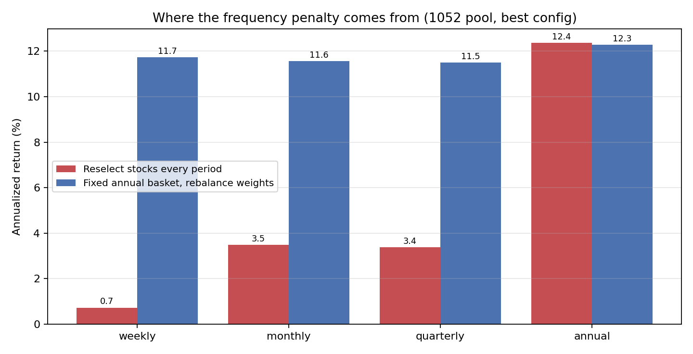
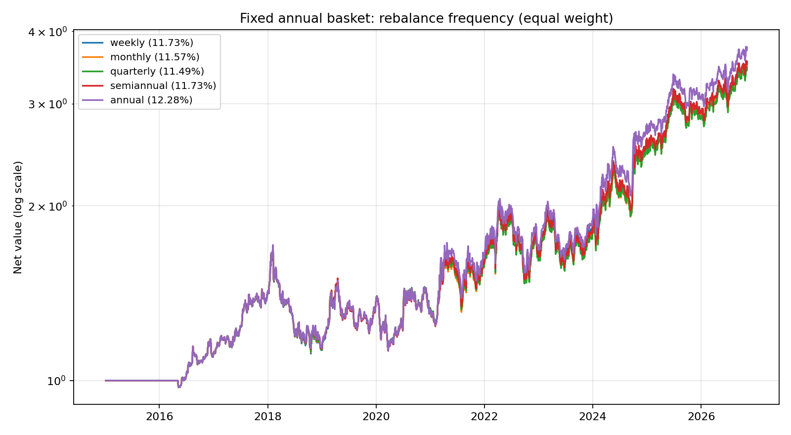
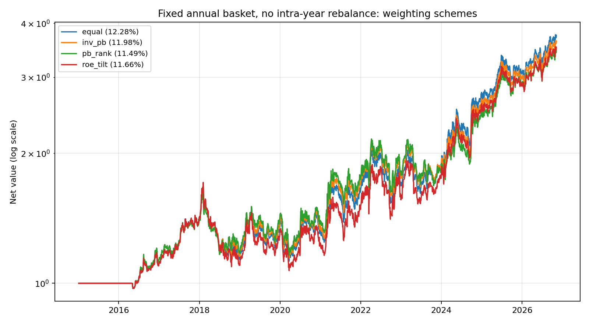
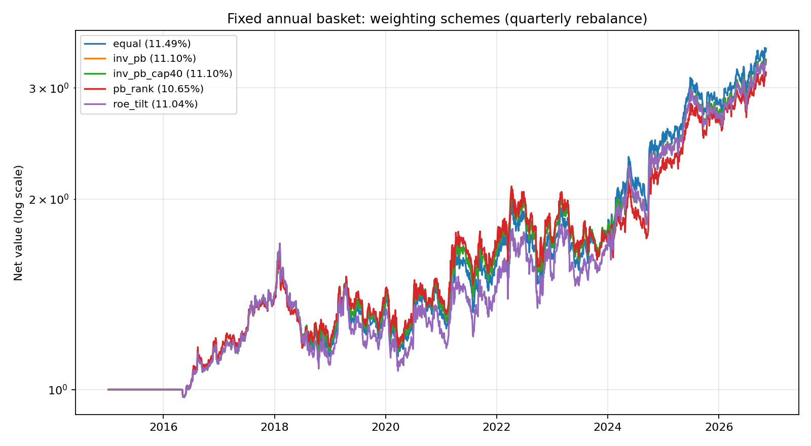

# 固定年度篮子内的再平衡频率与权重实验（2026-11）

> 问题：之前“不同频率”的对比，每个调仓日都会**重新选股**，所以高频调仓的损失同时包含“换股”和“再平衡”两件事。
> 这个实验把两者拆开：**一年只选一次股，篮子固定，年内只按不同频率恢复目标权重**；并额外测试不等权。

---

## 0. 结论

1. **选股频率和再平衡频率要分开看。** 一年只选一次、篮子固定后，年内按周/月/季/半年再平衡，年化 **11.49%~11.73%**，与“全年不动”的 **12.28%** 只差 0.55~0.79pp。
2. **之前高频调仓的低收益，几乎全部来自“换股”，不是“再平衡”。** 每期重新选股：周度 0.73%、月度 3.49%、季度 3.39%；固定篮子再平衡：周度 11.73%、月度 11.57%、季度 11.49%。差距 8~11pp。
3. **不等权没有优势。** 等权 12.28% > 逆 PB 11.98% > ROE 倾斜 11.66% > PB 排名 11.49%。PB 排名把回撤从 -34.3% 降到 -29.6%，但年化少 0.8pp、夏普也从 0.514 降到 0.475，不是免费午餐。
4. **实务建议**：年度选股后，年内**默认不动**；如果一定要检查，半年或季度做一次权重再平衡即可，代价约 0.5~0.8pp。**不要每季度重新选股。**



---

## 1. 实验设计

| 项目 | 设置 |
|---|---|
| 股票池 | 1052 只并集池（当前池） |
| 选股频率 | **只在每年 4 月底选一次**（1052 最优配置：PB<15% + ROE>70% + PE 排名 + 1% 裁尾 + N=5） |
| 建仓/换仓 | 每年 5 月第一个交易日整体换仓 |
| 年内再平衡频率 | `weekly` / `monthly` / `quarterly` / `semiannual` / `annual`（annual = 全年不动） |
| 权重方案 | `equal` / `inv_pb` / `inv_pb_cap40` / `pb_rank` / `roe_tilt` |
| 目标权重 | 在年度选股时按截面的 PB/ROE 确定，年内固定；再平衡就是把权重拉回这个目标 |
| 成本 | 佣金 0.03%（最低 5 元）、印花税 0.1%（卖出）、滑点 0.1%、100 股整手 |
| 区间 | 2015-01-01 ~ 2026-11-06；第一次实际建仓 2016-05-03（2015 年无股票通过筛选） |
| 对照配置 | `classic1052`：PB+ROE 25/75 + PB 排名 + 2% 裁尾 |

权重定义：

- `equal`：1/N。
- `inv_pb`：w ∝ 1/PB；`inv_pb_cap40` 是同一方案加 40% 单股上限（实际 5 只时上限未触发，两者结果相同）。
- `pb_rank`：按 PB 从低到高给 5/4/3/2/1 的权重。
- `roe_tilt`：w ∝ ROE。

---

## 2. 口径校验

本脚本的 `annual + equal` 结果：年化 **12.28%**、夏普 0.514、回撤 -34.30%。
引擎 `annual + equal`（同配置）：年化 12.37%、夏普 0.516、回撤 -34.51%。

差 0.09pp，来自本脚本没有做涨跌停/停牌成交限制等细节；**方向和量级一致，可用于横向比较**。

---

## 3. 再平衡频率（1052 最优配置，等权）

| 频率 | 年化 | 夏普 | 最大回撤 | 年换手 | 交易次数 |
|---|---:|---:|---:|---:|---:|
| **annual（全年不动）** | **12.28%** | **0.514** | -34.30% | 1.37 | 91 |
| weekly | 11.73% | 0.497 | -34.56% | 2.20 | 2082 |
| semiannual | 11.73% | 0.492 | -34.11% | 1.45 | 186 |
| monthly | 11.57% | 0.487 | -34.34% | 1.73 | 605 |
| quarterly | 11.49% | 0.483 | -34.19% | 1.58 | 319 |



观察：

- 全年不动最好，但优势只有 0.55~0.79pp，统计上很弱。
- 周度交易次数是年度的 23 倍，年化只低 0.55pp；因为只交易权重漂移，单次金额小、成本有限。
- 月度/季度反而比周度略低，说明这里没有“越频繁越差”的单调关系，更多是路径噪音。

---

## 4. 权重方案（1052 最优配置）

### 4.1 全年不动（纯初始权重，之后任由漂移）

| 权重 | 年化 | 夏普 | 最大回撤 |
|---|---:|---:|---:|
| **equal** | **12.28%** | **0.514** | -34.30% |
| inv_pb | 11.98% | 0.500 | -33.07% |
| inv_pb_cap40 | 11.98% | 0.500 | -33.07% |
| roe_tilt | 11.66% | 0.473 | -37.46% |
| pb_rank | 11.49% | 0.475 | **-29.60%** |



### 4.2 季度再平衡下的权重

| 权重 | 年化 | 夏普 | 最大回撤 |
|---|---:|---:|---:|
| **equal** | **11.49%** | **0.483** | -34.19% |
| inv_pb | 11.10% | 0.461 | -32.37% |
| roe_tilt | 11.04% | 0.452 | -37.09% |
| pb_rank | 10.65% | 0.436 | **-29.16%** |



观察：

- **等权在每个频率下都最好**（收益和夏普都是第一）。
- 逆 PB 和 ROE 倾斜都小幅跑输；PB 排名跑输最多，但回撤最浅。
- 想用 PB 排名降回撤，代价是年化少 0.8pp、夏普少 0.04；是否值得取决于风险偏好。
- `inv_pb_cap40` 与 `inv_pb` 完全一样：5 只股票时没有单只权重超过 40%，上限没触发。

---

## 5. 关键对比：换股 vs 再平衡

| 频率 | 每期重新选股 | 固定篮子再平衡 | 差异 |
|---|---:|---:|---:|
| weekly | 0.73% | 11.73% | **+11.00pp** |
| monthly | 3.49% | 11.57% | **+8.08pp** |
| quarterly | 3.39% | 11.49% | **+8.10pp** |
| annual | 12.37% | 12.28% | -0.09pp（口径差异） |

“每期重新选股”的数字来自 `universe_compare.py` 的 frequency 阶段（同一 1052 最优配置）；“固定篮子”来自本实验。

**结论：频率惩罚主要来自换股，而不是再平衡。** 每季度重新选股会损失约 9pp；每季度只做篮子内再平衡只损失约 0.8pp。

---

## 6. classic1052 稳健性（等权）

| 频率 | 年化 | 夏普 | 最大回撤 |
|---|---:|---:|---:|
| **annual** | **9.72%** | **0.390** | -33.80% |
| weekly | 9.67% | 0.395 | -34.37% |
| semiannual | 9.30% | 0.372 | -33.80% |
| monthly | 9.33% | 0.376 | -34.38% |
| quarterly | 9.26% | 0.371 | -34.26% |

同样的模式：年度不动最好，周度几乎持平，月/季略低。说明结论不是某一个配置的偶然。

---

## 7. 建议

1. **选股频率保持年度**：每年 4 月底选一次，5 月首个交易日换仓。这个结论没有变。
2. **年内默认不动**：全年持有同一篮子，权重随价格漂移。历史年化 12.28%，比任何年内再平衡都高。
3. **如果要做季度检查**：只做篮子内权重再平衡，**不要重新选股**；代价约 0.8pp。重新选股的代价是 8~9pp。
4. **权重用等权**：逆 PB / ROE 倾斜 / PB 排名都没有提高收益；PB 排名只适合“愿意用 0.8pp 年化换 4.7pp 回撤改善”的人。
5. **不要把这 0.5~0.8pp 的频率差异当成稳定规律**：它很小，换一段样本可能反转；真正稳定的是“不要每期换股”。

---

## 8. 限制

- 只测了 1052 最优配置和经典配置，没有对全部 133 组参数做这个实验。
- 本脚本没有做涨跌停/停牌成交限制，与引擎 annual 结果差 0.09pp。
- 5 只组合、单一历史区间；结论对篮子数量、股票池和样本期敏感。
- 再平衡频率之间的差异只有 0.5~0.8pp，统计显著性弱，不宜过度解读。

---

## 9. 复现

```bash
cd backtesting
../.venv/bin/python test_within_basket.py \
  --configs best1052,classic1052 \
  --frequencies weekly,monthly,quarterly,semiannual,annual \
  --weightings equal,inv_pb,inv_pb_cap40,pb_rank,roe_tilt \
  --end-date 2026-11-06
```

输出：

- 汇总：[results.csv](../data/processed/backtesting/within_basket_20261114/results.csv)
- 逐日净值：`data/processed/backtesting/within_basket_20261114/runs_<配置>_<频率>_<权重>.csv`
- 图表：`docs/img/within-basket-2026-11/`
- 脚本：[backtesting/test_within_basket.py](../backtesting/test_within_basket.py)
